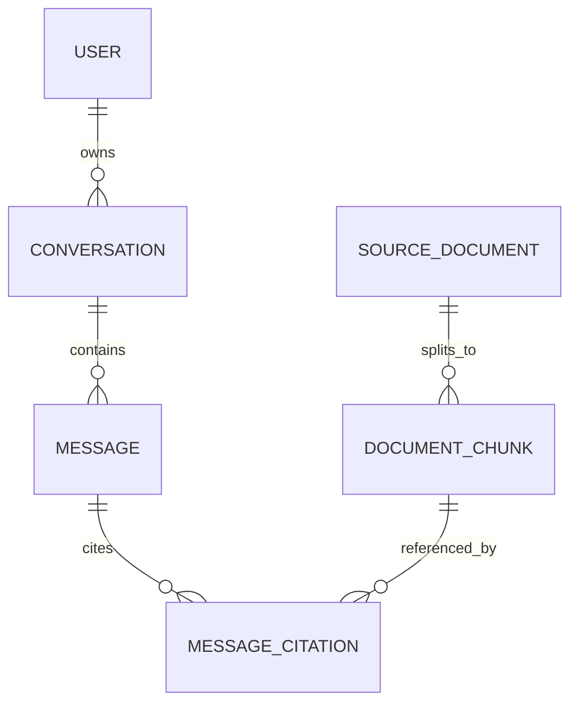

# Bài 2. Thiết kế bảng dữ liệu và migration với SQLAlchemy–Alembic

> **Module 05 — FastAPI, SQLAlchemy và schema**  
> Thời điểm tham chiếu: [0:43:42](https://www.youtube.com/watch?v=qF5il_9IwME&t=2622s).  
> Hình thức: bài học kết hợp thực hành.

## 1. Tóm tắt

Tạo schema có quan hệ và nguồn trích dẫn; áp migration có kiểm soát thay vì sửa trực tiếp bảng thủ công.

## 2. Mục tiêu học tập

- Giải thích được cơ chế và lý do kỹ thuật của chủ đề **Thiết kế bảng dữ liệu và migration với SQLAlchemy–Alembic**.
- Tự triển khai hoặc mô phỏng các bước thực hành và kiểm tra kết quả theo tiêu chí được nêu.
- Nhận diện các lỗi thiết kế/triển khai phổ biến và lựa chọn biện pháp xử lý có căn cứ.

## 3. Bối cảnh và vấn đề cần giải quyết

Các bảng nền của ứng dụng gồm hồ sơ người dùng, source documents, document chunks, chat threads/conversations, chat messages và message citations. Mục tiêu của bảng citations là ghi rõ một tin nhắn AI dựa vào chunk nào; đây là đường nối kiểm chứng giữa trải nghiệm hội thoại và kho tài liệu.

## 4. Kiến thức cốt lõi

### 4.1. Dữ liệu và quan hệ

`source_documents` lưu ticker, filing date, source URL và nội dung/metadata. `document_chunks` có foreign key đến source, thứ tự chunk, vị trí, text và embedding. `conversations` gắn owner; `messages` gắn conversation; `message_citations` nối message và chunks.

### 4.2. SQLAlchemy models

ORM cho phép định nghĩa schema trong Python, index và relationship. Hãy kiểm tra khóa ngoại, unique constraint, index theo user, date và document. Tách models theo file giúp review từng bảng.

### 4.3. Alembic migrations

Migration theo dõi các thay đổi schema theo thời gian. `revision --autogenerate` đưa ra SQL dự kiến nhưng phải đọc kỹ đặc biệt khi rename/drop column. `upgrade head` không đồng nghĩa migration đã an toàn trên dữ liệu thực; cần thử trên database copy và backup.

## 5. Quy trình áp dụng từng bước

Các bước dưới đây là phương án thực hành để tái tạo và kiểm chứng các nguyên tắc đã học. Điều chỉnh tên file, biến môi trường và phiên bản dependency theo dự án của bạn.

**Bước 1.** Thiết kế sơ đồ ERD với sáu nhóm bảng và các khóa ngoại.

**Bước 2.** Tạo SQLAlchemy model và metadata; tạo Alembic migration có thể áp trên DB rỗng.

**Bước 3.** Đọc file migration, kiểm tra indexes và nullable/default.

**Bước 4.** Chạy `upgrade head`, kiểm tra schema qua Supabase rồi tạo migration tiếp theo để kiểm tra tiến trình tiến hóa.

## 6. Ví dụ minh họa

Ví dụ sau tập trung vào một nguyên lý triển khai. Đây là mã/giả mã dùng cho học tập, có thể cần bổ sung các thành phần vận hành và kiểm thử khi tích hợp vào repository thực tế.

## 7. Kiểm tra kết quả và tiêu chí hoàn thành

- [ ] Có ràng buộc không cho citation trỏ đến chunk không tồn tại.
- [ ] Migration được test trên DB mẫu; không chứa DDL xóa dữ liệu bất ngờ.

**Checkpoint:** Người học cần trình bày được dữ liệu đầu vào, biến đổi hoặc hành động chính, đầu ra quan sát được và tình huống thất bại của phần này. Nếu chưa chứng minh được bằng lệnh chạy, ảnh chụp, test hoặc bảng so sánh, chưa nên đánh dấu hoàn tất.

## 8. Lỗi thường gặp và cách tự debug

1. Đừng để agent tự chấp thuận migration phá dữ liệu.

2. Đừng bỏ RLS/owner check chỉ vì mọi bảng ở cùng một database.

Khi gặp lỗi, hãy thu nhỏ tình huống về một input cụ thể, kiểm tra log/request id, xác nhận từng lớp độc lập và chỉ sửa một giả thuyết tại một thời điểm. Cách làm này giúp phân biệt sai dữ liệu, sai hợp đồng API và sai cấu hình môi trường.

## 9. Bài tập ứng dụng

Vẽ ERD, tạo migration khởi tạo và một migration bổ sung index; ghi lại kế hoạch rollback và cách phát hiện mất dữ liệu.

**Sản phẩm nộp:** một README ngắn mô tả cách chạy, dữ liệu/case thử, bằng chứng đã kiểm tra và tối thiểu một tình huống lỗi được xử lý. Nếu thực hành với tài khoản thật, loại bỏ mọi secret và dữ liệu nhạy cảm khỏi bản nộp.

## 10. Câu hỏi ôn tập trắc nghiệm

**Câu 1.** Bảng nào nối câu trả lời và đoạn bằng chứng?

A. `message_citations`.  
B. Quản lý version và áp thay đổi schema.  
C. Giữ tính nhất quán tham chiếu giữa các record.  
D. Có thể diễn giải rename thành drop/add gây mất dữ liệu.  

**Đáp án: A.** Nó ghi quan hệ giữa message và document chunk.

**Câu 2.** Alembic phục vụ công việc gì?

A. Giữ tính nhất quán tham chiếu giữa các record.  
B. Có thể diễn giải rename thành drop/add gây mất dữ liệu.  
C. Chủ sở hữu là người dùng đã xác thực.  
D. Quản lý version và áp thay đổi schema.  

**Đáp án: D.** Migration không chỉ tạo database ban đầu.

**Câu 3.** Lợi ích của foreign key?

A. Có thể diễn giải rename thành drop/add gây mất dữ liệu.  
B. Chủ sở hữu là người dùng đã xác thực.  
C. Giữ tính nhất quán tham chiếu giữa các record.  
D. `message_citations`.  

**Đáp án: C.** Ngăn orphan citations và chunks.

**Câu 4.** Vì sao phải review autogenerate?

A. Chủ sở hữu là người dùng đã xác thực.  
B. Có thể diễn giải rename thành drop/add gây mất dữ liệu.  
C. `message_citations`.  
D. Quản lý version và áp thay đổi schema.  

**Đáp án: B.** DDL tự sinh chưa an toàn tuyệt đối.

**Câu 5.** Một conversation cần gắn với gì?

A. Chủ sở hữu là người dùng đã xác thực.  
B. `message_citations`.  
C. Quản lý version và áp thay đổi schema.  
D. Giữ tính nhất quán tham chiếu giữa các record.  

**Đáp án: A.** Đây là cơ sở phân tách lịch sử hội thoại.

## 11. Tổng kết

Bài học tập trung vào **Thiết kế bảng dữ liệu và migration với SQLAlchemy–Alembic** như một mắt xích của Document Copilot. Giá trị quan trọng nhất không chỉ là chạy được một chức năng mà còn là lý giải được thiết kế, truy vết được dữ liệu và kiểm chứng bằng trường hợp thực tế.

**Mốc học video:** [0:43:42](https://www.youtube.com/watch?v=qF5il_9IwME&t=2622s) — 1:08:15.
