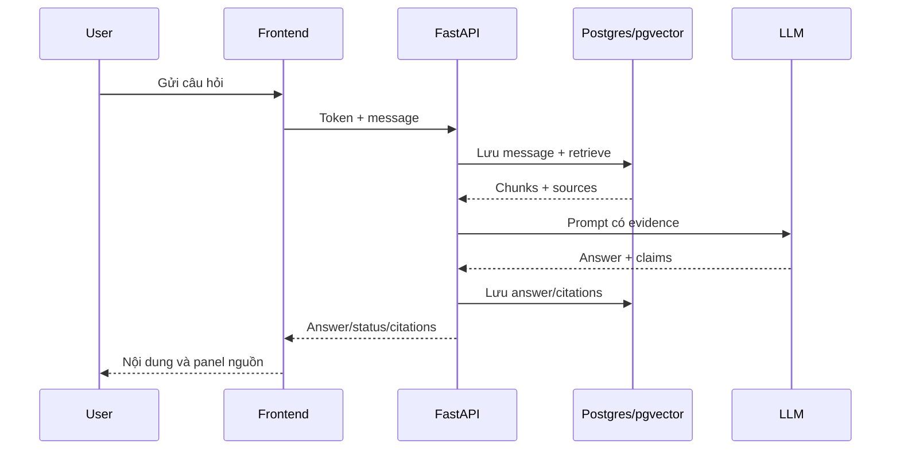

# Bài 1. Đi xuyên hệ thống từ đăng nhập đến câu trả lời có nguồn

> **Module 12 — Kiểm thử toàn hệ thống và walkthrough**  
> Thời điểm tham chiếu: [3:34:28](https://www.youtube.com/watch?v=qF5il_9IwME&t=12868s).  
> Hình thức: bài học kết hợp thực hành.

## 1. Tóm tắt

Đọc được data flow từ một thao tác người dùng tới auth, backend, retrieval, tools, LLM và UI.

## 2. Mục tiêu học tập

- Giải thích được cơ chế và lý do kỹ thuật của chủ đề **Đi xuyên hệ thống từ đăng nhập đến câu trả lời có nguồn**.
- Tự triển khai hoặc mô phỏng các bước thực hành và kiểm tra kết quả theo tiêu chí được nêu.
- Nhận diện các lỗi thiết kế/triển khai phổ biến và lựa chọn biện pháp xử lý có căn cứ.

## 3. Bối cảnh và vấn đề cần giải quyết

Từ một giao diện chat đã triển khai, người dùng tạo cuộc hội thoại, hỏi về dữ kiện trong hồ sơ và nhận câu trả lời có citations. Mỗi bước đều ánh xạ đến dữ liệu trong Supabase hoặc sự kiện ở API. Một walkthrough có chất lượng phải giải thích hệ thống sử dụng record nào chứ không chỉ cho thấy giao diện đẹp.

## 4. Kiến thức cốt lõi

### 4.1. Luồng identity và conversation

Supabase tạo session; frontend chuyển token; API xác thực, tạo conversation gắn owner, ghi message người dùng. Nếu có retry request, cần cân nhắc idempotency để tránh gửi trùng message.

### 4.2. Luồng evidence

Agent tìm tài liệu, tìm chunks qua hybrid retrieval, bổ sung neighbors rồi yêu cầu LLM tổng hợp. Citations được lưu với message và mô tả chunk/sources liên quan. Khi người dùng mở panel, app có thể hiển thị excerpt và URL gốc.

### 4.3. Luồng vận hành

Logs cho biết thứ tự stage và thời gian. Có thể xuất hiện nguồn không phù hợp hoặc bảng parse sai dù hệ thống trả lời được: walkthrough cần ghi lại sai lệch để cải tiến ở module cuối.

## 5. Quy trình áp dụng từng bước

Các bước dưới đây là phương án thực hành để tái tạo và kiểm chứng các nguyên tắc đã học. Điều chỉnh tên file, biến môi trường và phiên bản dependency theo dự án của bạn.

**Bước 1.** Tạo account test và một hội thoại mới trên production domain.

**Bước 2.** Hỏi một dữ kiện có ground truth từ hồ sơ; mở citations để kiểm tra.

**Bước 3.** Refresh trang; xác nhận conversation history còn nguyên và đúng owner.

**Bước 4.** So request id ở browser/API logs với message id và các citation records.

## 6. Ví dụ minh họa

Ví dụ sau tập trung vào một nguyên lý triển khai. Đây là mã/giả mã dùng cho học tập, có thể cần bổ sung các thành phần vận hành và kiểm thử khi tích hợp vào repository thực tế.

## 7. Kiểm tra kết quả và tiêu chí hoàn thành

- [ ] Có thể chỉ ra record nguồn cho mỗi claim kiểm tra.
- [ ] Không có rò rỉ chat giữa hai account.

**Checkpoint:** Người học cần trình bày được dữ liệu đầu vào, biến đổi hoặc hành động chính, đầu ra quan sát được và tình huống thất bại của phần này. Nếu chưa chứng minh được bằng lệnh chạy, ảnh chụp, test hoặc bảng so sánh, chưa nên đánh dấu hoàn tất.

## 8. Lỗi thường gặp và cách tự debug

1. Không xác minh dựa trên duy nhất text trả về từ model.

2. Không bỏ qua lỗi bảng/nguồn chỉ vì demo hoàn thành không crash.

Khi gặp lỗi, hãy thu nhỏ tình huống về một input cụ thể, kiểm tra log/request id, xác nhận từng lớp độc lập và chỉ sửa một giả thuyết tại một thời điểm. Cách làm này giúp phân biệt sai dữ liệu, sai hợp đồng API và sai cấu hình môi trường.

## 9. Bài tập ứng dụng

Ghi lại một truy vấn gồm request id, message id, chunk ids, URL nguồn và ảnh panel citation.

**Sản phẩm nộp:** một README ngắn mô tả cách chạy, dữ liệu/case thử, bằng chứng đã kiểm tra và tối thiểu một tình huống lỗi được xử lý. Nếu thực hành với tài khoản thật, loại bỏ mọi secret và dữ liệu nhạy cảm khỏi bản nộp.

## 10. Câu hỏi ôn tập trắc nghiệm

**Câu 1.** Điểm bắt đầu của luồng online?

A. Người dùng đã xác thực gửi câu hỏi từ UI.  
B. Conversation và message đã lưu trong DB.  
C. Mapping giữa answer/message với document chunks.  
D. Phát hiện sai lệch end-to-end trước pilot.  

**Đáp án: A.** Ingestion là một luồng riêng.

**Câu 2.** Khi refresh, dữ liệu nào phải bền?

A. Mapping giữa answer/message với document chunks.  
B. Phát hiện sai lệch end-to-end trước pilot.  
C. Request id hoặc correlation id.  
D. Conversation và message đã lưu trong DB.  

**Đáp án: D.** State React tạm thời là không đủ.

**Câu 3.** Citation được dựng từ đâu?

A. Phát hiện sai lệch end-to-end trước pilot.  
B. Request id hoặc correlation id.  
C. Mapping giữa answer/message với document chunks.  
D. Người dùng đã xác thực gửi câu hỏi từ UI.  

**Đáp án: C.** Đây là liên kết bằng chứng.

**Câu 4.** Walkthrough có thể dùng để làm gì ngoài demo?

A. Request id hoặc correlation id.  
B. Phát hiện sai lệch end-to-end trước pilot.  
C. Người dùng đã xác thực gửi câu hỏi từ UI.  
D. Conversation và message đã lưu trong DB.  

**Đáp án: B.** Nó kiểm chứng nhiều lớp tích hợp.

**Câu 5.** Thông số nào giúp nối log với UI?

A. Request id hoặc correlation id.  
B. Người dùng đã xác thực gửi câu hỏi từ UI.  
C. Conversation và message đã lưu trong DB.  
D. Mapping giữa answer/message với document chunks.  

**Đáp án: A.** Cho phép lần theo một lượt hỏi.

## 11. Tổng kết

Bài học tập trung vào **Đi xuyên hệ thống từ đăng nhập đến câu trả lời có nguồn** như một mắt xích của Document Copilot. Giá trị quan trọng nhất không chỉ là chạy được một chức năng mà còn là lý giải được thiết kế, truy vết được dữ liệu và kiểm chứng bằng trường hợp thực tế.

**Mốc học video:** [3:34:28](https://www.youtube.com/watch?v=qF5il_9IwME&t=12868s) — 3:45:00.
