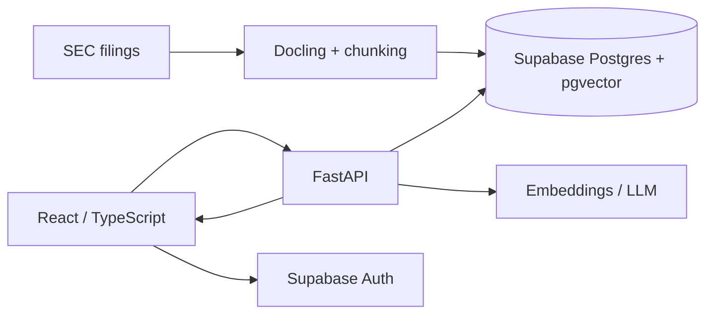

# Khóa học Full Stack GenAI: Document Copilot với RAG và Citations

Khóa học tiếng Việt theo dự án: xây dựng một trợ lý tài liệu cho hồ sơ SEC, sử dụng FastAPI, Supabase Postgres + pgvector, React, TypeScript, Tailwind/shadcn/ui, Docling, embeddings, hybrid retrieval và Railway.

**Nguồn học:** [Full Stack GenAI Project](https://www.youtube.com/watch?v=qF5il_9IwME). Nội dung được biên soạn lại từ transcript kèm ghi chú được cung cấp, bám vào trình tự của chương trình. **Các đoạn mã, schema và API contract minh họa trong giáo trình là bài tập sư phạm, không mặc định là mã chính xác trong repository của người dạy.** Khi thực hành, cần đối chiếu tài liệu chính thức của phiên bản đang cài.

## 1. Mục tiêu đầu ra

Sau khóa học, người học có thể thiết kế kiến trúc end-to-end, chạy một pipeline ingestion–retrieval–generation, duy trì lịch sử hội thoại theo tài khoản, hiển thị dẫn chứng kiểm chứng được, triển khai dịch vụ và đánh giá chất lượng RAG.

## 2. Cấu trúc và lộ trình

Mỗi thư mục module có `README.md` định hướng, hai bài học `.md` độc lập và bài tập thực hành, checklist và 5 câu hỏi ôn tập/ bài.

1. **[Tổng quan hệ thống GenAI Full Stack](M01_tong-quan-genai/README.md)** — 0:00:00–0:04:32. Bản đồ sản phẩm, kiến trúc RAG và cách học theo dự án.
2. **[Yêu cầu khách hàng và dữ liệu SEC](M02_nghiep-vu-va-sec/README.md)** — 0:04:32–0:18:45. Driftwood Capital, phạm vi MVP, 10-K/10-Q và manifest.
3. **[Stack công nghệ và kiến trúc](M03_kien-truc-va-stack/README.md)** — 0:18:45–0:28:34. FastAPI, React, Supabase, pgvector, OpenAI, Railway và monorepo.
4. **[Kế hoạch và cấu hình môi trường](M04_lap-ke-hoach-va-moi-truong/README.md)** — 0:28:34–0:43:42. To-dos, Supabase project, env, database URL và khu vực deploy.
5. **[FastAPI, SQLAlchemy và schema](M05_backend-va-database/README.md)** — 0:43:42–1:08:15. Backend foundation, model quan hệ, Alembic migrations.
6. **[React frontend, Auth và Chat](M06_frontend-auth-chat/README.md)** — 1:08:15–1:34:49. Vite TypeScript, Supabase login, shell UI, chat history.
7. **[Document ingestion, chunking và embeddings](M07_ingestion-chunking-embeddings/README.md)** — 1:34:49–1:59:52. Docling, HTML/Markdown, table fidelity, HybridChunker và vector index.
8. **[Hybrid retrieval, agent và grounding](M08_retrieval-agent-grounding/README.md)** — 1:59:52–2:20:05. Vector + full-text search, RRF, context neighbors, PydanticAI tools.
9. **[Tích hợp chat UI và citations](M09_tich-hop-frontend-citations/README.md)** — 2:20:05–2:50:17. Frontend–backend integration, trạng thái tool, citation side panel, debug.
10. **[Hoàn thiện UI và readiness cho pilot](M10_pilot-ready-va-ui-polish/README.md)** — 2:50:17–2:59:50. UI audit, logging, test cases, UX tối ưu và pilot checklist.
11. **[Docker và Railway deployment](M11_deploy-railway/README.md)** — 2:59:50–3:34:28. Build backend/frontend, secrets, logs, region, Railway MCP và CI/CD.
12. **[Kiểm thử toàn hệ thống và walkthrough](M12_demo-va-truy-vet-e2e/README.md)** — 3:34:28–3:45:00. Tổng hợp luồng dữ liệu và chạy một phiên kiểm thử trên môi trường thật.
13. **[Cải tiến chất lượng và vận hành production](M13_production-improvements/README.md)** — 3:45:00–3:51:48. Đánh giá parser, retriever, grounding, latency, cost và roadmap hardening.

## 3. Sơ đồ kiến trúc

Hướng dẫn đọc: pipeline offline đưa hồ sơ vào index; browser đăng nhập rồi gửi câu hỏi qua FastAPI; backend truy xuất bằng chứng, tổng hợp và lưu câu trả lời cùng citations.

## 4. Chuẩn bị

- Kiến thức nền: Python, TypeScript/React cơ bản, REST API, SQL và Git.
- Công cụ: Python + uv, Node.js + pnpm, Docker (cho bước deploy), tài khoản Supabase, Railway và nhà cung cấp LLM/embedding.
- Tài khoản dịch vụ có thể có giới hạn miễn phí/thay đổi phí; kiểm tra chính sách hiện tại trước khi chạy pipeline lớn.
- Tuyệt đối không lưu API key trong Git, file mẫu bài tập hoặc frontend bundle.

## 5. Cách học hiệu quả

1. Đọc bài theo thứ tự trong module; kiểm tra từng checkpoint.
2. Ưu tiên thực hành trên một tập tài liệu nhỏ có nguồn thật trước khi chạy hàng loạt.
3. Với câu trả lời tài chính, luôn mở citation và đối chiếu kỳ báo cáo, đơn vị và bảng gốc.
4. Ghi lại baseline đánh giá trước khi thay parser, chunker, retriever, prompt hoặc agent.

## 6. Đồ án cuối khóa

Xây một phiên bản Document Copilot có đăng nhập, lịch sử chat, tìm kiếm tài liệu, citations panel, ingestion có khả năng chạy lại và triển khai có thể kiểm thử. Nộp sơ đồ kiến trúc, schema, 10 câu hỏi evaluation và báo cáo lỗi/đề xuất cải tiến.

## 7. Tài liệu đi kèm

- [Lộ trình và rubric hoàn thành](LO_TRINH_VA_CHECKLIST.md)
- [Bảng thuật ngữ](THUAT_NGU.md)

**Lưu ý về mức độ kiểm chứng:** Tư liệu đầu vào mô tả quy trình xây dựng và các lỗi/debug trong dự án thực hành; không có bộ benchmark độc lập chứng minh chất lượng/hiệu quả của sản phẩm. Mọi KPI ở bài tập là mục tiêu kiểm chứng, không phải kết quả đã đạt.
