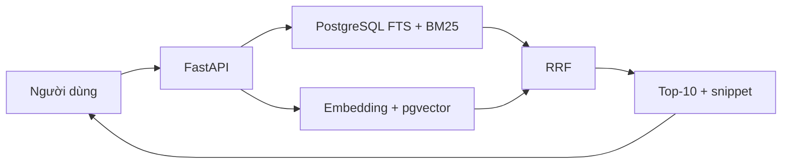

# Khóa học thực hành Hybrid Search với PostgreSQL

**Từ Full-Text Search, BM25, vector search đến RRF và FastAPI**

Khóa học tiếng Việt theo hướng học từng bước và tự triển khai. Sản phẩm học tập là **Wiki Search**: truy xuất bài viết qua từ khóa, ý nghĩa, hoặc kết hợp hai danh sách xếp hạng ngay trong PostgreSQL.

## 1. Bạn sẽ xây dựng được gì?



Dự án tham chiếu dùng snapshot **241.787** bài Wikipedia Simple English, keyword index cho toàn bộ dataset và embedding cho khoảng **25.000–25.002** bài. Nội dung thực hành dựa trên luồng kiến thức và các ví dụ kỹ thuật đã được giảng; các đoạn code **minh họa mở rộng** được đánh dấu ở nơi phù hợp. Khoá học không đính kèm mã nguồn chính thức của người giảng hoặc dataset 157 MB; cần tải nguồn phù hợp và kiểm tra phiên bản trước khi chạy toàn bộ demo.

## 2. Kiến thức đầu vào

SQL căn bản (`SELECT`, `WHERE`, `ORDER BY`, `JOIN`), Python cơ bản, khả năng sử dụng terminal, PostgreSQL và một môi trường có `pg_textsearch`, `vector`, tùy chọn `vectorscale` nếu muốn tái hiện nhánh ANN.

## 3. Lộ trình học

| Nhóm | Bài | Nội dung | Sản phẩm |
| --- | --- | --- | --- |
| Tổng quan | 01–02 | Kiến trúc, matching/ranking, nguyên lý BM25 | Sơ đồ và giải thích điểm |
| Chuẩn bị | 03 | Extension, schema, bulk import | Bảng `articles`, kiểm tra số hàng |
| Keyword | 04–06 | FTS/GIN, BM25, title+body, Boolean, snippet | Top-10 keyword và query plan |
| Semantic | 07–08 | Embedding, phạm vi, pgvector/ANN | Top-10 semantic |
| Hybrid | 09 | RRF và tuning | Top-10 hybrid |
| Ứng dụng | 10–11 | FastAPI, bảo mật và transaction | API và demo thêm bài |
| Đánh giá | 12 | Chất lượng, latency, coverage | Báo cáo thí nghiệm |
| Thực hành thêm | 13–14 | Lab tổng hợp, đồ án đổi miền dữ liệu | Sản phẩm học tập cá nhân |

Mỗi bài 01–12 có 5 câu trắc nghiệm với đáp án, giải thích. Bài 13–14 là lab/dự án nên tập trung vào nhiệm vụ, tiêu chí hoàn thành và rubrics thay vì đáp án tự động.

## 4. Thứ tự sử dụng tệp

Đọc từ `01-...md` đến `12-...md`, sau đó làm `13-lab-tong-hop.md` và `14-do-an-tim-kiem-mon-an.md`. `sql_postgres_baseline.sql` là ví dụ độc lập **chỉ cần PostgreSQL có sẵn full-text search**, phù hợp để thử lập tức. `sql_pg_textsearch_optional.sql` cần extension tương thích. `RRF_demo.py` chỉ dùng thư viện chuẩn Python, cho phép thử trọng số mà chưa phải tải dataset.

## 5. Lệnh bắt đầu với file ví dụ

```bash
# Đăng nhập database PostgreSQL của bạn và chạy baseline
psql "$DATABASE_URL" -f sql_postgres_baseline.sql

# RRF thuần Python (không cần database)
python RRF_demo.py
```

`DATABASE_URL` chứa bí mật: chỉ đặt trong môi trường local. **Không chạy file baseline vào database có bảng `demo_articles` cần giữ nguyên**, vì script khởi tạo lại bảng demo để tái chạy độc lập.

## 6. Các giới hạn quan trọng

1. Cú pháp `pg_textsearch` và chức năng phiên bản **không thay thế** việc kiểm tra extension thực tế. Demo mô tả môi trường nhắm `1.5.1`, trong khi tài liệu công khai có thể nói về một phiên bản khác.
2. RRF không thể cứu tài liệu vắng khỏi cả hai danh sách ứng viên.
3. Keyword index và semantic index không cùng coverage; đánh giá trên hai tập riêng không chứng minh phương pháp nào tốt hơn tổng quát.
4. Bài SQL minh họa sử dụng cấu trúc riêng để học, không giả làm repo gốc. Muốn tái hiện toàn bộ giao diện cần code project tương ứng và dataset đầu vào.
5. Việc tích hợp cho món ăn ở bài 14 là **bài tập chuyển giao kiến thức**, không phải tính năng đã được chứng minh trong ứng dụng Wiki Search.

## 7. Đối chiếu tài liệu kỹ thuật

- `pg_textsearch` và BM25: https://www.tigerdata.com/docs/deploy/tiger-cloud/tiger-cloud-aws/tiger-cloud-extensions/pg-textsearch
- Hướng dẫn hybrid search: https://www.tigerdata.com/docs/learn/tutorials/hybrid-search
- PostgreSQL Full-Text Search: https://www.postgresql.org/docs/current/textsearch.html
- pgvector: https://github.com/pgvector/pgvector

Dữ liệu Wikipedia Simple English phải giữ ghi công và tuân thủ giấy phép được ghi trên thẻ dataset, gồm Creative Commons Attribution-ShareAlike 3.0 và GNU Free Documentation License theo mô tả của tập dữ liệu dùng trong bài. Trước khi xuất bản nội dung, kiểm tra điều kiện giấy phép của chính phiên bản dữ liệu bạn tải.

## 8. Tiêu chí hoàn thành khóa học

- [ ] Giải thích được BM25, embedding và RRF
- [ ] Có baseline PostgreSQL FTS và phân tích `EXPLAIN`
- [ ] Có demo/tổng quan BM25 với index tương thích
- [ ] Lưu được 384-dimensional embedding và biết giới hạn coverage
- [ ] Tạo được danh sách hybrid từ hai top-20
- [ ] Thiết kế API có validation và binding
- [ ] Thiết kế được insert text+vector nhất quán
- [ ] Báo cáo được ít nhất 5 truy vấn, chất lượng và latency
