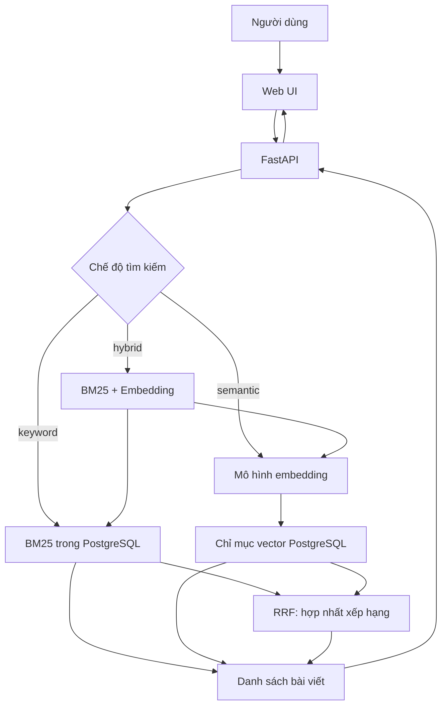

# Bài 01 — Kiến trúc ứng dụng tìm kiếm Wiki

**Chủ đề:** PostgreSQL · pg_textsearch · pgvector · Hybrid Search  
**Loại bài:** lesson

## 1. Tóm tắt và mục tiêu

Ứng dụng Wiki Search cho phép tìm bài viết theo **từ khóa**, **ý nghĩa** hoặc **kết hợp hai cách**. PostgreSQL lưu dữ liệu bài viết, chỉ mục văn bản và vector trong cùng hệ quản trị. Mục tiêu của kiến trúc này là giảm nhu cầu sao chép dữ liệu sang dịch vụ tìm kiếm khác trong một dự án cần truy vấn SQL và cập nhật nhất quán.

Sau bài học, người học có thể: (1) mô tả luồng truy vấn đầu-cuối; (2) phân biệt *matching* với *ranking*; (3) giải thích ưu, nhược điểm của việc lưu chỉ mục cùng dữ liệu; (4) xác định khác biệt về độ bao phủ giữa tìm kiếm từ khóa và ngữ nghĩa.

## 2. Bài toán tìm kiếm

Nếu chỉ dùng `LIKE` để kiểm tra một chuỗi con, kết quả dễ thiếu các bài viết sử dụng cách diễn đạt khác. Chẳng hạn, câu hỏi *animals that produce their own light* có thể hướng tới **bioluminescence** dù các từ trong câu hỏi không xuất hiện giống hệt tiêu đề. Ngược lại, các chủ đề có tên riêng như **Apollo 13** lại thường cần sự chính xác của từ khóa.

Một yêu cầu tìm kiếm bao gồm hai quyết định:

- **Matching**: tài liệu nào được coi là ứng viên hợp lệ?
- **Ranking**: trong các ứng viên đó, tài liệu nào cần xuất hiện trước?

Không nên đánh đồng thay đổi quy tắc `AND`/`OR` với cải tiến thuật toán xếp hạng.

## 3. Kiến trúc tổng thể

Khi chỉ dùng một phương pháp, API có thể trả kết quả của phương pháp đó. Ở chế độ lai, ứng dụng lấy các ứng viên từ cả hai nhánh, tổng hợp điểm theo vị trí và trả về thứ hạng chung. Các sơ đồ ở đây mô tả luồng logic, không bắt buộc mỗi nhánh phải là dịch vụ riêng.

## 4. Một cơ sở dữ liệu hay hai hệ thống?

Với hệ thống tách rời, một bản cập nhật từ PostgreSQL phải được chuyển sang search engine; nếu job đồng bộ chậm hoặc thất bại, người dùng có thể nhìn thấy dữ liệu cũ. Khi chỉ mục tìm kiếm nằm trong PostgreSQL, việc ghi bài viết và cập nhật chỉ mục có thể được quản lý trong cùng ranh giới giao dịch của DB.

Cách này không mặc nhiên tốt nhất cho mọi quy mô. Nền tảng chuyên dụng có thể phù hợp hơn nếu nhu cầu vận hành, tính năng hoặc tải truy vấn vượt khỏi thiết kế hiện tại. Quyết định kiến trúc cần căn cứ vào dữ liệu và phép đo thực tế.

## 5. Phạm vi thực nghiệm

Bộ dữ liệu minh họa chứa **241.787** bài Wikipedia Simple English (snapshot `2023-11-01.simple`). Tìm kiếm từ khóa làm việc trên toàn tập; tìm kiếm ngữ nghĩa chỉ có vector cho nhóm khoảng **25.000** bài (có thể thành **25.002** do bổ sung ví dụ). Hai mẫu bao phủ khác nhau là một biến nhiễu lớn khi so sánh kết quả.

## 6. Thực hành nhanh

Vẽ lại sơ đồ và đánh dấu nơi phát sinh hai kiểu độ trễ: (a) SQL chạy trong PostgreSQL và (b) mô hình mã hóa câu truy vấn thành embedding. Với truy vấn `Apollo 13`, dự đoán vì sao tìm kiếm từ khóa thường có lợi thế về tên riêng.

## 7. Điểm cần nhớ

Tính liên quan không đồng nghĩa với việc có đủ mọi từ; độ bao phủ của chỉ mục cũng không đồng nghĩa với chất lượng xếp hạng. Kiến trúc phải đo được cả hai.

## 8. Câu hỏi ôn tập

### Câu 1

Người dùng tìm "Apollo 13"; điều gì đặc biệt quan trọng?

A. Chỉ phát hiện lỗi chính tả  
B. Giữ đúng tên riêng trong kết quả  
C. Chỉ xét số từ của tài liệu  
D. Luôn bỏ qua keyword  

**Đáp án:** B  
**Giải thích:** Tên riêng là tín hiệu từ khóa chính xác, còn ngữ nghĩa có thể đưa nhiệm vụ không gian khác vào.

### Câu 2

Matching trả lời câu hỏi nào?

A. Ai nên xuất hiện trong tập ứng viên?  
B. Tác vụ chạy bao lâu?  
C. Điểm bao nhiêu phần trăm?  
D. Server có bao nhiêu CPU?  

**Đáp án:** A  
**Giải thích:** Matching xác định tính đủ điều kiện; ranking sắp xếp các ứng viên.

### Câu 3

Vì sao đồng bộ sang search engine thứ hai có thể gây dữ liệu cũ?

A. SQL không hỗ trợ UPDATE  
B. Sự kiện đồng bộ có thể trễ hoặc lỗi  
C. Tài liệu không có tiêu đề  
D. Trình duyệt không hỗ trợ JSON  

**Đáp án:** B  
**Giải thích:** Bản sao chỉ mục ở dịch vụ thứ hai có thể không được cập nhật cùng lúc.

### Câu 4

Khi đánh giá keyword và semantic ở dự án Wiki Search, điều kiện nào chưa tương đương?

A. Phông chữ giao diện  
B. Số kết nối  
C. Tập bài viết được bao phủ  
D. Ngôn ngữ lập trình  

**Đáp án:** C  
**Giải thích:** Keyword bao phủ toàn tập, semantic mới có vector cho một tập con.

### Câu 5

Giải pháp nào là mục tiêu lưu chỉ mục cùng PostgreSQL?

A. Loại bỏ mọi chi phí hạ tầng  
B. Cập nhật dữ liệu/chỉ mục cùng ranh giới giao dịch  
C. Không cần kiểm thử  
D. Không bao giờ cần index  

**Đáp án:** B  
**Giải thích:** Dữ liệu và chỉ mục cùng DB giúp đơn giản hóa ranh giới cập nhật nhất quán.
