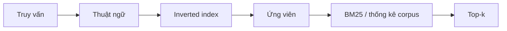

# Bài 02 — Full-text search và nền tảng BM25

**Chủ đề:** PostgreSQL · pg_textsearch · pgvector · Hybrid Search  
**Loại bài:** lesson

## 1. Tóm tắt và mục tiêu

PostgreSQL có tìm kiếm toàn văn (Full-Text Search, FTS) với `tsvector`, `tsquery` và `ts_rank`. `pg_textsearch` bổ sung **BM25**, sử dụng thống kê của cả tập tài liệu để xếp hạng theo độ liên quan. Sau bài này, người học có thể giải thích IDF, sự bão hòa tần suất, điều chỉnh độ dài và ý nghĩa của tham số `k1`, `b`.

## 2. Vì sao số lần xuất hiện từ không đủ?

Giả sử một bộ sưu tập có 1.000 tài liệu. Từ `database` xuất hiện trong 900 tài liệu, còn `pooling` chỉ xuất hiện ở 10. Với truy vấn `database pooling`, từ `pooling` giúp phân biệt tài liệu rõ hơn. Tần suất xuất hiện trong toàn bộ **corpus** quyết định độ hiếm — không chỉ số lần từ đó lặp trong một bài viết.

Cũng cần tính đến độ dài: một bài viết rất dài có nhiều cơ hội chứa từ bất kỳ hơn bài ngắn. Đồng thời, lần xuất hiện thứ mười không nên có tác dụng gấp mười lần lần đầu.

## 3. Ba cơ chế của BM25

| Tín hiệu | Câu hỏi được trả lời | Diễn giải |
| --- | --- | --- |
| IDF | Từ khóa phổ biến hay hiếm trong corpus? | Từ hiếm thường mang nhiều bằng chứng về độ liên quan |
| TF bão hòa | Từ lặp trong bài viết bao nhiêu lần? | Xuất hiện thêm có ích nhưng lợi ích giảm dần |
| Chuẩn hóa độ dài | Bài viết dài hay ngắn so với trung bình? | Tránh ưu ái tài liệu dài chỉ vì có nhiều từ |

Một dạng công thức thường dùng để giải thích BM25 là:

$$
\operatorname{BM25}(D,Q)=\sum_{q\in Q}\operatorname{IDF}(q)
\frac{f(q,D)(k_1+1)}{f(q,D)+k_1\left(1-b+b\frac{|D|}{\operatorname{avgdl}}\right)}
$$

Trong đó $f(q,D)$ là số lần thuật ngữ $q$ có trong tài liệu $D$; $|D|$ là độ dài tài liệu; $\operatorname{avgdl}$ là độ dài trung bình của corpus. Công thức trình bày ý tưởng xếp hạng, không nhằm bảo đảm đồng nhất tuyệt đối với mọi hiện thực thư viện.

Tham số mặc định được sử dụng trong nội dung thực hành là **`k1 = 1.2`** và **`b = 0.75`**. `k1` chi phối độ bão hòa TF; `b=0` tắt điều chỉnh theo chiều dài, tăng `b` thường khiến điều chỉnh mạnh hơn. Không nên tinh chỉnh chỉ vì một truy vấn có thứ hạng chưa ưng ý; hãy lập bộ truy vấn kiểm tra rồi so sánh.

## 4. BM25 và `ts_rank` khác nhau ra sao?

`ts_rank` tính điểm từ các lexeme khớp trong tài liệu và có các tùy chọn chuẩn hóa. BM25 đưa thêm thống kê tần suất tài liệu trên corpus và chiều dài trung bình vào một mô hình thống nhất. Do đó hai phương pháp có thể cho thứ tự khác nhau ngay cả khi tìm trong cùng một cột văn bản.

Cả hai vẫn là **lexical retrieval**, không tự hiểu ngữ nghĩa sâu. Nếu truy vấn nói 'loài vật tự phát sáng' mà tài liệu chỉ dùng một thuật ngữ chuyên ngành khác, tìm kiếm ngữ nghĩa có thể hữu ích hơn.

## 5. Chỉ mục đảo ngược và top-k

Chỉ mục đảo ngược nối các thuật ngữ với tài liệu chứa chúng. Với BM25, chiến lược **Block-Max WAND** có thể bỏ qua những nhóm posting không có khả năng vượt điểm nhóm đầu hiện tại, giảm công việc cho top-k. Hiệu năng cuối cùng vẫn tùy query, số ứng viên, bộ nhớ và kế hoạch SQL.

## 6. Câu hỏi thực hành

Với corpus 1.000 bài, so sánh hai từ xuất hiện trong 900 và 10 bài. Sau đó suy luận vì sao việc lập chỉ mục một phân vùng riêng có thể thay đổi IDF: tập tài liệu dùng để thống kê đã thay đổi.

## 7. Tổng kết

BM25 = độ hiếm từ khóa + tần suất có bão hòa + điều chỉnh độ dài. Điểm của BM25 chỉ có ý nghĩa trong ngữ cảnh truy vấn và chỉ mục đang xét, không phải phần trăm độ chính xác.

## 8. Câu hỏi ôn tập

### Câu 1

Trong corpus, thuật ngữ xuất hiện ở 10/1.000 tài liệu thường có tín hiệu nào?

A. IDF mang nhiều thông tin hơn thuật ngữ xuất hiện ở 900 tài liệu  
B. Luôn bị loại khỏi index  
C. Độ dài tài liệu bằng 10  
D. Độ chính xác luôn 100%  

**Đáp án:** A  
**Giải thích:** Từ hiếm giúp phân biệt tài liệu hơn; IDF phản ánh điều đó.

### Câu 2

Khi một từ lặp lại từ 10 lên 50 lần, BM25 có nguyên lý gì?

A. Lợi ích tăng đều tuyến tính  
B. Không bao giờ tính TF  
C. Lợi ích bổ sung giảm dần  
D. Điểm số luôn bằng 0  

**Đáp án:** C  
**Giải thích:** TF bão hòa khiến các lần xuất hiện sau đóng góp ít dần.

### Câu 3

Đặt b = 0 có ý nghĩa gì?

A. Bật tìm kiếm vector  
B. Tắt chuẩn hóa theo độ dài tài liệu  
C. Chỉ giữ tiêu đề  
D. Nhân đôi IDF  

**Đáp án:** B  
**Giải thích:** b điều khiển mức chuẩn hóa độ dài, và 0 tắt yếu tố này.

### Câu 4

Thành phần nào mô tả chiều dài trung bình corpus?

A. Token API  
B. HTTP method  
C. Checkpoint  
D. avgdl  

**Đáp án:** D  
**Giải thích:** avgdl xuất hiện trong thành phần điều chỉnh chiều dài tài liệu.

### Câu 5

Vì sao điểm BM25 không nên hiểu là phần trăm?

A. Đó là số thứ hạng theo mô hình và corpus, không phải xác suất đúng  
B. Nó chỉ đo RAM  
C. Bởi vì PostgreSQL không dùng số  
D. Do dữ liệu không có tiêu đề  

**Đáp án:** A  
**Giải thích:** Điểm BM25 là thước đo xếp hạng, không mang nghĩa % độ chính xác.
