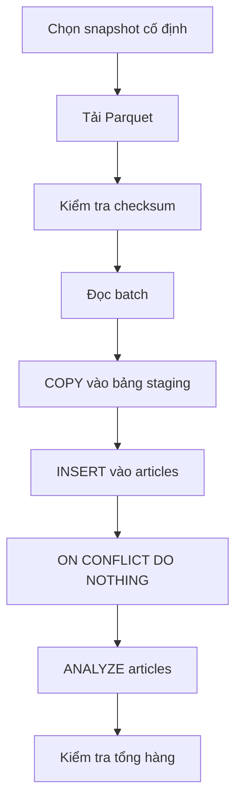

# Bài 03 — Cấu hình môi trường, dữ liệu và nhập bài viết

**Chủ đề:** PostgreSQL · pg_textsearch · pgvector · Hybrid Search  
**Loại bài:** lab

## 1. Tổng quan

Bài thực hành xây dựng nền dữ liệu của Wiki Search. Mục tiêu là tạo database, kiểm tra extension, định nghĩa bảng `articles`, nhập dữ liệu theo batch và xác nhận kết quả trước khi lập chỉ mục. Cần có PostgreSQL, Python chạy script và quyền bật extension thích hợp. Có thể dùng Tiger Cloud hoặc PostgreSQL tự quản lý khi extension tương thích.

## 2. Chuẩn bị và xác minh phiên bản

Trong bài thực hành được mô tả, môi trường hướng tới **`pg_textsearch` 1.5.1**. Đây là phiên bản mục tiêu của *bộ demo*, không phải tuyên bố rằng mọi nhà cung cấp đều đang cung cấp đúng phiên bản đó. Các tính năng có thể thay đổi theo bản cài đặt; kiểm tra trước khi chạy các ví dụ nâng cao.

```sql
SELECT current_date;
SELECT name, default_version, installed_version
FROM pg_available_extensions
WHERE name IN ('pg_textsearch', 'vector', 'vectorscale');
```

Nếu máy chủ chưa cài đặt binary extension, `CREATE EXTENSION` sẽ thất bại và phải được xử lý ở cấp dịch vụ/server. Đừng tiếp tục nếu bài thực hành cần toán tử chưa có. Sau khi có extension tương thích, quản trị viên có thể bật nó theo hướng dẫn của môi trường. Không lưu connection string thật trong git.

## 3. Thiết kế bảng bài viết

Bảng cơ sở gồm 5 trường: khóa ID nguồn, URL, tiêu đề, nội dung và ước lượng số từ.

```sql
CREATE TABLE IF NOT EXISTS articles (
  id BIGINT PRIMARY KEY,
  url TEXT NOT NULL,
  title TEXT NOT NULL,
  body TEXT NOT NULL,
  word_count INTEGER NOT NULL DEFAULT 0
);
```

`word_count` có thể tính gần đúng bằng cách tách khoảng trắng. Nó **không** tương đương số token mà tokenizer của full-text search hoặc mô hình embedding dùng.

## 4. Nhập dữ liệu lớn theo batch

Dữ liệu minh họa thuộc Simple English Wikipedia, snapshot `2023-11-01.simple`, **241.787** bài. File Parquet nén khoảng **157 MB**, không phải kích thước database sau index. Mỗi record có ID, URL, tiêu đề và văn bản. Quy trình import:



Chốt dataset revision và checksum giúp mọi lần chạy dùng cùng dữ liệu. `COPY` vào staging rồi `INSERT ... ON CONFLICT DO NOTHING` khiến lần chạy lại không tự ý ghi đè bài đã có. Mệnh đề này chỉ an toàn khi bạn chủ ý bảo toàn dữ liệu hiện hữu; nó không thay thế chiến lược cập nhật production.

Đối với import ban đầu, nên **nạp xong trước, xây index sau** để tránh chi phí cập nhật chỉ mục cho mỗi dòng đang thêm. Sau `ANALYZE`, planner có thống kê bảng phục vụ lập kế hoạch — khác với thống kê corpus mà BM25 dùng để tính điểm.

## 5. Checkpoint và kiểm tra kết quả

```sql
SELECT COUNT(*) FROM articles;
SELECT id, title, url, word_count
FROM articles ORDER BY word_count DESC LIMIT 10;
SELECT COUNT(*) AS empty_body
FROM articles WHERE btrim(body) = '';
```

Với snapshot nguyên vẹn, dự kiến **241.787** hàng dữ liệu nguồn. Nếu có thêm bài demo do người dùng tạo thì tổng số có thể tăng. Không nên suy ra import đúng chỉ vì câu lệnh không báo lỗi: phải kiểm tra các trường thực sự chứa nội dung kỳ vọng.

## 6. Debug và deliverable

- Lỗi `extension is not available`: kiểm tra dịch vụ/phiên bản server, không thử đoán tên extension.
- Import thiếu hàng: kiểm tra revision, checksum, batch lỗi và `ON CONFLICT`.
- Chạy lại làm tăng dữ liệu bất ngờ: kiểm tra khóa ID và logic deduplicate.
- `word_count` lệch số token: đây là hai phép đo khác nhau.

**Deliverable:** database chứa bảng `articles`, báo cáo `COUNT(*)`, mẫu 10 hàng, kết quả kiểm tra extension và ghi chú cấu hình môi trường (không chứa mật khẩu).

## 7. Checklist

- [ ] Kiểm tra extension và phiên bản
- [ ] Tạo lược đồ 5 cột
- [ ] Nạp dữ liệu theo batch và kiểm tra tổng hàng
- [ ] Xác nhận chạy lại không ghi đè dữ liệu
- [ ] Chạy `ANALYZE`

## 8. Câu hỏi ôn tập

### Câu 1

Vì sao kiểm tra checksum của Parquet trước import?

A. Để làm giao diện đẹp hơn  
B. Để cố định và kiểm tra dữ liệu đã tải  
C. Để tạo vector tự động  
D. Để thay HTTP bằng SQL  

**Đáp án:** B  
**Giải thích:** Checksum giúp phát hiện thay đổi/hỏng file trong pipeline lặp lại.

### Câu 2

Khi import lần đầu hàng trăm nghìn bài, thứ tự phù hợp là?

A. Tạo mọi index trước rồi chèn từng dòng  
B. Không cần kiểm tra dữ liệu  
C. Nạp dữ liệu, sau đó lập chỉ mục  
D. Chỉ import tiêu đề  

**Đáp án:** C  
**Giải thích:** Lập chỉ mục sau khi bulk-load tránh nhiều lần bảo trì index cho từng insert.

### Câu 3

`ON CONFLICT DO NOTHING` trong import có tác dụng gì?

A. Không chèn lại hàng có khóa đã tồn tại  
B. Xóa bài trùng  
C. Đổi tokenizer  
D. Tăng số kết nối  

**Đáp án:** A  
**Giải thích:** Khi khóa chính xung đột, hàng đang có được giữ nguyên.

### Câu 4

`ANALYZE articles` chủ yếu phục vụ?

A. Tạo đường dẫn URL  
B. Tạo câu truy vấn ngôn ngữ tự nhiên  
C. Khởi tạo FastAPI  
D. Thống kê hỗ trợ query planner  

**Đáp án:** D  
**Giải thích:** ANALYZE cập nhật thống kê cho bộ lập kế hoạch PostgreSQL.

### Câu 5

Một file Parquet 157 MB có nghĩa gì?

A. Database sau index luôn 157 MB  
B. Đó là kích thước file nén đầu vào, không phải dung lượng database cuối  
C. Số vector phải bằng 157  
D. Số dòng bằng 157  

**Đáp án:** B  
**Giải thích:** Kích thước nén đầu vào khác dữ liệu bảng và chỉ mục sau giải nén.
