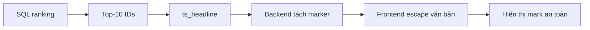

# Bài 06 — Kết hợp tiêu đề, bộ lọc Boolean và highlight an toàn

**Chủ đề:** PostgreSQL · pg_textsearch · pgvector · Hybrid Search  
**Loại bài:** lesson

## 1. Tóm tắt và mục tiêu

Người dùng thường tìm theo cả tiêu đề lẫn nội dung. Một chỉ mục chỉ nhìn `body` có thể bỏ qua tín hiệu mạnh từ `title`. Bài học xây text kết hợp, mô tả cách ghép điều kiện Boolean/phrasal với ranking và tạo snippet an toàn để hiển thị trên web.

## 2. Trường văn bản kết hợp

Có thể tạo cột `search_text` được tính từ `title` và `body`:

```sql
ALTER TABLE articles
ADD COLUMN search_text TEXT
GENERATED ALWAYS AS (coalesce(title, '') || ' ' || coalesce(body, '')) STORED;

CREATE INDEX articles_search_bm25_idx
ON articles USING bm25 (search_text)
WITH (text_config='english');
```

Cột generated giúp nội dung tìm kiếm thay đổi cùng dữ liệu bài viết. Với bảng đang có `search_text` hoặc index trùng tên, cần điều chỉnh DDL tương ứng; ví dụ trên là lộ trình chạy một lần cho bảng khởi tạo chưa có trường này.

## 3. Matching ràng buộc, ranking ưu tiên

Không phải mọi query đều chỉ cần “gần đúng nhất”. Người dùng có thể muốn bài về `jazz` nhưng loại `rock`; hoặc muốn `New Orleans` như một cụm. PostgreSQL FTS cung cấp matching Boolean và phrase:

```sql
SELECT title
FROM articles
WHERE to_tsvector('english', search_text)
      @@ to_tsquery('english', 'jazz & !rock')
LIMIT 10;

SELECT title
FROM articles
WHERE to_tsvector('english', search_text)
      @@ phraseto_tsquery('english', 'New Orleans')
LIMIT 10;
```

Sau khi lọc có thể dùng BM25 để **xếp hạng** những bài hợp lệ. Đây có thể là kế hoạch SQL phức tạp hơn top-k BM25 thuần. `pg_textsearch` ở các phiên bản khác nhau không nhất thiết hỗ trợ cú pháp Boolean/phrase ngay trong BM25; an toàn nhất là tách **lọc FTS** và **xếp hạng BM25** nếu yêu cầu tính năng/phạm vi phiên bản chưa rõ.

## 4. Snippet và nguy cơ HTML injection

`ts_headline` có thể tạo phần trích có đánh dấu từ khớp. Chỉ làm việc này **sau khi đã chọn top-10**, vì không cần tạo hàng nghìn snippet nếu giao diện chỉ hiển thị 10 kết quả.

```sql
SELECT id, title,
  ts_headline('english', body,
    plainto_tsquery('english', 'jazz trumpet'),
    'MaxFragments=2, StartSel=@@H_START@@, StopSel=@@H_END@@') AS snippet
FROM articles
ORDER BY body <@> to_bm25query('jazz trumpet',
                               'articles_body_bm25_idx')
LIMIT 10;
```

Các marker mang ý nghĩa **ranh giới tô sáng**, không phải HTML an toàn. Backend phải tách marker thành đoạn văn bản bình thường và đoạn highlight; frontend render đoạn thường bằng text node / escape HTML, chỉ dùng phần tử `mark` do code tạo. Tuyệt đối không đưa toàn bộ snippet chưa xử lý vào `innerHTML`.

## 5. Sơ đồ hiển thị



Văn bản lấy từ Wikipedia hoặc nguồn do user nhập có thể chứa ký tự giống HTML. Xử lý đúng ranh giới dữ liệu và markup là một phần của tính đúng đắn chức năng tìm kiếm.

## 6. Tự luyện

Viết hai truy vấn: `jazz & !rock` và phrase `New Orleans`; dự đoán tập khớp. Sau đó giải thích vì sao highlight được tạo sau top-k, không phải trước ranking.

## 7. Tổng kết

Nội dung có thể tìm kiếm gồm `title + body`; matching có điều kiện rõ ràng; ranking là quyết định độc lập; snippet phải được xử lý như dữ liệu không tin cậy.

## 8. Câu hỏi ôn tập

### Câu 1

Vì sao đưa tiêu đề vào search_text?

A. Tăng tín hiệu tìm kiếm từ tiêu đề  
B. Để bỏ body  
C. Chuyển mọi văn bản thành vector  
D. Để loại WHERE  

**Đáp án:** A  
**Giải thích:** Tiêu đề thường chứa thuật ngữ quan trọng nên nên được tìm cùng nội dung.

### Câu 2

`jazz & !rock` mang nghĩa gì?

A. Chỉ bài về rock  
B. Có jazz và không có rock  
C. Có jazz hoặc rock  
D. Luôn khớp mọi bài  

**Đáp án:** B  
**Giải thích:** AND + NOT đưa ra quy tắc matching bắt buộc.

### Câu 3

`phraseto_tsquery` phù hợp với yêu cầu nào?

A. Tính token API  
B. Đổi màu trang  
C. Kiểm tra cụm từ có thứ tự  
D. Gộp điểm RRF  

**Đáp án:** C  
**Giải thích:** Phrase query kiểm tra trật tự/gần kề lexeme qua FTS.

### Câu 4

Vì sao nên tạo snippet sau khi chọn top-k?

A. Vì không hỗ trợ tiếng Anh  
B. Để làm tăng số hàng  
C. Vì cần sort bằng CSS  
D. Tránh làm việc cho quá nhiều kết quả không hiển thị  

**Đáp án:** D  
**Giải thích:** Chỉ có top-k mới cần snippet cho giao diện.

### Câu 5

Cách tránh HTML injection khi highlight?

A. Escape văn bản và tự tạo node mark cho đoạn được chọn  
B. Gắn mọi đoạn vào innerHTML  
C. Tin hoàn toàn dữ liệu nguồn  
D. Tắt PostgreSQL  

**Đáp án:** A  
**Giải thích:** Dữ liệu văn bản không được biến trực tiếp thành HTML thực thi.
