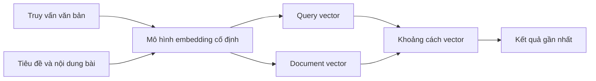
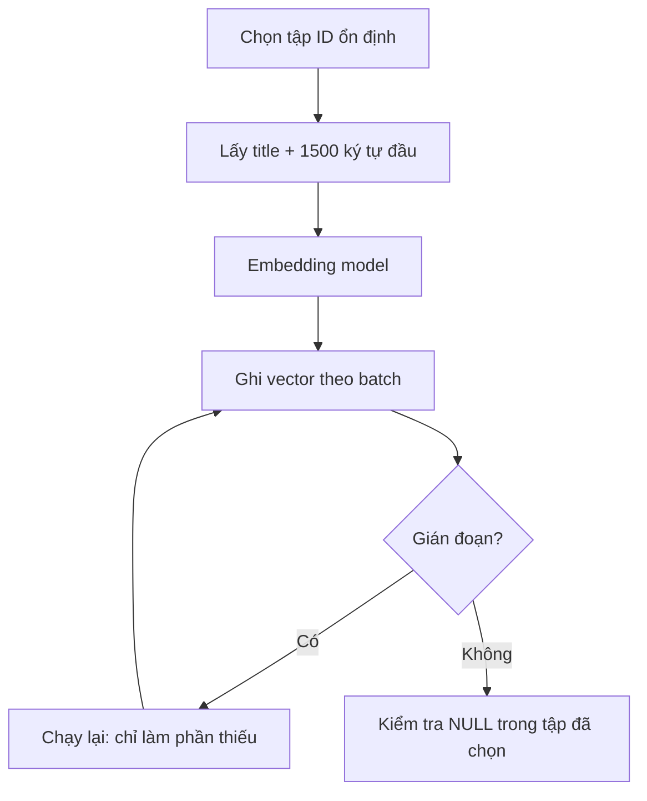

# Bài 07 — Embedding và phạm vi tìm kiếm ngữ nghĩa

**Chủ đề:** PostgreSQL · pg_textsearch · pgvector · Hybrid Search  
**Loại bài:** lesson

## 1. Tóm tắt và mục tiêu

Semantic search so sánh *biểu diễn ngữ nghĩa* của câu hỏi và tài liệu. Mô hình embedding chuyển văn bản thành vector cùng số chiều để tính khoảng cách/similarity. Sau bài học, người học có thể chọn tập tài liệu cần mã hóa, phân tích giới hạn cắt ngắn và giải thích vì sao không nên trộn vector từ hai model không tương thích.

## 2. Từ câu chữ đến vector

Ví dụ truy vấn *animals that produce their own light* có thể liên quan bài về `bioluminescence`. Nếu chỉ dựa vào từ khóa, các từ khác nhau có thể không khớp. Embedding ánh xạ cả hai thành biểu diễn số gần nhau hơn theo các mẫu mà mô hình học được.

Cần dùng **cùng model và cùng cấu hình tiền xử lý** cho query và documents. Vector giống nghĩa không bảo đảm kết quả đúng; với câu hỏi tên riêng `Apollo 13`, semantic retrieval có thể đưa bài về nhiệm vụ khác.

## 3. Phạm vi mã hóa tài liệu

Demo giữ ~25.000 bài dài nhất, có thêm các bài minh họa núi lửa và bioluminescence, nên số được chọn có thể là **25.002**. Script chọn nhóm ổn định qua các lần chạy để có thể resume.

Text gửi tới model gồm **tiêu đề và 1.500 ký tự đầu của phần thân**. Model còn có thể tiếp tục truncate theo giới hạn input. Do đó bài dài chỉ có ý tưởng quan trọng ở cuối **có thể bị bỏ lỡ**. Một cải tiến sau khóa học là chia bài thành chunks rồi tổng hợp kết quả về bài gốc.

Model trong bài thực hành tạo **384 chiều**, không phải 384 từ. Dữ liệu không có embedding nằm ngoài phạm vi semantic search, nhưng vẫn có thể được tìm bằng keyword search.

## 4. Pipeline tạo embedding

Lần chạy đầu có thể tốn thời gian để tải model. Nếu dừng giữa chừng, các batch đã commit không cần mã hóa lại; chạy lại chỉ tiếp tục phần còn thiếu. Hãy đợi tạo embedding hoàn tất trước khi xây chỉ mục vector hoặc đánh giá semantic.

## 5. Các nhầm lẫn thường gặp

- `word_count` không phải số token của tokenizer embedding.
- `vector(384)` là ràng buộc số chiều lưu trữ, không tự tạo embedding.
- Embedding ở **một tập con** không đồng nghĩa tìm kiếm ngữ nghĩa toàn bộ tài liệu.
- “Khoảng cách gần” không đồng nghĩa “đúng thực thể/tên riêng”.

## 6. Thực hành

Thiết kế bảng kiểm cho từng ID: `has_embedding`, `text_preview_length`, `embedding_model_version`, `updated_at` (các trường bổ sung là đề xuất thiết kế thực hành, không thuộc lược đồ 5 cột ban đầu). Giải thích cách phát hiện bài đã được cập nhật nhưng vector chưa được làm mới.

## 7. Tổng kết

Semantic search tăng khả năng bắt được ý tưởng khác câu chữ, nhưng cần kiểm soát độ bao phủ, đoạn văn bản được mã hóa, tính nhất quán model và chi phí tạo vector.

## 8. Câu hỏi ôn tập

### Câu 1

Tìm kiếm ngữ nghĩa dựa vào biểu diễn nào?

A. Chuỗi SQL nguyên văn  
B. Vector embedding của query và tài liệu  
C. Số lượt click  
D. Mã màu của trang  

**Đáp án:** B  
**Giải thích:** Embedding cho phép so sánh sự gần nhau về biểu diễn ý nghĩa.

### Câu 2

Lý do không trộn hai model embedding khác nhau?

A. Mọi model chỉ chạy ở cloud  
B. Model khác nhau luôn 512 chiều  
C. Không gian vector và tiền xử lý có thể không tương thích  
D. SQL không lưu được số  

**Đáp án:** C  
**Giải thích:** Các vector từ hai mô hình không được giả định có thể so sánh trực tiếp.

### Câu 3

Vì sao bài dài có thể bị thiếu trong semantic search demo?

A. Chỉ lấy phần đầu 1.500 ký tự của thân bài  
B. Chỉ dùng URL  
C. Không có ID  
D. Không có tiêu đề  

**Đáp án:** A  
**Giải thích:** Thông tin chỉ xuất hiện cuối bài không được mã hóa trong biểu diễn đầu vào này.

### Câu 4

Nếu semantic trả thiếu một bài dù keyword tìm thấy?

A. BM25 đã xóa bài  
B. PostgreSQL không tìm title  
C. HTTP lỗi bắt buộc  
D. Bài có thể không thuộc tập đã embedding  

**Đáp án:** D  
**Giải thích:** Semantic search chỉ có thể truy xuất tập được tạo vector.

### Câu 5

Chạy lại sau gián đoạn hợp lý nhất là?

A. Xóa hết mọi vector  
B. Chỉ tạo nốt embedding còn thiếu  
C. Đổi model giữa chừng  
D. Bỏ kiểm tra NULL  

**Đáp án:** B  
**Giải thích:** Resume giữ các batch đã commit và xử lý phần còn thiếu.
