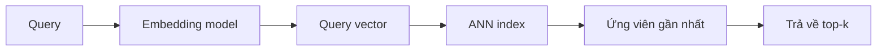

# Bài 08 — pgvector, chỉ mục ANN và truy vấn semantic

**Chủ đề:** PostgreSQL · pg_textsearch · pgvector · Hybrid Search  
**Loại bài:** lab

## 1. Tổng quan và mục tiêu

Bài thực hành lưu vector 384 chiều trong PostgreSQL, tạo chỉ mục phục vụ Approximate Nearest Neighbor (ANN) và tìm top-k theo khoảng cách. Demo sử dụng họ `pgvector` và `pgvectorscale`; DDL riêng cho chỉ mục ANN phải đối chiếu phiên bản extension cài đặt.

## 2. Lưu trữ vector trong PostgreSQL

Sau khi bật extension `vector` trên môi trường hỗ trợ:

```sql
CREATE EXTENSION IF NOT EXISTS vector;
ALTER TABLE articles
ADD COLUMN IF NOT EXISTS embedding vector(384);

SELECT COUNT(*) AS embedded_count
FROM articles WHERE embedding IS NOT NULL;
```

Một cột `vector(384)` chỉ khai báo kiểu dữ liệu. Chính script embedding mới tạo từng vector. Chỉ mã hóa cùng một cách cho toàn bộ tập tài liệu. Có thể kiểm tra số bài mục tiêu chưa có vector dựa vào danh sách ID đã chọn; số `NULL` của *toàn bộ bảng* được phép rất lớn trong demo.

## 3. Tìm top-k theo khoảng cách

Ví dụ minh họa tham số vector do backend truyền vào từ model:

```sql
SELECT id, title,
       embedding <=> %s::vector AS distance
FROM articles
WHERE embedding IS NOT NULL
ORDER BY embedding <=> %s::vector
LIMIT 10;
```

Đây là **mẫu SQL chứa placeholder của psycopg**, không chạy trực tiếp trong psql khi chưa binding `%s`. Toán tử `<=>` là cosine distance của pgvector; nhỏ hơn nghĩa là gần hơn. Khi model và metric khác, lựa chọn distance operator/index opclass cũng phải nhất quán.

## 4. Chỉ mục xấp xỉ

Trong demo, chỉ mục vector tăng tốc tìm kiếm nhờ `pgvectorscale`. Bản chất ANN là đánh đổi: có thể không tìm đúng toàn bộ hàng gần nhất so với brute force. Vì vậy, đánh giá cần theo dõi **recall** và latency. DDL để tạo `diskann` hay biến thể index phụ thuộc vào phiên bản/cấu hình extension đã cài; không sao chép tùy tiện câu lệnh từ bản khác.



## 5. Checkpoint

- Đếm số vector `IS NOT NULL`.
- Kiểm tra không thiếu vector trong **tập ID đã chọn**.
- Tạo ANN index theo tài liệu extension tương thích; đợi build và `ANALYZE` hoàn tất.
- Chạy `animals that produce their own light` và `Apollo 13`, đánh giá tên bài thực tế.
- Ghi thời gian tạo embedding truy vấn **riêng** khỏi thời gian SQL.

## 6. Debug

**Không có kết quả:** xem số hàng đã embedding và câu `WHERE embedding IS NOT NULL`. **Khoảng cách không hợp lý:** kiểm tra model, thứ tự/chuẩn hóa input, metric và số chiều. **Bài liên quan bị thiếu:** có thể do dataset chưa embed, phần đầu bài không chứa ý cần tìm, hoặc ANN bỏ lỡ nearest neighbor.

## 7. Deliverable

Báo cáo gồm thống kê số vector, cấu hình model và metric, query plan, kết quả top-10 cho hai query, giới hạn độ bao phủ và ít nhất một tình huống semantic trả về tài liệu không đúng thực thể.

## 8. Câu hỏi ôn tập

### Câu 1

Trong pgvector, `<=>` thường biểu thị?

A. Cosine distance  
B. BM25 score  
C. Số lượng từ  
D. Số kết nối  

**Đáp án:** A  
**Giải thích:** <=> là toán tử cosine distance trong pgvector.

### Câu 2

Một vector có khoảng cách nhỏ hơn mang nghĩa gì?

A. Luôn có điểm cao hơn theo BM25  
B. Gần query hơn theo metric đang dùng  
C. Luôn đúng đáp án  
D. Có URL ngắn hơn  

**Đáp án:** B  
**Giải thích:** Khoảng cách nhỏ hơn biểu thị gần hơn trong không gian embedding.

### Câu 3

ANN có rủi ro chính nào?

A. Không lưu title  
B. Không hỗ trợ Python  
C. Có thể bỏ sót một số hàng gần nhất thật  
D. Không thể LIMIT  

**Đáp án:** C  
**Giải thích:** ANN ưu tiên tốc độ và có thể giảm recall so với exact nearest neighbors.

### Câu 4

Với cột vector chỉ có 25.000/241.787 bài, NULL toàn bảng là?

A. Luôn lỗi dữ liệu  
B. Luôn buộc xóa bảng  
C. Không ảnh hưởng bao phủ  
D. Dự kiến đối với demo chỉ nhúng tập con  

**Đáp án:** D  
**Giải thích:** Tập còn lại không có embedding là thiết kế chủ ý.

### Câu 5

Muốn so sánh latency end-to-end cần tính thêm?

A. Thời gian mã hóa query thành embedding  
B. Chỉ số word_count  
C. Tên CSS  
D. SHA của Parquet  

**Đáp án:** A  
**Giải thích:** Thời gian API gồm cả embedding trong khi EXPLAIN chỉ phản ánh SQL.
