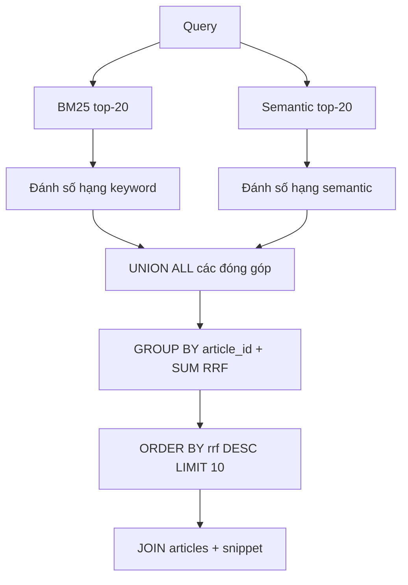

# Bài 09 — Hybrid Search và Reciprocal Rank Fusion (RRF)

**Chủ đề:** PostgreSQL · pg_textsearch · pgvector · Hybrid Search  
**Loại bài:** lesson

## 1. Tóm tắt và mục tiêu

Khi có kết quả keyword và semantic, chúng ta cần kết hợp hai danh sách có **hệ điểm khác nhau**. Không cộng trực tiếp score BM25 âm với vector distance. RRF (Reciprocal Rank Fusion) dùng **vị trí** của một bài trong từng danh sách thay vì so sánh trực tiếp điểm gốc.

## 2. Công thức RRF

Với bài $d$ và các danh sách $L_i$:

$$
\operatorname{RRF}(d)=\sum_i\frac{w_i}{k+\operatorname{rank}_i(d)}
$$

Nếu bài không nằm trong một danh sách thì **không có đóng góp** từ danh sách đó. `k = 60` là hằng làm dịu tác động của khoảng cách thứ hạng, **không phải số lượng kết quả**. Trọng số mặc định demo là `w_keyword = 0.5`, `w_semantic = 0.5`.

Ví dụ không trọng số: bài A xếp #2 ở keyword và #3 ở semantic; bài B chỉ xếp #1 ở keyword.

$$
\begin{aligned}
\operatorname{RRF}(A) &= \frac{1}{62}+\frac{1}{63}\approx 0.0320\\
\operatorname{RRF}(B) &= \frac{1}{61}\approx 0.0164
\end{aligned}
$$

A có thể lên trước B vì nhận bằng chứng từ cả hai danh sách. Với hai trọng số bằng `0.5`, mọi đóng góp đều giảm một nửa, nhưng thứ tự A/B không đổi trong ví dụ này.

## 3. Pipeline hợp nhất

Ở lần đo được mô tả, có 20 + 20 = 40 bản ghi ứng viên và 32 bài khác nhau sau khi nhóm, nghĩa là **8 bài xuất hiện ở cả hai danh sách**. Con số là của một truy vấn thử cụ thể, không phải quy luật cố định.

## 4. Kiến trúc SQL bằng CTE

Sử dụng `WITH` để đặt tên các bước `keyword_candidates`, `semantic_candidates`, `keyword_ranks`, `semantic_ranks`, `contributions`, `combined`. `ROW_NUMBER()` đánh số thứ hạng theo mỗi phương pháp; `UNION ALL` gom đóng góp; `GROUP BY article_id` cộng điểm. Bước cuối `JOIN articles` lấy tiêu đề và snippet cho 10 kết quả đầu.

Vì danh sách ứng viên chỉ có top-20 mỗi bên, **tài liệu đứng ngoài cả hai top-20 không thể xuất hiện trong kết quả lai** dù có thể liên quan. Tăng candidate depth làm tăng độ bao phủ nhưng cũng tăng chi phí. Phải kiểm chứng độ lợi.

## 5. Điều chỉnh trọng số

`semantic_weight = 0.7` tương đương từ khóa `0.3`. Giá trị 0 chuyển về chỉ keyword; 1 tương đương chỉ semantic nếu backend xử lý hợp lý các chế độ biên. Thay đổi trọng số và giữ nguyên tập truy vấn thử, so sánh tài liệu nào được đẩy lên/đẩy xuống. Không giả định 0.7 tốt hơn 0.5 với mọi loại câu hỏi.

## 6. Thực hành

Mở `RRF_demo.py`, chạy danh sách mẫu và thay `semantic_weight` từ 0.5 sang 0.7. Ghi lại sự thay đổi. Sau đó đề xuất một truy vấn kiểu tên riêng và một truy vấn mô tả ý tưởng để thấy lợi ích mỗi nhánh.

## 7. Tổng kết

RRF hợp nhất **thứ hạng**, không trộn score khác thang đo. Chất lượng kết quả phụ thuộc vào hai danh sách nguồn, candidate depth, trọng số và tập dữ liệu đủ điều kiện.

## 8. Câu hỏi ôn tập

### Câu 1

Vì sao không cộng trực tiếp raw BM25 và cosine distance?

A. Vì chúng có thang đo và ý nghĩa khác nhau  
B. Vì PostgreSQL không cộng được số  
C. Vì API không hỗ trợ SELECT  
D. Vì cả hai đều là %  

**Đáp án:** A  
**Giải thích:** Các điểm không nằm trên cùng thang đo nên cộng thẳng dễ vô nghĩa.

### Câu 2

Trong RRF, k=60 là gì?

A. Tổng số bài  
B. Hằng làm dịu ảnh hưởng của rank  
C. Số kết nối  
D. Mốc kiểm thử mặc định  

**Đáp án:** B  
**Giải thích:** k nằm trong mẫu số k+rank, không phải số kết quả.

### Câu 3

A đứng #2 keyword, #3 semantic; B #1 keyword nhưng vắng semantic. Vì sao A có thể cao hơn?

A. Vì A có URL dài  
B. Vì B không có ID  
C. Vì A nhận hai đóng góp RRF  
D. Vì keyword vô giá trị  

**Đáp án:** C  
**Giải thích:** Hai nhánh cùng tìm thấy A và mỗi nhánh đóng góp một phần.

### Câu 4

Top-20 keyword + top-20 semantic có thể đưa bài ngoài cả hai top-20 vào RRF?

A. Có, tự sinh bài mới  
B. Có, nếu b=0  
C. Có, do DB JOIN  
D. Không, vì nó không nằm trong tập ứng viên  

**Đáp án:** D  
**Giải thích:** RRF chỉ xếp hạng lại các ứng viên đã được lấy.

### Câu 5

Khi tăng semantic_weight từ .5 lên .7, thay đổi gì?

A. Tăng đóng góp nhánh semantic so với keyword  
B. Tăng số chiều vector  
C. Tự động thêm 100.000 bài  
D. Bắt buộc đổi metric  

**Đáp án:** A  
**Giải thích:** Trọng số đổi ảnh hưởng tương đối của hai danh sách trong RRF.
