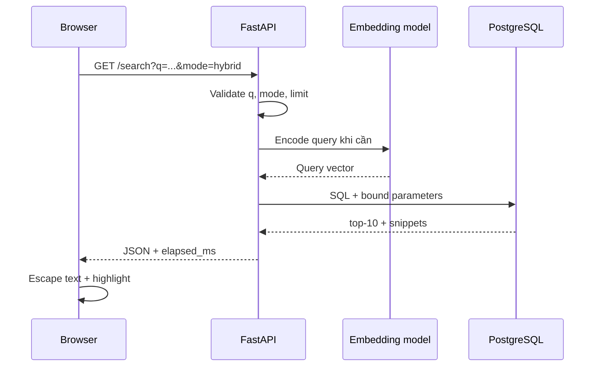

# Bài 10 — FastAPI, tham số truy vấn và giao diện web

**Chủ đề:** PostgreSQL · pg_textsearch · pgvector · Hybrid Search  
**Loại bài:** lab

## 1. Tổng quan

Bài này nối các truy vấn SQL với giao diện qua API Python dùng **FastAPI**. Ứng dụng nhận văn bản tìm kiếm, `mode` và số lượng kết quả; chọn SQL thích hợp; tạo embedding ở chế độ semantic/hybrid; trả dữ liệu JSON và thời gian thực hiện.

## 2. Sơ đồ luồng yêu cầu



`mode` giới hạn trong `keyword`, `semantic`, `hybrid`; không cho phép user tự chỉ định tên SQL file hay cấu trúc truy vấn. Backend lập mapping mode → câu SQL cố định. Trình điều khiển PostgreSQL truyền giá trị qua binding để dấu nháy, nội dung user và chuỗi lạ không trở thành cú pháp SQL.

## 3. Ví dụ thiết kế API

Bảng contract minh họa (tên field là gợi ý thiết kế, không phải cam kết 1:1 về JSON của một repository cụ thể):

| Endpoint | Tham số | Mục đích |
| --- | --- | --- |
| `GET /search` | `q`, `mode`, `limit` | Tìm bài viết theo chế độ |
| `GET /health` | Không | Kiểm tra tình trạng dịch vụ/cấu hình |
| `POST /articles` | `title`, `body`, `url` | Thêm bài qua quyền quản trị |

Ví dụ ngắn về validation với FastAPI:

```python
from enum import Enum
from fastapi import FastAPI, Query

app = FastAPI()
class Mode(str, Enum):
    keyword = 'keyword'
    semantic = 'semantic'
    hybrid = 'hybrid'

@app.get('/search')
def search(q: str = Query(min_length=1, max_length=300),
           mode: Mode = Mode.hybrid,
           limit: int = Query(10, ge=1, le=50)):
    # Đấu nối logic truy vấn DB / embedding trong project thật.
    return {'query': q, 'mode': mode, 'limit': limit, 'results': []}
```

Đoạn này minh họa kiểm tra input và contract; **chưa phải API tìm kiếm hoàn chỉnh**. Đừng trình bày kết quả rỗng mẫu như kết quả thật của PostgreSQL.

## 4. Connection pool và đo thời gian

Mỗi request cần kết nối DB. Dùng pool để tái sử dụng kết nối thay vì tạo kết nối mới liên tục; trong demo pool tối đa **4 kết nối**. Đặt statement timeout để tránh truy vấn chạy vô hạn. Model embedding cũng nên được tải một lần và dùng lại, không khởi tạo cho mỗi request.

Phân biệt:

- **DB execution time:** báo bởi `EXPLAIN (ANALYZE, BUFFERS)`, không tính việc Python mã hóa query.
- **API elapsed time:** bao gồm validation, embedding nếu cần, giao tiếp DB và xử lý kết quả, không nhất thiết gồm network/render ở client.

Một lần đo hybrid trong SQL được mô tả khoảng **71 ms** không thể được xem là latency end-to-end và không phải benchmark phổ quát.

## 5. Kiểm thử và giao diện

Thử ba chế độ với cùng văn bản. Giao diện nên hiển thị tổng số bài được keyword index và tổng số embedding riêng để người học không hiểu nhầm các phạm vi. Dùng snippet có escape và cho phép mở URL nguồn, kèm ghi công/giấy phép phù hợp với dữ liệu Wikipedia.

## 6. Deliverable và checklist

- [ ] Có contract `GET /search` cho ba chế độ
- [ ] Input được validate và bind SQL
- [ ] Model được cache/tái sử dụng
- [ ] Có pool kết nối và timeout
- [ ] Giao diện hiện title, snippet, nguồn và mode
- [ ] Hiển thị/ghi log độ trễ API riêng với SQL

## 7. Câu hỏi ôn tập

### Câu 1

API semantic cần bước nào mà keyword có thể bỏ qua?

A. Tải CSS  
B. Encode query thành embedding  
C. Đổi table name theo user  
D. Xóa index  

**Đáp án:** B  
**Giải thích:** Semantic/hybrid cần query vector từ embedding model.

### Câu 2

Cách xử lý user query SQL an toàn?

A. Nối trực tiếp vào chuỗi SQL  
B. Cho user chọn table SQL  
C. Dùng binding tham số  
D. Bỏ validation  

**Đáp án:** C  
**Giải thích:** Binding truyền query text như dữ liệu, giảm nguy cơ SQL injection.

### Câu 3

Vì sao dùng connection pool?

A. Tái sử dụng kết nối  
B. Thay thế truy vấn  
C. Mã hóa model nhanh hơn  
D. Xóa dữ liệu cũ  

**Đáp án:** A  
**Giải thích:** Pool tránh mở kết nối mới cho từng yêu cầu.

### Câu 4

Một con số EXPLAIN 71 ms có bao gồm query embedding trong Python không?

A. Có, tất cả  
B. Có, gồm render browser  
C. Có, gồm tải ảnh  
D. Không, chỉ đo phạm vi truy vấn DB  

**Đáp án:** D  
**Giải thích:** EXPLAIN không đo giai đoạn mã hóa câu hỏi bên Python.

### Câu 5

Cách render snippet được ưu tiên?

A. Bơm raw text vào innerHTML  
B. Escape text và tạo highlight node an toàn  
C. Cho HTML user chạy  
D. Không cần xử lý  

**Đáp án:** B  
**Giải thích:** Nội dung không tin cậy phải được escape trước khi hiển thị.
