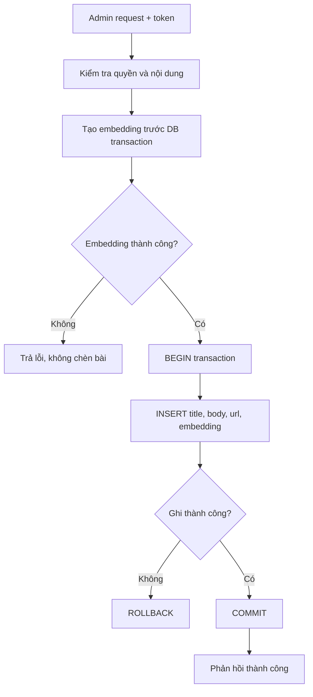

# Bài 11 — Thêm bài mới, giao dịch nhất quán và bảo mật

**Chủ đề:** PostgreSQL · pg_textsearch · pgvector · Hybrid Search  
**Loại bài:** lab

## 1. Tổng quan

Wiki Search không chỉ đọc bài viết. Ứng dụng có thể chèn bài demo mới sao cho bài xuất hiện trong cả keyword, semantic và hybrid ngay sau khi ghi thành công. Bài thực hành tập trung vào token quản trị, tính nhất quán của văn bản và vector, và các trường hợp thất bại.

## 2. Luồng chèn bài

Tạo embedding trước khi mở transaction giúp không giữ một giao dịch ghi DB mở quá lâu trong lúc model xử lý. Tuy nhiên vector được tạo từ **chính nội dung cuối cùng** chuẩn bị ghi. Sau đó văn bản và vector được chèn trong cùng giao dịch. Chỉ báo thành công sau `COMMIT`.

## 3. Quy tắc an toàn

- **Token quản trị** nằm trong biến môi trường, không ghi cứng vào source, log hoặc ví dụ curl công khai.
- SQL ghi dữ liệu phải dùng binding, không ghép chuỗi.
- Validate URL, title, body, giới hạn độ dài, kích thước request và quyền của caller.
- Nếu model embedding thất bại thì không thêm bài “chỉ có text” khi yêu cầu sản phẩm là hiển thị đủ ba mode.
- Trong production, cần tính đến update/delete: vector phải được tính lại khi text thay đổi, hoặc có pipeline đánh dấu stale và sửa đồng bộ.

## 4. Ghi và thử lại

Nếu API timeout sau khi DB đã commit, client có thể không biết bài đã được tạo hay chưa; thử lại có thể sinh bản ghi trùng nếu ID sinh mới. Một thiết kế production có thể dùng idempotency key/unique business key để nhận biết yêu cầu lặp. Đây là mở rộng có chủ đích so với demo chèn bài cơ bản.

## 5. Kiểm tra kết quả

Sau khi gửi yêu cầu thành công, thực hiện một truy vấn đủ đặc trưng cho bài mới trong ba chế độ. Kiểm tra liệu bài có `embedding IS NOT NULL`, và các chỉ mục cập nhật theo transaction hay không. Nếu keyword tìm thấy nhưng semantic không có kết quả, kiểm tra pipeline tạo/gán vector, quyền sử dụng model, và metric.

## 6. Tình huống debug

| Lỗi | Cách kiểm tra |
| --- | --- |
| 401/403 | Token và chính sách xác thực |
| Embedding thất bại | Không có bài insert; log lỗi model ở server |
| DB thất bại | Rollback, không báo thành công |
| Bài chỉ có keyword | Kiểm tra vector và chỉ mục semantic |
| Nội dung nhập chứa HTML | Escape khi render snippet |

## 7. Deliverable

Thiết kế một endpoint thêm bài có authentication, đường xử lý embedding, transaction và ít nhất ba tình huống kiểm thử: thành công; embedding lỗi; DB ghi lỗi. Ghi lại bằng chứng rằng trường hợp lỗi không tạo bài mới dở dang.

## 8. Câu hỏi ôn tập

### Câu 1

Thứ tự thích hợp để tránh giữ transaction khi model đang encode?

A. Mở transaction rồi chờ model vô hạn  
B. Sinh embedding trước, rồi mở transaction ghi cả text/vector  
C. Chèn text và không cần vector  
D. Ghi nhận thành công trước commit  

**Đáp án:** B  
**Giải thích:** Tạo vector trước khi ghi giúp rút ngắn thời gian transaction và đảm bảo đủ dữ liệu.

### Câu 2

Khi tạo embedding thất bại trước transaction, API nên?

A. Chèn bài chỉ có text  
B. Bỏ qua lỗi  
C. Trả lỗi và không chèn bài  
D. Báo thành công  

**Đáp án:** C  
**Giải thích:** Nếu mục tiêu là ba chế độ đều truy xuất được thì không để bản ghi thiếu vector.

### Câu 3

Khi nào có thể báo insert thành công?

A. Sau khi COMMIT thành công  
B. Ngay khi nhận request  
C. Khi có token bất kỳ  
D. Ngay khi model được tải  

**Đáp án:** A  
**Giải thích:** Commit thành công là mốc DB đã xác nhận ghi.

### Câu 4

Token admin nên được đặt ở đâu?

A. URL công khai  
B. HTML trả về  
C. Ghi trong readme thật  
D. Biến môi trường bí mật  

**Đáp án:** D  
**Giải thích:** Không được tiết lộ token ở code/log/trình duyệt.

### Câu 5

Nếu cập nhật body mà không cập nhật embedding?

A. Luôn tăng relevance  
B. Vector có thể bị stale so với văn bản  
C. Chắc chắn không ảnh hưởng semantic  
D. Giao diện tự sửa DB  

**Đáp án:** B  
**Giải thích:** Semantic index cần phản ánh cùng phiên bản nội dung được lưu.
