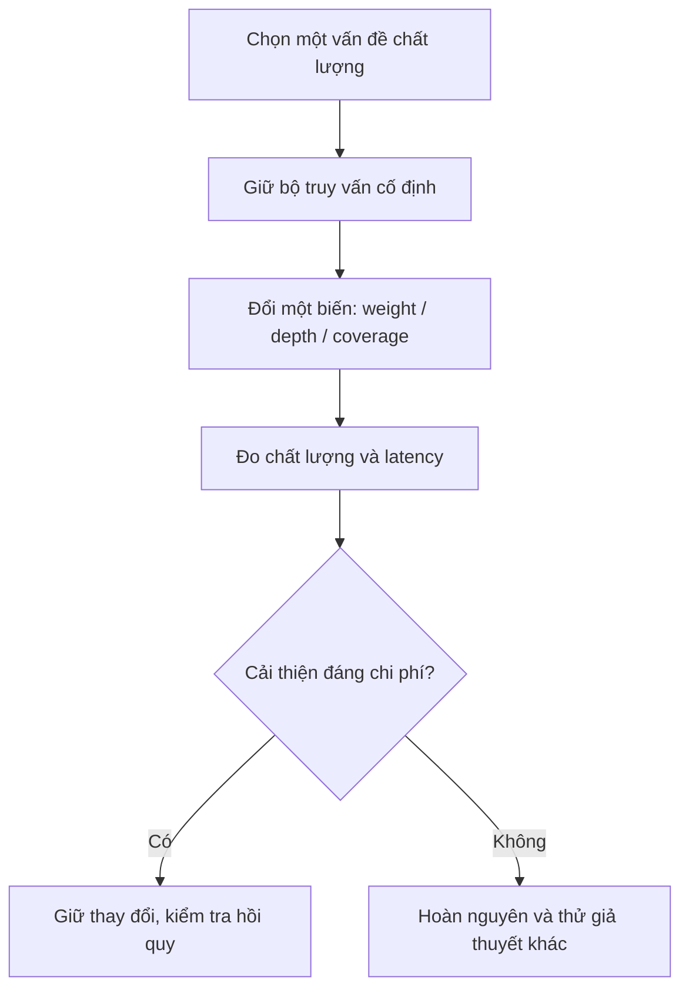

# Bài 12 — Đánh giá chất lượng, hiệu năng và hướng mở rộng

**Chủ đề:** PostgreSQL · pg_textsearch · pgvector · Hybrid Search  
**Loại bài:** review

## 1. Tóm tắt và mục tiêu

Ứng dụng chạy được không có nghĩa hệ thống tìm kiếm đã cho kết quả tốt. Bài cuối hướng dẫn so sánh **keyword**, **semantic** và **hybrid** theo chất lượng kết quả, độ bao phủ, latency và tính nhất quán khi cập nhật. Người học sẽ lập kế hoạch thí nghiệm có thể lặp lại.

## 2. Bộ truy vấn kiểm thử

| Query | Điều muốn kiểm tra |
| --- | --- |
| `Apollo 13` | Tên riêng, nhiệm vụ cụ thể, tránh nhầm thực thể |
| `animals that produce their own light` | Khả năng hiểu ý tưởng/bioluminescence |
| `jazz trumpet New Orleans` | Cụm từ, liên hệ chủ đề và đối chiếu keyword |
| `volcano eruption ash aviation` | Điều kiện nhiều thuật ngữ, AND/OR, ranking |
| `plants that eat insects` | Truy vấn mô tả thay vì tên khoa học |

Giữ nguyên tập query khi điều chỉnh trọng số và candidate depth. Đọc title, snippet và bài nguồn để đánh giá, không chỉ nhìn score.

## 3. Công bằng trong so sánh

Keyword index bao phủ khoảng **241.787** bài, semantic index khoảng **25.000–25.002** bài. Điều này làm cho phép so sánh chất lượng chưa công bằng về recall. Có hai cách: (a) chỉ so sánh trên **tập giao** của hai hệ thống; hoặc (b) tạo vector cho cả tập nếu nguồn lực cho phép.

Các bài không được embed không thể nhận điểm RRF từ nhánh semantic. Một thay đổi hybrid có thể làm một bài tốt lên hoặc xuống, không thể kết luận lai luôn tốt hơn.

## 4. Đo lường nhiều chiều

| Nhóm đo | Câu hỏi | Gợi ý |
| --- | --- | --- |
| Quality | Top-10 có hữu ích? | Đánh nhãn relevance, xem nDCG@10/Recall@10 khi đủ ground truth |
| Coverage | Bao nhiêu bài có thể truy xuất? | Đếm toàn bộ và số embedding |
| SQL latency | DB thực thi bao lâu? | `EXPLAIN (ANALYZE, BUFFERS)` |
| API latency | Người dùng đợi bao lâu phía server? | Timer bao gồm embedding và DB |
| Consistency | Insert/update khi search có nhất quán? | Test sau commit và khi tải đồng thời |
| Operations | Index build/ingest tốn bao nhiêu? | Ghi tài nguyên và thời gian |

Các chỉ số nDCG/Recall là **gợi ý mở rộng để tự đánh giá**, không phải phép đo đã có sẵn trong demo.

## 5. Cẩn trọng với benchmark công bố

Ví dụ benchmark quy mô khoảng **138 triệu đoạn văn** so sánh các phiên bản sản phẩm khác nhau trong điều kiện cache/thiết lập nhất định. Kết quả của nhà cung cấp không tương đương phép đo ứng dụng này, cũng không khẳng định `pg_textsearch` phiên bản mục tiêu luôn thắng đối thủ. Hãy đo trên dữ liệu và query của chính sản phẩm.

## 6. Kế hoạch cải tiến từng bước

Các hướng cải tiến phù hợp gồm: mở rộng embedding coverage; chia văn bản dài thành chunks; hỗ trợ lỗi chính tả; thêm reranker để đánh giá sâu một tập kết quả nhỏ; cache có kiểm soát; giám sát tải search song song với update. Mỗi hướng làm thay đổi trade-off cần kiểm tra lại.

## 7. Bài đánh giá cuối

Viết một báo cáo tối đa 2 trang cho 5 query kiểm thử: mỗi query chọn top-3 của ba chế độ, nhận xét vì sao bài đứng đầu đúng/sai, thống kê vùng dữ liệu được bao phủ, báo độ trễ SQL/API và đề xuất **một** cải tiến có giả thuyết rõ ràng.

## 8. Tổng kết

Không có thuật toán tìm kiếm tốt nhất cho mọi truy vấn. Giá trị hệ thống đến từ tập dữ liệu đúng, chỉ mục phù hợp, kết quả liên quan và phép đo trung thực, có thể lặp lại.

## 9. Câu hỏi ôn tập

### Câu 1

Vì sao cần dùng cùng tập bài khi so keyword và semantic?

A. Để so sánh chất lượng trên độ bao phủ tương đương  
B. Để xóa các bài ngắn  
C. Để tránh LIMIT  
D. Vì SQL yêu cầu  

**Đáp án:** A  
**Giải thích:** Khác coverage là biến nhiễu khi đánh giá recall và thứ hạng.

### Câu 2

Để kiểm tra một thay đổi weight có tốt hơn, nên?

A. Đổi luôn model, depth và corpus  
B. Giữ bộ truy vấn và các yếu tố khác ổn định  
C. Chỉ nhìn điểm BM25 thô  
D. Chỉ đo một truy vấn bất kỳ  

**Đáp án:** B  
**Giải thích:** Thử một biến mỗi lần giúp quy nguyên nhân thay đổi kết quả.

### Câu 3

Đo latency API khác DB latency vì?

A. API không liên quan DB  
B. DB latency luôn lớn hơn API  
C. API có thể gồm cả embedding và xử lý Python  
D. API chỉ tính CSS  

**Đáp án:** C  
**Giải thích:** Timer API bao gồm các bước ngoài SQL.

### Câu 4

Benchmark 138 triệu đoạn văn của nhà cung cấp nên được diễn giải như?

A. Bảo đảm mọi app nhanh hơn  
B. Chính là thời gian hiện tại  
C. Đại diện mọi bản PostgreSQL  
D. Kết quả của một cấu hình/thí nghiệm cụ thể  

**Đáp án:** D  
**Giải thích:** Số đo có ý nghĩa trong bối cảnh dataset, phiên bản, cache và phần cứng của thí nghiệm.

### Câu 5

Khi truy vấn bị lỗi chính tả thường xuyên, mở rộng nào phù hợp nhất để cân nhắc?

A. Thêm cơ chế typo tolerance  
B. Bỏ mọi validation  
C. Tắt index  
D. Giảm toàn bộ tài liệu xuống 1  

**Đáp án:** A  
**Giải thích:** Keyword và semantic không tự bảo đảm giải quyết mọi lỗi chính tả.
