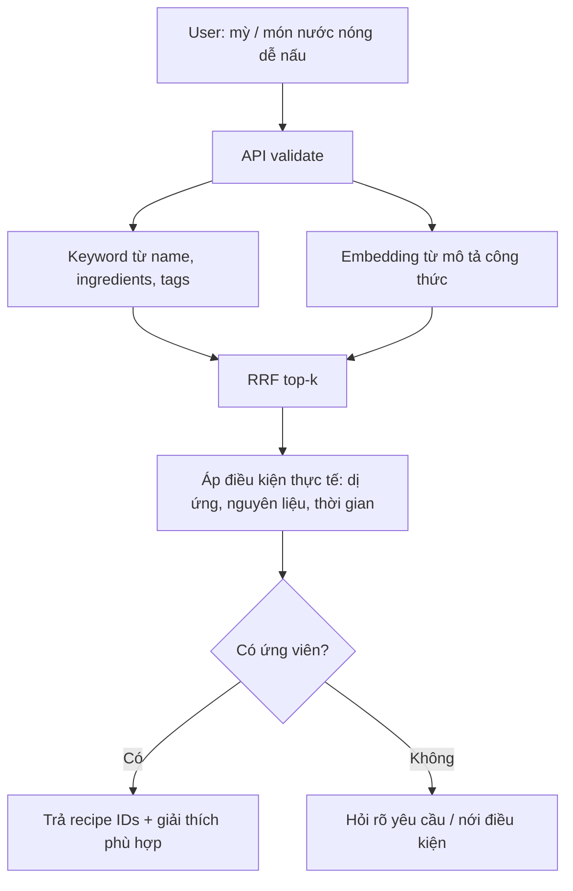

# Bài 14 — Đồ án ứng dụng: tìm món ăn bằng từ khóa và ý nghĩa

## 1. Bài toán

Một ứng dụng có database công thức nấu ăn. Người dùng có thể gõ **“mỳ”** để tìm món chứa mỳ, hoặc mô tả **“món nước nóng, dễ nấu, không cay”** dù không nhớ tên món. Nhiệm vụ là áp dụng nguyên lý keyword + semantic + RRF để đề xuất món từ **bản ghi có thật trong database**, không sinh ra món giả rồi giả làm dữ liệu đã lưu.

Đây là bài tập mở rộng từ kiến trúc Wiki Search; công thức/số liệu trong phần thiết kế là ví dụ dành cho người học, không phải dataset gốc.

## 2. Mục tiêu sản phẩm

- Tìm chính xác tên món và nguyên liệu bằng keyword/FTS hoặc BM25.
- Tìm ý tưởng bằng embedding khi người dùng mô tả nhu cầu.
- Hợp nhất hai danh sách bằng RRF có cấu hình trọng số.
- Nếu không có món phù hợp, API trả `results: []` và có thể **đề xuất câu hỏi làm rõ** (như nguyên liệu sẵn có, thời gian nấu, sở thích vị) ở tầng ứng dụng; không ghi món mới khi chưa có hành động rõ ràng.
- Có provenance: mỗi kết quả trỏ đến ID công thức thật.

## 3. Lược đồ dữ liệu gợi ý

```sql
CREATE TABLE recipes (
  id BIGSERIAL PRIMARY KEY,
  name TEXT NOT NULL,
  ingredients TEXT NOT NULL,
  instructions TEXT NOT NULL,
  tags TEXT NOT NULL DEFAULT '',
  prep_minutes INTEGER
);
```

Không cần tạo thêm bảng nếu database đã có quan hệ món–nguyên liệu chuẩn hóa; thay vì nối toàn bộ dữ liệu trong runtime mỗi request, có thể xây search_text duy trì theo pipeline riêng. Schema trên chỉ là bản tối thiểu để làm đồ án.

## 4. Kiến trúc đề xuất



Lưu ý: các tiêu chí về dị ứng phải được xử lý bằng điều kiện dữ liệu có cấu trúc và kiểm chứng phù hợp, không dựa hoàn toàn vào mô hình embedding hay một câu trả lời suy đoán.

## 5. Milestone

| Mốc | Kết quả cần đạt |
| --- | --- |
| 1 | Import tối thiểu một tập recipe có ID thật |
| 2 | Query `mỳ` khớp tên món hoặc nguyên liệu có trong DB |
| 3 | Tạo embedding cho phần mô tả, có version model |
| 4 | RRF cho keyword/semantic và thống kê coverage |
| 5 | API trả kết quả cùng ID, không bịa công thức |
| 6 | Kịch bản không có kết quả dẫn tới một câu hỏi làm rõ |

## 6. Kiểm thử

Thử `mỳ`, `món ăn có trứng và cà chua`, `món nước nóng không cay`, một tên món cụ thể và một yêu cầu không thể đáp ứng. Ghi nhận top-5, phần giải thích dựa trên trường dữ liệu thực, thời gian tìm kiếm và trường hợp semantic đưa món sai.

## 7. Definition of Done

- [ ] Tất cả món trả về tồn tại trong `recipes`
- [ ] Cả keyword và semantic có phạm vi dữ liệu được công bố
- [ ] Đã thử query tiếng Việt và các cách viết khác nhau
- [ ] RRF không cộng score BM25 và distance thô
- [ ] Có ca không kết quả và hỏi thêm hợp lý
- [ ] Có kiểm thử input, SQL binding và escape output

## 8. Gợi ý mở rộng

Chỉ khi đã có search chính xác, mới cân nhắc thêm chatbot hội thoại và chức năng **tạo công thức mới**. Khi sinh món mới, cần phân biệt bản đề xuất do mô hình tạo với bản ghi recipe thật, yêu cầu user xác nhận trước khi lưu DB.
