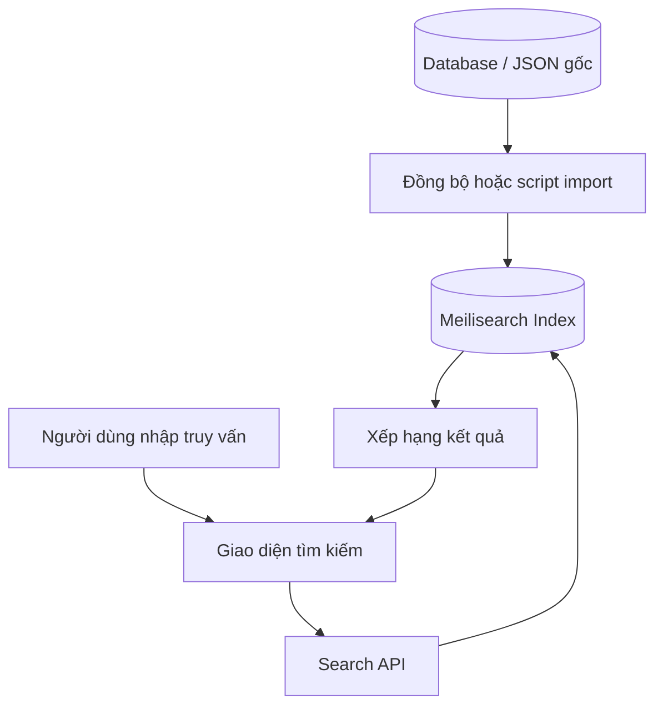

# Bài 01 — Tư duy tìm kiếm và kiến trúc Meilisearch

> **Loại:** Lesson · **Chủ đề:** Full-text search, index, document, ranking.

## 1. Tóm tắt

Khi lượng dữ liệu tăng, một ô tìm kiếm hữu ích không chỉ kiểm tra chuỗi ký tự có giống hệt nhau hay không. Người dùng thường nhập một phần tên, gõ thiếu dấu, viết sai một vài chữ hoặc muốn tìm bằng nội dung mô tả. Meilisearch là công cụ tìm kiếm mã nguồn mở, được xây dựng để đưa kết quả phù hợp đến ứng dụng qua một API.

## 2. Mục tiêu học tập

Sau bài học, người học có thể:

- Giải thích sự khác nhau giữa nguồn dữ liệu nghiệp vụ và chỉ mục tìm kiếm.
- Phân biệt `document`, `index`, `query`, `hit` và `ranking`.
- Vẽ được luồng dữ liệu khi nhập mới và khi người dùng tìm kiếm.
- Mô tả được điểm mạnh cũng như giới hạn của tìm kiếm có khả năng dung sai lỗi gõ.

## 3. Vấn đề: vì sao `LIKE` không phải lúc nào cũng đủ?

Giả sử ứng dụng lưu 20.000 món ăn. Người dùng gõ `mì`, mong nhìn thấy "Mì xào trứng", "Mì gà nước" và "Mì trộn rau". Một câu truy vấn `LIKE '%mì%'` đơn giản có thể giải quyết một phần bài toán, nhưng dự án còn cần phản hồi nhanh khi người dùng đang gõ, ưu tiên khớp tên trước khớp mô tả, chấp nhận những sai sót phổ biến và phân trang hợp lý.

Meilisearch hỗ trợ các hành vi tìm kiếm này thông qua cấu trúc chỉ mục và bộ quy tắc xếp hạng mặc định. Nó không phải mô hình ngôn ngữ hiểu được mọi ý định, vì vậy truy vấn mơ hồ hoặc câu hỏi nhiều ràng buộc vẫn cần thiết kế dữ liệu, bộ lọc hoặc tầng xử lý khác.

## 4. Thành phần và thuật ngữ

| Thuật ngữ | Ý nghĩa | Ví dụ |
| --- | --- | --- |
| `document` | Một đối tượng JSON có các trường dữ liệu | Một phim `{id, title, overview}` |
| `index` | Tập tài liệu được lập chỉ mục để tìm kiếm | `movies` hoặc `recipes` |
| `primary key` | Trường nhận diện duy nhất một tài liệu | `id` |
| `query` | Văn bản người dùng nhập | `space`, `mì` |
| `hit` | Một tài liệu được trả về và khớp truy vấn | `Space Adventure` |
| `ranking` | Cách sắp thứ tự kết quả | Khớp title thường có thể được ưu tiên hơn overview khi cấu hình |
| `typo tolerance` | Dung sai với một số lỗi đánh máy | Gõ sai một chữ của từ đủ dài |
| `prefix search` | Khớp theo phần đầu của từ | `spa` → `space` (tùy dữ liệu/cài đặt) |

## 5. Kiến trúc hai luồng



Mũi tên từ database sang index là **luồng ghi dữ liệu**: khi nội dung thay đổi, hệ thống cần cập nhật tài liệu tìm kiếm. Những mũi tên từ giao diện qua Search API là **luồng đọc**. Với dữ liệu thật, database thường tiếp tục giữ vai trò nguồn sự thật; Meilisearch tạo bản sao phục vụ tra cứu.

### 5.1. Cách Meilisearch tìm nội dung

1. Nhận truy vấn từ API hoặc SDK.
2. Chuẩn hóa/tách thành các đơn vị từ phù hợp với ngôn ngữ.
3. Đối chiếu các tài liệu đã được lập chỉ mục, áp dụng luật matching và dung sai lỗi nếu phù hợp.
4. Sắp xếp kết quả theo độ liên quan, trả về `hits` cùng metadata.

### 5.2. Khi nào dùng dịch vụ tìm kiếm riêng?

Tìm kiếm theo tên và mô tả với dữ liệu vừa, cần trải nghiệm cập nhật liên tục, là tình huống phù hợp để đánh giá Meilisearch. Nếu chỉ có vài chục dữ liệu ít thay đổi, tìm trực tiếp trong database có thể đơn giản và đủ dùng. Nếu muốn trả lời như một AI Agent biết hỏi thêm về khẩu vị, Meilisearch chỉ là một thành phần truy xuất, không đảm nhiệm toàn bộ hội thoại.

## 6. Ví dụ: tìm phim và tìm món ăn

Cùng một kiến trúc có thể vận hành hai index:

```json
{"id": 1, "title": "Space Adventure", "overview": "Một nhóm phi hành gia khám phá hành tinh bí ẩn"}
```

```json
{"id": 101, "title": "Mì xào trứng", "overview": "Mì xào cùng trứng và rau", "ingredients": ["mì", "trứng", "rau"]}
```

Trong ví dụ phim, người dùng nhập `space`. Trong ví dụ món ăn, người dùng nhập `trứng`. Khi cấu hình `ingredients` là trường tìm kiếm, truy vấn `trứng` có thể tìm thấy món có nguyên liệu trứng dù tên món không chứa từ đó.

## 7. Điểm dễ hiểu sai

- **Tìm kiếm tức thì không có nghĩa là mọi truy vấn luôn chạy trong một số mili giây cố định.** Độ trễ phụ thuộc hạ tầng, lượng dữ liệu, cấu hình và mạng.
- **Typo tolerance không chữa được mọi kiểu gõ sai.** Ngưỡng dung sai và số lỗi tối đa phụ thuộc độ dài từ và cấu hình.
- **Index không tự biết khi database đổi.** Cần quy trình đồng bộ như job, queue, change stream hoặc cập nhật qua backend.
- **Không dùng khóa quản trị ở frontend.** Trình duyệt không che giấu được API key.

## 8. Thực hành ngắn

Vẽ sơ đồ cho một ứng dụng quản lý 1.000 công thức nấu ăn. Hãy xác định dữ liệu nào thuộc database, dữ liệu nào nên sao chép vào index `recipes`, và người dùng sẽ nhìn thấy gì khi gõ `bún`. Nêu hai trường nên cho phép tìm kiếm và một trường chỉ nên dùng làm bộ lọc.

## 9. Câu hỏi ôn tập

**Câu 1.** `index` trong Meilisearch là gì?

A. Một bảng HTML hiển thị kết quả.  
B. Một máy chủ SMTP.  
C. Tập tài liệu được chuẩn bị để phục vụ tìm kiếm.  
D. Danh sách tài khoản người dùng.

**Đáp án:** C. **Giải thích:** Index tổ chức tài liệu đã nhập để công cụ có thể đối chiếu truy vấn hiệu quả.

**Câu 2.** Người dùng chỉ mới nhập `spa` nhưng muốn thấy tài liệu có từ `space`. Tính năng nào liên quan trực tiếp nhất?

A. Prefix search.  
B. Role-based authorization.  
C. SQL transaction.  
D. File compression.

**Đáp án:** A. **Giải thích:** Prefix search hỗ trợ khớp phần đầu của từ khi dữ liệu và cài đặt cho phép.

**Câu 3.** Ứng dụng sửa tên món ăn trong database. Tìm kiếm sẽ tự thấy tên mới khi nào?

A. Sau khi đổi CSS.  
B. Khi cập nhật/sync tài liệu tương ứng vào index.  
C. Sau khi người dùng đổi mật khẩu.  
D. Không bao giờ cập nhật được.

**Đáp án:** B. **Giải thích:** Index là lớp truy xuất riêng nên cần đồng bộ thay đổi dữ liệu.

**Câu 4.** Meilisearch có thay thế toàn bộ database nghiệp vụ không?

A. Có, luôn luôn.  
B. Có, nếu dữ liệu là JSON.  
C. Có, nhưng chỉ trong trình duyệt.  
D. Không; nó thường đóng vai trò tầng tìm kiếm chuyên dụng.

**Đáp án:** D. **Giải thích:** Database vẫn quản lý nguồn dữ liệu, giao dịch, quan hệ và nhiều logic nghiệp vụ khác.

**Câu 5.** Ứng dụng muốn hỏi người dùng thêm về khẩu vị khi không tìm được món. Cách hiểu nào hợp lý?

A. Typo tolerance tự hỏi thêm câu hỏi.  
B. Meilisearch bắt buộc có mô hình LLM đi kèm.  
C. Meilisearch tìm ứng viên; logic hội thoại cần được phát triển riêng.  
D. Chỉ cần đặt tên index là `agent`.

**Đáp án:** C. **Giải thích:** Hệ thống gợi ý qua hội thoại cần lớp xác định ý định/hỏi lại bên ngoài Search API.

## 10. Tổng kết

Meilisearch giúp xây dựng trải nghiệm tìm kiếm theo từng lần gõ, tổ chức dữ liệu qua index và truy vấn qua Search API. Hãy nắm chắc `document → index → query → hits` trước khi viết mã.
