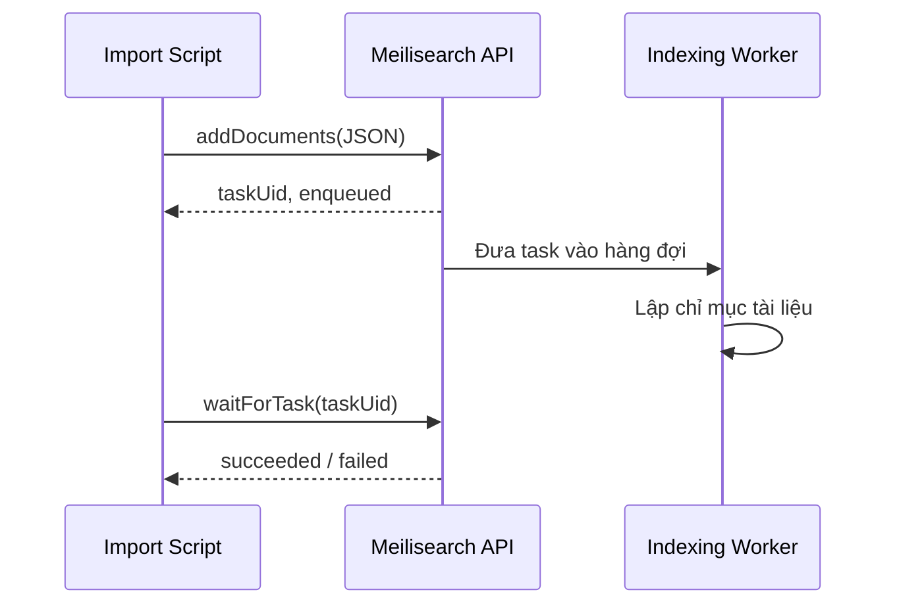

# Bài 03 — Thiết kế tài liệu, lập chỉ mục và nhập JSON

> **Loại:** Lab · **Chủ đề:** JSON, JavaScript SDK, `addDocuments()`, tasks.

## 1. Tổng quan

Một giao diện tìm kiếm không thể trả về kết quả nếu index chưa có tài liệu. Bước nhập dữ liệu gồm hai việc: chuẩn bị các đối tượng JSON với trường khóa chính ổn định, sau đó gửi dữ liệu qua Meilisearch JavaScript SDK. Thao tác nhập tài liệu là **bất đồng bộ**: API thường xác nhận đã đưa tác vụ vào hàng đợi trước khi việc lập chỉ mục hoàn thành.

## 2. Mục tiêu

- Thiết kế được tài liệu phim với `id`, `title`, `overview` và `genres`.
- Nạp tài liệu JSON qua `Meilisearch` client và `index.addDocuments()`.
- Theo dõi `taskUid` đến khi trạng thái hoàn tất.
- Tự kiểm tra tên index, khóa chính và dữ liệu trước khi dựng UI.

## 3. Cấu trúc một document

```json
{
  "id": 1,
  "title": "Space Adventure",
  "overview": "Một nhóm phi hành gia khám phá hành tinh bí ẩn",
  "genres": ["Science Fiction", "Adventure"],
  "releaseYear": 2021
}
```

`id` là định danh duy nhất. `title` chứa tên hiển thị, `overview` là mô tả ngắn; `genres` và `releaseYear` có thể được dùng cho lọc. Một index `movies` chứa nhiều tài liệu có cấu trúc tương tự. Tên trường phải nhất quán giữa JSON, cấu hình index và template UI; dùng `description` trong template khi JSON chỉ có `overview` sẽ hiển thị sai hoặc thiếu dữ liệu.

### 3.1. Dữ liệu cần và không cần trong index

Dữ liệu phục vụ tìm kiếm hoặc hiển thị nên có mặt trong index. Các bí mật, khóa quản trị hoặc dữ liệu người dùng chưa được phép hiển thị không nên đưa vào chỉ mục công khai. Đối với ứng dụng thật, tài liệu có thể chỉ chứa ID, tên, mô tả và thẻ phân loại; khi mở chi tiết, backend tải bản đầy đủ từ database.

### 3.2. Chọn primary key

`primaryKey: 'id'` yêu cầu từng tài liệu có trường `id` hợp lệ. Khi nhập lại một tài liệu có cùng ID, nó được cập nhật thay vì tạo thêm tài liệu hoàn toàn độc lập. Hãy tránh ID thay đổi theo mỗi lần đồng bộ nếu muốn hệ thống cập nhật chính xác.

## 4. Tạo dự án JavaScript

Mở terminal trong `du-an/`:

```bash
npm install
```

Tệp `package.json` đã khai báo gói `meilisearch`. Điền cấu hình server trong `.env` trước khi chạy. Với dự án tự viết, mẫu kết nối cơ bản là:

```javascript
import { Meilisearch } from 'meilisearch';

const client = new Meilisearch({
  host: process.env.MEILI_HOST,
  apiKey: process.env.MEILI_ADMIN_KEY,
});
const index = client.index('movies');
```

Dùng `MEILI_ADMIN_KEY` trên Node.js, không chuyển script này sang frontend. Mã mẫu đi kèm khóa học là `du-an/scripts/import.mjs`.

## 5. Nhập JSON và đợi task

```javascript
const documents = [
  { id: 1, title: 'Space Adventure', overview: 'Phim phiêu lưu không gian' },
  { id: 2, title: 'Ocean Pirates', overview: 'Phiêu lưu trên biển' },
];

const task = await index.addDocuments(documents);
console.log(task.taskUid);

const done = await client.waitForTask(task.taskUid, { timeout: 60000 });
if (done.status !== 'succeeded') {
  throw new Error(`Indexing failed: ${JSON.stringify(done.error)}`);
}
```

Điểm quan trọng: `addDocuments()` gửi yêu cầu và trả về **thông tin tác vụ** (`taskUid`). Không nên thông báo nhập thành công chỉ vì nhận được `taskUid`; cần kiểm tra trạng thái cuối. Khi số dữ liệu lớn, nhiệm vụ có thể mất thời gian tùy điều kiện thực tế.

### 5.1. Luồng nhập bất đồng bộ



Sơ đồ cho thấy vì sao nút nhập thành công và việc dữ liệu xuất hiện trong index không nhất thiết diễn ra cùng thời điểm.

## 6. Chạy import hoàn chỉnh

```bash
npm run import:movies
```

Script đi kèm thực hiện: kiểm tra biến môi trường → đọc `movies.json` → tạo index với `id` nếu chưa có → cấu hình trường searchable/filterable → gửi tài liệu → đợi task hoàn tất. Mã mẫu cấu hình **trước khi nạp dữ liệu** để giảm chi phí lập chỉ mục lại khi tập dữ liệu lớn.

Tiếp theo, thử:

```bash
npm run search -- "space"
```

Kết quả kỳ vọng: bảng chứa `Space Adventure` trong số các mục phù hợp. Mở dashboard và chọn index `movies` để quan sát tài liệu, trạng thái indexing và công cụ thử tìm kiếm có sẵn.

## 7. Lỗi thường gặp

| Hiện tượng | Nguyên nhân thường gặp | Hướng xử lý |
| --- | --- | --- |
| `index_not_found` | Gọi sai tên index, chưa nạp dữ liệu | Xác nhận `movies` và task tạo index |
| Tên phim trống | UI dùng `name` nhưng JSON dùng `title` | Đồng nhất field |
| `invalid_document_id` | `id` không hợp lệ/thiếu | Chuẩn hóa khóa chính |
| `401` hoặc `403` | Key sai / không đủ quyền ghi | Kiểm tra Admin key phía script |
| Truy vấn chưa thấy dữ liệu | Indexing chưa hoàn tất hoặc task lỗi | Kiểm tra `taskUid` và status |
| Nhập lại bị cập nhật | Trùng primary key | Đó là cách cập nhật tài liệu; kiểm tra yêu cầu nghiệp vụ |

## 8. Deliverable và checklist

- [ ] Có file JSON với ít nhất 5 tài liệu mang `id` duy nhất.
- [ ] Import script chạy và hiển thị task hoàn thành.
- [ ] Preview trên dashboard tìm thấy từ trong `title` hoặc `overview`.
- [ ] Không đưa khóa quản trị vào HTML hoặc JavaScript trình duyệt.

## 9. Câu hỏi ôn tập

**Câu 1.** Khi `addDocuments()` trả về `taskUid`, điều gì được xác nhận?

A. Trình duyệt đã render thành công.  
B. Yêu cầu lập chỉ mục đã được tiếp nhận làm tác vụ.  
C. Toàn bộ dữ liệu đã lưu vào database SQL.  
D. Tất cả kết quả đều chính xác.

**Đáp án:** B. **Giải thích:** Cần theo dõi trạng thái task để xác nhận lập chỉ mục hoàn tất.

**Câu 2.** Hai tài liệu cùng `id` được thêm vào index. Điều gì thường xảy ra?

A. Mỗi tài liệu thành một index riêng.  
B. Trình duyệt yêu cầu tải lại.  
C. Meilisearch tắt server.  
D. Tài liệu cùng định danh được thêm/cập nhật theo ID.

**Đáp án:** D. **Giải thích:** Khóa chính dùng để nhận diện tài liệu khi cập nhật.

**Câu 3.** Vì sao template `{{description}}` có thể để trống với dữ liệu có `overview`?

A. Tên field không trùng nhau.  
B. Do lỗi dấu cách giữa thẻ.  
C. Vì ID phải là chuỗi.  
D. Vì Search API key quá ngắn.

**Đáp án:** A. **Giải thích:** Template chỉ lấy đúng field được đặt tên trong tài liệu.

**Câu 4.** Cách tốt để biết việc nạp dữ liệu đã thật sự thành công là gì?

A. Kiểm tra dòng `console.log` trước khi gọi API.  
B. Đếm số hàng trong HTML tĩnh.  
C. Đợi `taskUid` chuyển sang `succeeded`, sau đó tìm thử.  
D. Đổi tên file `.json` thành `.html`.

**Đáp án:** C. **Giải thích:** Task status kết hợp truy vấn thử xác minh cả khâu ghi lẫn đọc.

**Câu 5.** Nên làm gì với thông tin không được phép công khai?

A. Đưa vào field `overview` để dễ tìm.  
B. Không index công khai; phân quyền truy xuất bằng kiến trúc phù hợp.  
C. Đổi thành tên viết tắt là an toàn tuyệt đối.  
D. Chỉ ẩn bằng CSS.

**Đáp án:** B. **Giải thích:** Bất kỳ trường nào có thể đọc qua Search API đều cần được quản lý quyền ngay tại tầng dữ liệu/API.
