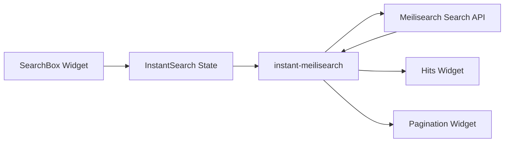

# Bài 04 — Xây dựng giao diện tìm kiếm với InstantSearch.js

> **Loại:** Lab · **Chủ đề:** Search client, widget, HTML, template, pagination.

## 1. Tổng quan

Sau khi index đã có tài liệu, người dùng cần một giao diện để nhập truy vấn. `InstantSearch.js` cung cấp các widget như ô tìm kiếm, danh sách kết quả và phân trang. `@meilisearch/instant-meilisearch` là bộ kết nối giúp InstantSearch gửi truy vấn tới Meilisearch.

Hai thư viện có vai trò **khác nhau**:

- `InstantSearch.js`: xây dựng giao diện, quản lý trạng thái và các widget.
- `instant-meilisearch`: cung cấp `searchClient` tương thích để gọi Meilisearch.

Không nên hiểu `instant-meilisearch` là một thư viện tự dựng toàn bộ giao diện khi cài riêng lẻ.

## 2. Mục tiêu

- Tạo trang HTML có vùng `#searchbox`, `#hits` và `#pagination`.
- Khởi tạo `instantMeiliSearch()` và `instantsearch()` đúng vai trò.
- Hiển thị `title` và `overview` từ các tài liệu JSON.
- Giới hạn số kết quả mỗi trang với `hitsPerPage`.
- Kiểm tra hành vi nhập liên tục, từ không tồn tại và lỗi kết nối.

## 3. Thiết kế màn hình



Khi người dùng nhập từ mới, trạng thái tìm kiếm thay đổi; `searchClient` thực hiện truy vấn và trả dữ liệu; widget cập nhật các kết quả. Không cần tự viết hàm vẽ lại danh sách từ đầu cho ví dụ cơ bản.

## 4. Cấu trúc HTML

Đây là các phần tử quan trọng được sử dụng trong `du-an/web/index.html`:

```html
<div id="searchbox"></div>
<div id="hits"></div>
<div id="pagination"></div>
```

Trang HTML cần tải hai thư viện JavaScript qua CDN hoặc bundler, sau đó tải file cấu hình và đoạn khởi tạo của dự án. Với mã đi kèm, cấu trúc này đã được tạo sẵn.

### 4.1. Tạo cấu hình riêng cho frontend

Tại `du-an/web/`, sao chép `config.example.js` thành `config.js`:

```javascript
window.MEILI_CONFIG = {
  host: 'http://127.0.0.1:7700',
  searchKey: 'YOUR_SEARCH_ONLY_API_KEY',
  indexName: 'movies',
};
```

**Không dùng Admin API key hoặc master key** trong cấu hình trên. Trình duyệt không có vùng lưu bí mật tuyệt đối; nên xem mọi khóa nằm trong `config.js` là có thể bị xem. Nếu ứng dụng chứa dữ liệu riêng tư, cần phương án backend kiểm tra quyền thay vì cấp một Search key đọc rộng rãi.

## 5. Khởi tạo công cụ tìm kiếm

```javascript
const { searchClient } = instantMeiliSearch(
  window.MEILI_CONFIG.host,
  window.MEILI_CONFIG.searchKey
);

const search = instantsearch({
  indexName: window.MEILI_CONFIG.indexName,
  searchClient,
});
```

Trong mã trên, `indexName` phải trùng với index đã nhập dữ liệu, ví dụ `movies`. `searchClient` là lớp kết nối do `instant-meilisearch` cung cấp.

### 5.1. Thêm các widget

```javascript
search.addWidgets([
  instantsearch.widgets.searchBox({
    container: '#searchbox',
    placeholder: 'Nhập tên phim...',
  }),
  instantsearch.widgets.configure({ hitsPerPage: 6 }),
  instantsearch.widgets.hits({
    container: '#hits',
    templates: {
      item: '<h2>{{title}}</h2><p>{{overview}}</p>',
      empty: 'Không tìm thấy kết quả.',
    },
  }),
  instantsearch.widgets.pagination({ container: '#pagination' }),
]);

search.start();
```

`searchBox` gắn vào vùng nhập; `configure` quyết định số kết quả mỗi trang; `hits` sử dụng template với các field trong JSON; `pagination` tạo điều hướng trang; `search.start()` khởi động vòng đời tìm kiếm.

### 5.2. Phân biệt `hitsPerPage` và tổng kết quả

Nếu `hitsPerPage = 6`, mỗi trang cố gắng hiển thị tối đa sáu hit; không có nghĩa index chỉ còn sáu tài liệu. Người dùng có thể tiếp tục tới các trang khác qua phân trang. Lượng kết quả thực tế còn chịu giới hạn bởi cài đặt engine và truy vấn.

### 5.3. Thay nội dung `title` bằng `overview`

Template sử dụng tên trường đúng với dữ liệu. Nếu muốn ưu tiên tóm tắt thay cho tên, thay `{{title}}` bằng `{{overview}}`. Tuy nhiên cách hiển thị thường hợp lý hơn là tên ở heading, mô tả ở đoạn văn. Không nên đoán tên field là `description` khi JSON đang dùng `overview`.

## 6. Chạy giao diện

Ở thư mục `du-an/`, chạy:

```bash
npx serve web
```

Mở địa chỉ được in ra trên terminal, thử `space`, `ocean`, `adventur` và một truy vấn không có kết quả. Dữ liệu mẫu có các tên phim và mô tả tự tạo để có thể kiểm tra luồng chức năng; không phải cơ sở dữ liệu phim đầy đủ.

Nếu truy vấn hiển thị được trong dashboard nhưng không xuất hiện trên web, hãy kiểm tra Console và Network trên DevTools, tập trung vào **host**, **key**, **indexName**, **CORS** và đúng field hiển thị.

## 7. Debug giao diện

| Hiện tượng | Cách kiểm tra |
| --- | --- |
| Ô nhập không xuất hiện | Xác nhận CDN tải xong, script app chạy, `#searchbox` tồn tại |
| Không có kết quả dù index đã có dữ liệu | Mở tab Network xem yêu cầu Search API, kiểm tra query/index |
| `401` hoặc `403` | Kiểm tra Search API key có quyền `search` đúng index |
| Kết quả xuất hiện nhưng thiếu tên | Trường `title` có thật trong JSON không? |
| Chỉ hiển thị một vài kết quả | Xem `hitsPerPage`, phân trang và tổng số tài liệu khớp |
| Không hiển thị trên Cloud | Dùng host HTTPS thực tế; không dùng localhost khi truy cập từ máy khác |

## 8. Deliverable và checklist

- [ ] Ô tìm kiếm có placeholder dễ hiểu.
- [ ] Kết quả gồm tên và mô tả.
- [ ] Có trạng thái không tìm thấy kết quả.
- [ ] Có phân trang và số kết quả mỗi trang được cấu hình.
- [ ] Giao diện không chứa khóa ghi/khóa quản trị.

## 9. Câu hỏi ôn tập

**Câu 1.** Vai trò chính của `instant-meilisearch` là gì?

A. Tạo database SQL.  
B. Tạo ảnh poster phim.  
C. Cung cấp lớp kết nối tìm kiếm giữa InstantSearch và Meilisearch.  
D. Thay toàn bộ nội dung HTML bằng PDF.

**Đáp án:** C. **Giải thích:** Đây là search client adapter, không tự xây dựng mọi widget giao diện.

**Câu 2.** Widget nào trực tiếp tạo ô nhập truy vấn?

A. `instantsearch.widgets.searchBox`.  
B. `instantsearch.widgets.pagination`.  
C. `instantsearch.widgets.configure`.  
D. `instantsearch.widgets.hits`.

**Đáp án:** A. **Giải thích:** `searchBox` xử lý giao diện và tương tác nhập từ khóa.

**Câu 3.** `hitsPerPage` được dùng để làm gì?

A. Xóa bớt dữ liệu index.  
B. Sửa tên API key.  
C. Chỉ cho phép tối đa một index.  
D. Giới hạn số hit được hiển thị trên một trang kết quả.

**Đáp án:** D. **Giải thích:** Tổng kết quả vẫn có thể lớn hơn số hit của một trang.

**Câu 4.** Template không thấy nội dung `overview` dù `title` có hiển thị. Cách kiểm tra đầu tiên?

A. Tắt máy chủ và xóa dữ liệu.  
B. Đối chiếu tên trường trong JSON với template.  
C. Đổi sang master key.  
D. Tăng chiều cao màn hình.

**Đáp án:** B. **Giải thích:** Tên thuộc tính cần khớp chính xác.

**Câu 5.** Khóa nào tuyệt đối không nên gắn vào JavaScript gửi xuống trình duyệt?

A. Search-only key đã được cấp quyền tối thiểu cho dữ liệu công khai.  
B. Một tên index công khai.  
C. Admin API key có quyền sửa index.  
D. Host URL công khai.

**Đáp án:** C. **Giải thích:** Trình duyệt lộ mã nên người khác có thể lấy khóa quản trị.
