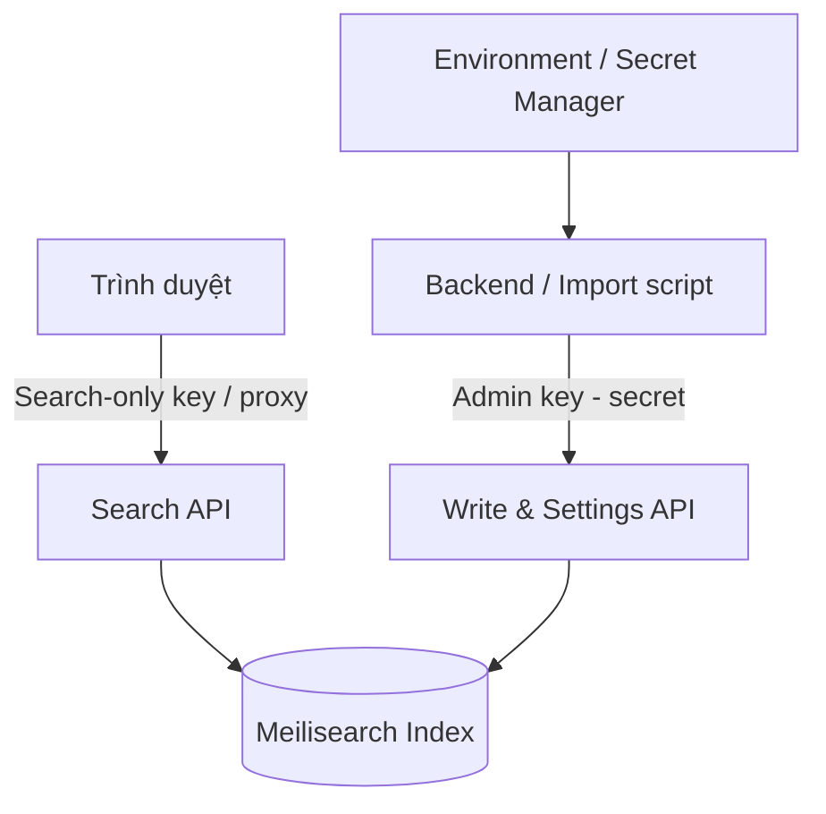
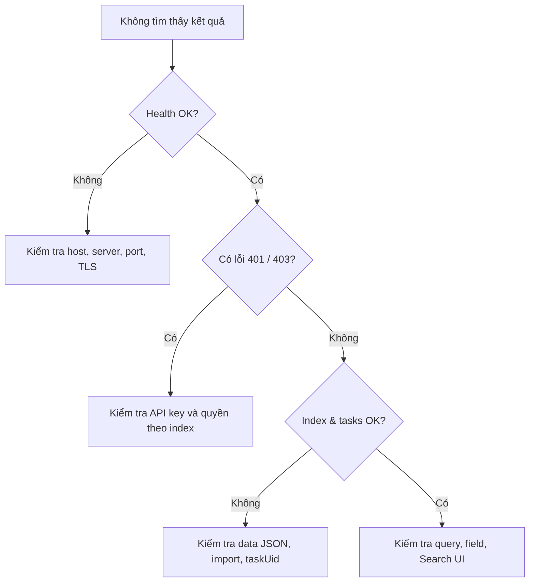

# Bài 06 — Bảo mật API key, gỡ lỗi và kiểm tra vận hành

> **Loại:** Review & Lab · **Chủ đề:** Least privilege, task status, lỗi thường gặp, checklist.

## 1. Tổng quan

Ứng dụng có giao diện đẹp nhưng sử dụng sai khóa hoặc không kiểm tra trạng thái tác vụ lập chỉ mục vẫn có thể gặp sự cố nghiêm trọng. Bài học hệ thống hóa quy trình kiểm tra theo từng lớp, từ kết nối máy chủ, quyền API, dữ liệu cho đến giao diện.

## 2. Mục tiêu

- Chẩn đoán được sự khác nhau giữa lỗi kết nối, lỗi quyền và lỗi chưa lập chỉ mục.
- Giải thích được tại sao Admin API key không được đặt trong mã trình duyệt.
- Thiết lập checklist kiểm tra từ `/health` đến `hits` trên giao diện.
- Đề xuất cách giảm nguy cơ rò rỉ dữ liệu hoặc bị lạm dụng API.

## 3. Mô hình quyền theo trách nhiệm

Tư tưởng chính là **người chỉ cần tìm kiếm không cần quyền thêm/xóa tài liệu**. Trình duyệt chỉ nên truy cập dữ liệu được phép công khai. Search key có phạm vi rộng không đủ để bảo vệ tài liệu chứa thông tin riêng của từng tài khoản.

### 3.1. Ba kiểu dữ liệu cần phân biệt

| Kiểu dữ liệu | Thiết kế phù hợp |
| --- | --- |
| Danh sách phim/sản phẩm công khai | Search-only key giới hạn index; backend vẫn có thể kiểm soát lưu lượng |
| Dữ liệu nội bộ doanh nghiệp | Nên truy vấn qua backend có xác thực và kiểm tra quyền |
| Dữ liệu riêng của từng người dùng | Bắt buộc kiểm soát quyền dữ liệu ở server; không chỉ dựa vào khóa chung trong web |

## 4. Thứ tự gỡ lỗi hiệu quả

### 4.1. Lớp kết nối

Từ máy chạy script, mở `/health`. Nếu thất bại, không nên sửa template HTML trước. Kiểm tra URL đã gồm giao thức `http`/`https`, container chạy, cổng mở, DNS và tường lửa.

### 4.2. Lớp phân quyền

`401` thường gợi ý thiếu hoặc sai thông tin xác thực; `403` thường liên quan quyền không phù hợp. Một tài khoản/khóa có thể chỉ được tìm trên `movies` mà không được thao tác với `recipes`.

### 4.3. Lớp dữ liệu

Xem dashboard hoặc danh sách tasks. Tác vụ `enqueued` mới được tiếp nhận; `processing` đang xử lý; `succeeded` là hoàn tất; `failed` cần xem chi tiết lỗi. Đảm bảo `id` hiện diện và tài liệu đã thực sự được nhập vào đúng index.

### 4.4. Lớp frontend

Kiểm tra Network trong DevTools để xem request/response. Nếu request thành công nhưng UI trống, kiểm tra `#hits`, template fields, `indexName`, thứ tự tải script và các lỗi JavaScript. Nếu dùng dữ liệu công khai qua browser, mọi trường trả về phải được xem xét như dữ liệu có thể bị đọc.

## 5. Kịch bản kiểm thử tối thiểu

| Kịch bản | Kết quả cần ghi nhận |
| --- | --- |
| Truy vấn khớp chính xác trong `title` | Có ít nhất một hit phù hợp |
| Truy vấn trong `overview` | Hit mang mô tả chứa thông tin liên quan |
| Truy vấn sai chính tả có kiểm soát | Quan sát kết quả thực tế, không đoán |
| Truy vấn không tồn tại | Giao diện thông báo dễ hiểu |
| Search key sai | Hiển thị lỗi quyền/kết nối trong Network, không lộ Admin key |
| Thử import bằng Search-only key | Không thể thực hiện tác vụ ghi |

## 6. Checklist đưa dự án lên môi trường thật

- [ ] Không đưa master/admin key vào frontend, log công khai, repository hoặc tập Markdown phát hành.
- [ ] Restrict index/search actions cho khóa đọc, kiểm tra quyền theo tổ chức/người dùng khi cần.
- [ ] Có phương án đồng bộ khi record gốc thay đổi hoặc bị xóa.
- [ ] Có log/metrics cơ bản cho lỗi HTTP, latency, task failed và lượng truy vấn.
- [ ] Kiểm soát request rate/budget và không xem quota miễn phí là vô hạn.
- [ ] Có sao lưu hoặc khả năng xây lại index từ nguồn dữ liệu chính.
- [ ] Test tình huống không có kết quả và nhiều kết quả.

## 7. Bài thực hành gỡ lỗi

Một trang đang hiển thị hộp tìm kiếm nhưng gõ `space` không có kết quả, dù `movies.json` chứa `Space Adventure`. Hãy lập một bảng kiểm gồm các cột "bước", "bằng chứng", "kết luận" và đi qua: `/health` → xác thực key → tên index → trạng thái task nhập → Search API → tên trường trong template. **Không đổi khóa quản trị vào trình duyệt để thử nhanh.**

## 8. Câu hỏi ôn tập

**Câu 1.** Một Search API key có quyền đọc toàn index có bảo vệ được dữ liệu riêng giữa các người dùng không?

A. Không; vẫn cần kiểm soát quyền phù hợp theo dữ liệu/người dùng.  
B. Có, vì key tên là Search.  
C. Có, chỉ cần ẩn ô tìm kiếm.  
D. Có, nếu không hiển thị JSON.

**Đáp án:** A. **Giải thích:** Key frontend không tự phân quyền từng tài liệu theo người dùng.

**Câu 2.** Một tác vụ indexing đang `enqueued` nghĩa là gì?

A. Đã xong và tất cả hit phải sẵn sàng.  
B. Đã được nhận vào hàng đợi, chưa chứng minh xử lý xong.  
C. Tất cả tài liệu đều bị xóa.  
D. Trình duyệt mất mạng.

**Đáp án:** B. **Giải thích:** Cần chờ đến `succeeded` hoặc xử lý `failed`.

**Câu 3.** Thứ tự gỡ lỗi tốt khi ứng dụng không kết nối được?

A. Đổi font rồi thử lại.  
B. Thêm nhiều dữ liệu mới.  
C. Đổi tên index ngẫu nhiên.  
D. Kiểm tra host, cổng và `/health` trước các lớp UI.

**Đáp án:** D. **Giải thích:** Lỗi kết nối phải được xử lý tại hạ tầng trước khi debug giao diện.

**Câu 4.** Dấu hiệu `403` có thể liên quan tới gì?

A. Thiếu CSS.  
B. JSON dùng tiếng Việt.  
C. API key không có quyền phù hợp.  
D. Người dùng nhập quá ngắn.

**Đáp án:** C. **Giải thích:** Server có thể từ chối hành động bị hạn chế quyền.

**Câu 5.** Khi dữ liệu gốc thay đổi, biện pháp nào giúp kết quả tra cứu cập nhật?

A. Thiết kế luồng đồng bộ/tái lập chỉ mục có thể kiểm tra trạng thái.  
B. Chỉ cần đổi placeholder.  
C. Tăng kích thước heading.  
D. Xóa trang phân trang.

**Đáp án:** A. **Giải thích:** Index cần được cập nhật theo thay đổi của nguồn dữ liệu.

## 9. Tổng kết

Hãy debug theo thứ tự hạ tầng → quyền → index/task → query → giao diện, và duy trì nguyên tắc quyền tối thiểu. Tính năng tìm kiếm nhanh chỉ hữu ích khi có thể tin cậy và không làm lộ dữ liệu.
