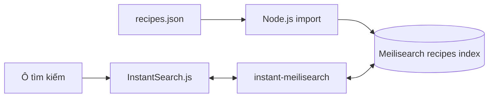

# Bài 07 — Đồ án: tìm kiếm món ăn theo tên và nguyên liệu

> **Loại:** Project · **Chủ đề:** Tái sử dụng Meilisearch, đổi index và dữ liệu thực hành.

## 1. Bài toán sản phẩm

Ứng dụng có danh sách công thức nấu ăn. Người dùng nhập `mì`, `trứng` hoặc `bún` để khám phá những món phù hợp với tên hoặc thành phần. Giao diện phải cập nhật kết quả khi truy vấn thay đổi, hiển thị tên và mô tả món, đồng thời xử lý trường hợp không tìm được kết quả.

Đồ án dùng đúng công cụ đã học: Meilisearch để lập chỉ mục, JavaScript SDK để nạp dữ liệu và InstantSearch.js để tạo giao diện. Không phát triển chatbot LLM trong phạm vi bài này; khả năng AI hỏi thêm khi không có kết quả là một phần mở rộng độc lập.

## 2. Mục tiêu và tiêu chí hoàn thành

Sản phẩm được coi là đạt yêu cầu khi:

- Có index `recipes` với tối thiểu tám công thức minh họa chứa trường `id`, `title`, `overview`, `ingredients` và `category`.
- Truy vấn trong `title` và `ingredients` cho kết quả có thể đọc được.
- Giao diện hiển thị tối đa sáu kết quả mỗi trang và có phân trang.
- Mã frontend chỉ sử dụng Search API key.
- Người học có bộ test gồm ít nhất năm truy vấn và phần nhận xét kết quả thực tế.

## 3. Mô hình dữ liệu

```json
{
  "id": 101,
  "title": "Mì xào trứng",
  "overview": "Mì xào cùng trứng, rau cải và hành lá",
  "ingredients": ["mì", "trứng", "rau cải", "hành lá"],
  "category": "Món xào"
}
```

`title` là tên món; `overview` là mô tả ngắn; `ingredients` chứa danh sách nguyên liệu có thể tìm kiếm; `category` là nhóm món để mở rộng các bộ lọc. `du-an/data/recipes.json` cung cấp tám đối tượng để thực hành. Dữ liệu nhỏ giúp kiểm tra quy trình, không đại diện cho độ phủ của một ứng dụng nhà bếp thực tế.

## 4. Kiến trúc ứng dụng



Index `recipes` và `movies` có thể cùng nằm trên một instance, nhưng mỗi index có nhóm trường được phép tìm/lọc khác nhau. Việc đổi `indexName` trong frontend chỉ đổi đích truy vấn, không tự động chuyển nội dung từ index này sang index khác.

## 5. Các mốc triển khai

### 5.1. Mốc 1 — Nhập dữ liệu

Mở terminal trong `du-an/` và bảo đảm `.env` đã được cấu hình bằng host và **Admin API key**:

```bash
npm run import:recipes
```

Script chọn tệp `recipes.json`, tạo hoặc dùng lại index `recipes`, cấu hình `searchableAttributes: ['title','overview','ingredients','category']` và `filterableAttributes: ['category','ingredients']`, đợi tác vụ indexing thành công.

Checkpoint: Mở dashboard tìm index `recipes`, thử nhập `mì` và `trứng` trong ô tìm kiếm của dashboard.

### 5.2. Mốc 2 — Chạy tìm kiếm không cần giao diện

```bash
npm run search -- "trứng" recipes
npm run search -- "mì" recipes
```

Quan sát kết quả và xác định khớp từ trong tên hay danh sách nguyên liệu. Nếu script tìm được nhưng UI không tìm được, hãy tập trung vào host, quyền Search key và cấu hình frontend.

### 5.3. Mốc 3 — Chuyển giao diện sang index `recipes`

Sửa `du-an/web/config.js`:

```javascript
window.MEILI_CONFIG = {
  host: 'http://127.0.0.1:7700',
  searchKey: 'YOUR_SEARCH_ONLY_API_KEY',
  indexName: 'recipes',
};
```

Chỉ thay key bằng Search API key thật khi chạy trên máy cá nhân; không tải file cấu hình thật lên kho mã công khai. Từ `du-an/`, chạy `npx serve web` và mở địa chỉ đã in.

### 5.4. Mốc 4 — Kiểm thử tính phù hợp

| Truy vấn | Mục đích |
| --- | --- |
| `mì` | Có các món sử dụng mì |
| `trứng` | Có món mang nguyên liệu trứng, kể cả tên không chứa từ này |
| `bún` | Có món thuộc nhóm bún |
| `rau cải` | Có món chứa nguyên liệu rau cải |
| `nguyên liệu không có` | Giao diện hiển thị thông báo không tìm thấy |

Không cần cố buộc thứ tự kết quả hoàn toàn cố định khi chưa có yêu cầu xếp hạng cụ thể. Điều quan trọng là độ liên quan và khả năng giải thích vì sao kết quả xuất hiện.

## 6. Bài toán mở rộng: từ tìm kiếm sang gợi ý món ăn

Tình huống người dùng nhập "Tôi có trứng và mì, muốn món nhanh" là câu hỏi có nhiều ràng buộc, không chỉ một chuỗi từ. Một hệ thống nâng cao có thể:

1. Tách ý định và danh sách nguyên liệu từ câu hỏi ở tầng ứng dụng/AI.
2. Truy vấn index để lấy các món ứng viên.
3. Kiểm tra thêm ràng buộc về thời gian nấu, dị ứng, khẩu vị, nguyên liệu còn thiếu bằng dữ liệu đáng tin cậy.
4. Nếu không đủ thông tin, hỏi người dùng về điều kiện quan trọng còn thiếu.
5. Nếu không có món trong database, nêu rõ không tìm thấy; chỉ tạo món mới bằng chức năng riêng có kiểm soát và đánh dấu rõ đó là công thức gợi ý mới.

Meilisearch xử lý tốt **bước tìm ứng viên**. Nó không tự đảm bảo công thức an toàn, không biết người dùng bị dị ứng gì, không suy luận được đầy đủ mọi sở thích khi không có các dữ liệu đó.

## 7. Kiểm thử, sản phẩm nộp và Definition of Done

Giao nộp: thư mục `du-an/` (không gồm `.env`, `web/config.js`, `node_modules`), ảnh chụp giao diện chạy với truy vấn `mì`, bảng test và 3–5 câu đánh giá hạn chế của dữ liệu.

**Definition of Done:** Tất cả truy vấn cơ bản có hành vi đúng; không lộ key quản trị; có tài liệu hướng dẫn chạy; người học có thể giải thích mối quan hệ database/index/front-end và biết cần bổ sung tầng logic gì để triển khai AI Agent gợi ý món.

## 8. Câu hỏi ôn tập

**Câu 1.** Muốn truy vấn `trứng` tìm cả món có nguyên liệu trứng nhưng tên không chứa từ đó, cần cấu hình nào?

A. Chỉ tìm trong `id`.  
B. Đặt `ingredients` trong `searchableAttributes`.  
C. Đổi `indexName` thành `trứng`.  
D. Tăng cỡ chữ giao diện.

**Đáp án:** B. **Giải thích:** Engine cần tìm nội dung trong trường nguyên liệu.

**Câu 2.** Đổi `indexName` từ `movies` sang `recipes` sẽ làm gì?

A. Tự chuyển mọi phim thành công thức.  
B. Tự thêm dữ liệu mới vào JSON.  
C. Xóa index `movies`.  
D. Thay index mà frontend gửi truy vấn tới.

**Đáp án:** D. **Giải thích:** Đổi index đích không biến đổi dữ liệu đã nhập.

**Câu 3.** Trong kiến trúc ứng dụng gợi ý món hội thoại, Meilisearch đảm nhiệm phần nào tốt nhất?

A. Truy xuất các công thức ứng viên theo truy vấn.  
B. Tự suy ra dị ứng chưa từng khai báo.  
C. Tự đưa ra chẩn đoán y tế.  
D. Kiểm chứng độ an toàn mọi công thức khi thiếu dữ liệu.

**Đáp án:** A. **Giải thích:** Search engine lấy ứng viên; các tầng logic khác kiểm tra ràng buộc và quyết định đối thoại.

**Câu 4.** Vì sao cần test truy vấn không có kết quả?

A. Để tăng dữ liệu index.  
B. Để thay tên API key.  
C. Để đảm bảo giao diện có thông báo và luồng xử lý rõ ràng.  
D. Để buộc AI tự bịa món ăn.

**Đáp án:** C. **Giải thích:** Empty state là một phần quan trọng của trải nghiệm tìm kiếm.

**Câu 5.** Khi đưa dự án lên Git, tệp nào cần giữ riêng?

A. `README.md`.  
B. `.env` chứa Admin API key thật.  
C. `movies.json` dữ liệu mẫu công khai.  
D. `styles.css`.

**Đáp án:** B. **Giải thích:** Bí mật triển khai không được công khai cùng mã nguồn.

## 9. Tổng kết

Bằng cách thay dữ liệu, cấu hình fields và tên index, một giao diện tìm phim có thể trở thành giao diện tìm món ăn. Đây là nền tảng để xây dựng hệ thống gợi ý dựa trên dữ liệu thật; việc hội thoại hỏi đáp là giai đoạn phát triển riêng.
