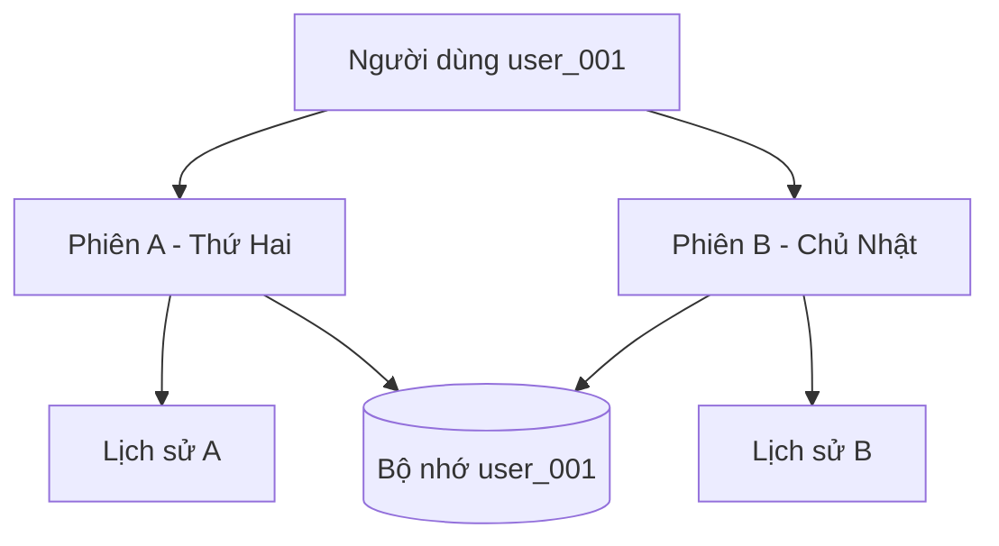
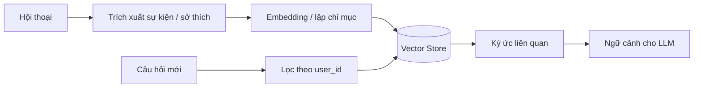

# Bài 01. Kiến trúc bộ nhớ dài hạn cho AI Agent

## 1. Tóm tắt

Bộ nhớ dài hạn giúp AI Agent sử dụng những thông tin quan trọng của người dùng từ nhiều lần trò chuyện khác nhau. Thay vì đưa toàn bộ lịch sử vào prompt, hệ thống giữ các **ký ức có ích**, gắn với định danh người dùng và tìm lại theo ngữ nghĩa khi cần. Mem0 cung cấp lớp xử lý ghi và truy xuất ký ức; LangGraph điều phối các bước trong quá trình hội thoại.

## 2. Mục tiêu học tập

Sau bài này, người học có thể phân biệt `session history` với `long-term memory`, vẽ luồng đọc/ghi ký ức và giải thích vai trò của `user_id`, LLM, embedding, vector store.

## 3. Vấn đề: trò chuyện mới nhưng người dùng cũ

Giả sử thứ Hai, người dùng nói: “Mình thích cà phê, nhất là cà phê ít đường”. Vài ngày sau họ mở một cuộc trò chuyện khác: “Mình muốn uống gì đó cho tỉnh táo”. Nếu hệ thống chỉ giữ tin nhắn của phiên mới, nó không có thông tin về sở thích cà phê. Một agent có bộ nhớ dài hạn có thể tìm lại ký ức “Người dùng thích cà phê ít đường” và đưa ra gợi ý phù hợp hơn.

Điều quan trọng là agent **không cần nhớ nguyên từng câu**. Nó cần tìm lại dữ kiện có khả năng hữu ích cho yêu cầu hiện tại.

## 4. Hai lớp thông tin thường bị nhầm lẫn

| Tiêu chí | Lịch sử hội thoại | Bộ nhớ dài hạn |
| --- | --- | --- |
| Phạm vi thường gặp | `thread_id`/cuộc hội thoại | `user_id`/người dùng |
| Dữ liệu | Các lượt nói, phản hồi theo thứ tự | Dữ kiện và sở thích được chọn lọc |
| Mục đích | Giữ ngữ cảnh gần và mạch đối thoại | Cá nhân hóa qua các phiên |
| Truy xuất | Theo lượt và thứ tự thời gian | Theo mức độ liên quan, thường kèm bộ lọc |
| Khi tạo phiên mới | Có thể bắt đầu rỗng | Vẫn có thể truy vấn các ký ức đã lưu |

Một người dùng có nhiều `thread_id` nhưng cùng `user_id`. Dùng `thread_id` như khóa bộ nhớ dài hạn sẽ khiến hệ thống khó kết nối các lần trao đổi.

Hai phiên có lịch sử riêng, nhưng có thể dùng chung kho ký ức của **cùng người dùng**. Đổi sang `user_002` phải truy xuất một phạm vi ký ức khác.

## 5. Mem0 ghi nhớ như thế nào?

Một pipeline điển hình gồm bốn bước:

1. **Nhận nội dung:** một hoặc nhiều tin nhắn gồm `role` và `content`.
2. **Trích xuất dữ kiện:** dùng LLM để xác định thông tin đáng giữ lại, ví dụ “Thích cà phê ít đường”.
3. **Lưu trữ và lập chỉ mục:** chuyển dữ kiện thành biểu diễn phục vụ tìm kiếm (embedding) và ghi vào vector store.
4. **Truy xuất:** dùng truy vấn hiện tại, bộ lọc `user_id` và cơ chế xếp hạng để chọn ký ức phù hợp.

Một tin nhắn có thể tạo ra nhiều ký ức; một cuộc hội thoại dài cũng có thể chỉ tạo ra một vài dữ kiện đáng nhớ. Không nên giả định “một tin nhắn = một ký ức”.

Sơ đồ này là mô hình khái niệm, không khẳng định Mem0 luôn thực hiện số lần gọi LLM giống nhau ở mọi phiên bản.

## 6. Vai trò của từng thành phần

- **Mem0:** giao diện tạo, tìm kiếm, xem, cập nhật và quản lý ký ức; tách logic memory khỏi chatbot.
- **LLM:** diễn giải tin nhắn và/hoặc sinh câu trả lời. LLM tự nó không đảm bảo nhớ qua phiên nếu không được cấp dữ liệu.
- **Embedding:** biểu diễn nội dung để hỗ trợ tìm kiếm ngữ nghĩa.
- **Qdrant:** một lựa chọn vector database lưu và truy vấn các embedding cùng payload.
- **LangGraph:** thực thi các node dựa trên state và luồng điều khiển (`edges`).
- **SQLite history:** có thể lưu lịch sử thao tác/thay đổi của Mem0 OSS; **không đồng nghĩa** với vector store.

## 7. Khi nào nên lưu, khi nào không?

Hãy ưu tiên sở thích ổn định, dự án lâu dài hoặc thông tin người dùng **muốn ứng dụng ghi nhớ**. Tin nhắn tức thời như “Tối nay mình xem phim” không nhất thiết cần lưu dài hạn, trong khi “Mình thích khoa học viễn tưởng hơn phim giật gân” thường có giá trị cho những lần gợi ý sau.

Trong ứng dụng thật, cần có cơ chế đồng ý lưu trữ, quyền xem/xóa dữ liệu, thời hạn lưu, xử lý ký ức sai và kiểm tra thông tin nhạy cảm. Ký ức là **dữ liệu tham khảo**, không nên được đối xử như chỉ dẫn có quyền ưu tiên cao hơn nguyên tắc hệ thống.

## 8. Bài thực hành ngắn

Thiết kế hai đoạn hội thoại cho cùng `user_id = "demo_an"`: phiên 1 chứa “Mình thích cà phê”; phiên 2 chỉ chứa “Gợi ý đồ uống”. Trả lời ba câu hỏi: ký ức nào đáng lưu, câu truy vấn tìm ký ức nên là gì, và cần xử lý thế nào nếu tìm không được ký ức phù hợp?

## 9. Câu hỏi ôn tập

**Câu 1.** Muốn gợi ý đồ uống qua hai phiên độc lập, thông tin nên được gắn chủ yếu với gì?

A. `thread_id` của phiên mới.  
B. Tên node chatbot.  
C. `user_id` của người dùng.  
D. Thời gian bắt đầu chương trình.

**Đáp án:** C. **Giải thích:** Bộ nhớ xuyên phiên cần truy xuất theo danh tính người dùng, không giới hạn trong một phiên chat.

**Câu 2.** Phát biểu nào đúng về số lượng ký ức?

A. Một tin nhắn luôn tạo chính xác một ký ức.  
B. Một tin nhắn có thể tạo không, một hoặc nhiều ký ức.  
C. Mọi tin nhắn đều phải lưu nguyên văn.  
D. Chỉ phản hồi của assistant mới được lưu.

**Đáp án:** B. **Giải thích:** Lớp trích xuất chọn thông tin đáng nhớ, không sao chép từng lượt nói theo tỷ lệ 1:1.

**Câu 3.** Thành phần nào thường chứa vector và payload để tìm kiếm ký ức?

A. Vector store như Qdrant.  
B. `START`.  
C. `thread_id`.  
D. Markdown renderer.

**Đáp án:** A. **Giải thích:** Qdrant lưu vector/metadata cho thao tác truy vấn tương đồng.

**Câu 4.** Một người nói “Mai tôi đi xem phim” thì cách xử lý phù hợp nhất là gì?

A. Bắt buộc lưu vĩnh viễn.  
B. Coi đó là sở thích dài hạn chắc chắn.  
C. Xóa toàn bộ lịch sử.  
D. Cân nhắc tính tạm thời và quy tắc lưu trước khi thêm ký ức.

**Đáp án:** D. **Giải thích:** Thông tin thời điểm cụ thể có thể hết giá trị nhanh.

**Câu 5.** Vì sao không nên đưa tất cả ký ức của người dùng vào mọi prompt?

A. Vì embedding không chứa chữ cái.  
B. Vì `user_id` không thể lặp lại.  
C. Vì thông tin không liên quan làm tăng chi phí, nhiễu và rủi ro dùng sai ngữ cảnh.  
D. Vì LangGraph chỉ có một node.

**Đáp án:** C. **Giải thích:** Chọn lọc ký ức liên quan giúp câu trả lời tập trung và tiết kiệm token.

## 10. Tổng kết

Lịch sử theo phiên giúp hội thoại liền mạch; bộ nhớ dài hạn theo người dùng giúp cá nhân hóa qua nhiều phiên. Trọng tâm của thiết kế là **chọn điều đáng nhớ, lưu đúng phạm vi và chỉ truy xuất khi liên quan**.
