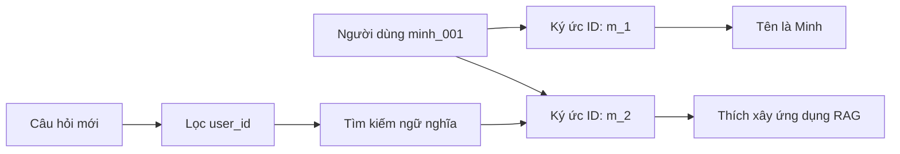

# Bài 03. Quản lý ký ức bằng các thao tác Mem0

## 1. Tóm tắt

Sau khi khởi tạo `Memory`, cần biết cách ghi, tìm kiếm, xem, chỉnh sửa và kiểm tra sự thay đổi của từng ký ức. Những thao tác này là nền tảng để agent có thể duy trì trí nhớ hữu ích thay vì chỉ ghi nhật ký tin nhắn.

## 2. Mục tiêu học tập

Người học có thể gọi các phương thức `add`, `search`, `get_all`, `get`, `update`, `history`; sử dụng `user_id`, `metadata`; phân biệt memory ID với các giá trị định danh khác.

## 3. Chuẩn hóa dữ liệu đầu vào

Mỗi thông điệp được mô tả bằng ít nhất hai trường:

```python
messages = [
    {"role": "user", "content": "Mình tên là Minh."},
    {"role": "user", "content": "Mình thích xây dựng ứng dụng RAG Agent."},
]
```

`role` xác định ai nói (`user`, `assistant`), còn `content` chứa nội dung. Khi ghi ký ức, truyền `user_id` ổn định để liên kết đúng người. Có thể thêm `metadata` cho các nhãn nghiệp vụ.

## 4. Các thao tác cần thành thạo

Tất cả ví dụ dưới đây sử dụng đối tượng `memory` đã được khởi tạo ở Bài 02.

### 4.1. Thêm ký ức với `add`

```python
result = memory.add(
    messages,
    user_id="minh_001",
    metadata={"category": "profile"},
)
print(result)
```

Mem0 có thể trích xuất một hoặc nhiều dữ kiện, ví dụ tên người dùng và sở thích làm RAG Agent. `metadata` là dữ liệu bổ sung có cấu trúc; không nên coi nhãn tự đặt là sự thật về người dùng.

### 4.2. Tìm ký ức theo ngữ nghĩa với `search`

```python
result = memory.search(
    "Người dùng thích xây dựng ứng dụng nào?",
    filters={"user_id": "minh_001"},
)
for hit in result.get("results", []):
    print(hit.get("memory"), hit.get("score"))
```

Tìm kiếm ngữ nghĩa không chỉ so sánh từ khóa đúng nguyên văn. Với cùng kho memory, câu hỏi “Mình thích phát triển cái gì?” có thể tìm ra “thích làm ứng dụng RAG Agent”. `score` là điểm phục vụ xếp hạng; không mặc định hiểu nó là xác suất ký ức đúng.

### 4.3. Xem tất cả ký ức với `get_all`

```python
all_data = memory.get_all(filters={"user_id": "minh_001"})
for item in all_data.get("results", []):
    print(item["id"], item["memory"])
```

Dùng `get_all` khi cần giao diện quản trị hoặc kiểm tra toàn bộ dữ liệu một người dùng; không nên thay `search` bằng `get_all` trong mọi prompt vì dữ liệu có thể lớn.

### 4.4. Xem một ký ức với `get`

```python
items = all_data.get("results", [])
if items:
    memory_id = items[0]["id"]
    detail = memory.get(memory_id)
    print(detail)
```

Cần sử dụng đúng trường **`id`** của ký ức. Một `hash`, `user_id` hay điểm tìm kiếm không thay thế được `memory_id`.

### 4.5. Cập nhật với `update`

```python
if items:
    memory_id = items[0]["id"]
    memory.update(
        memory_id=memory_id,
        data="Người dùng quan tâm xây dựng ứng dụng RAG Agent và AI Agent.",
    )
```

Đây là thao tác cập nhật tường minh theo ID, hữu ích khi người dùng sửa thông tin cũ. Trong ứng dụng thực, cần kiểm tra ký ức này thuộc đúng `user_id` được phép chỉnh sửa trước khi gọi `update`.

### 4.6. Xem lịch sử thay đổi với `history`

```python
if items:
    events = memory.history(memory_id)
    print(events)
```

Lịch sử có thể thể hiện dữ liệu cũ và mới của ký ức, hỗ trợ giải thích vì sao hệ thống đang nhớ như hiện tại. Dữ liệu trả về phụ thuộc phiên bản và cấu hình history store; không tự suy diễn rằng mọi triển khai đều giữ lịch sử đầy đủ vô hạn.

## 5. Mối quan hệ giữa nội dung, user_id và memory_id



`user_id` là phạm vi sở hữu; `memory_id` chỉ một bản ghi; `metadata` mô tả thuộc tính bổ sung; nội dung `memory` là thông tin được trích xuất hoặc ghi vào.

## 6. Cẩn trọng khi cập nhật và ghi nhớ

Thông tin người dùng có thể thay đổi: hôm nay thích cà phê, sau này không còn thích. Khi agent nhận được dữ kiện mới, nên có cơ chế xử lý mâu thuẫn, thay vì bất kể trường hợp nào cũng tạo bản ghi trùng lặp. Việc bản Mem0 tự xử lý cập nhật/sáp nhập ở mức nào **phụ thuộc phiên bản thuật toán**: không suy ra tự động từ kết quả của một video thực hành.

Ngoài ra, dữ liệu trích xuất có thể bị diễn đạt sai. Cần thiết kế cách cho người dùng xem, xác nhận, sửa hoặc xóa những ký ức ảnh hưởng đến gợi ý cá nhân.

## 7. Bài thực hành

Tạo `user_id = "demo_01"`. Ghi hai tin nhắn: “Tôi thích viết Python” và “Tôi làm dự án AI Agent”. Tìm lại sở thích lập trình bằng câu hỏi khác nguyên văn. In toàn bộ `id`, chọn một ký ức để cập nhật, gọi `get` và `history` để kiểm tra. Lặp lại `search` với `user_id = "demo_02"` để kiểm tra không lẫn người dùng.

## 8. Câu hỏi ôn tập

**Câu 1.** Cách nào phù hợp để tìm ký ức liên quan đến “thích học Python”?  
A. `history()` không truyền ID.  
B. `get_all()` của toàn bộ người dùng.  
C. `get()` với tên người dùng.  
D. `search(query, filters={"user_id": ...})`.

**Đáp án:** D. **Giải thích:** `search` dùng truy vấn và bộ lọc đúng phạm vi để tìm ký ức liên quan.

**Câu 2.** Muốn sửa một ký ức xác định, cần giá trị nào?  
A. Giá trị `id` của ký ức.  
B. Điểm tương đồng.  
C. Tên file SQLite.  
D. Tên node `START`.

**Đáp án:** A. **Giải thích:** `update` sử dụng định danh bản ghi memory.

**Câu 3.** `metadata={"category": "interest"}` có tác dụng gì?  
A. Đổi mô hình ngôn ngữ.  
B. Gắn dữ liệu mô tả cho ký ức.  
C. Tạo phiên chat mới.  
D. Tự xác minh sở thích của người dùng.

**Đáp án:** B. **Giải thích:** Metadata là thuộc tính bổ sung phục vụ tổ chức và lọc dữ liệu.

**Câu 4.** Một truy vấn trả kết quả có `score=0.80`, có thể khẳng định điều gì?  
A. 80% người dùng thích câu trả lời.  
B. Độ chính xác của mô hình là 80%.  
C. Đó là điểm xếp hạng/tương đồng theo hệ thống truy xuất, không tự động là xác suất đúng.  
D. Mỗi memory đều có 80 từ.

**Đáp án:** C. **Giải thích:** Điểm truy xuất không tương đương đánh giá độ đúng của dữ kiện.

**Câu 5.** Khi `get(memory_id)` không trả dữ liệu, bước nào đáng kiểm tra nhất?  
A. Tên file Markdown.  
B. Độ dài prompt hệ thống.  
C. Màu của notebook.  
D. Có lấy nhầm `hash` thay cho `id` không.

**Đáp án:** D. **Giải thích:** Lỗi định danh làm thao tác truy xuất bản ghi thất bại.

## 9. Tổng kết

Năm nhóm thao tác phải nắm là: ghi (`add`), truy xuất theo liên quan (`search`), xem (`get`/`get_all`), chỉnh sửa (`update`) và kiểm tra lịch sử (`history`). Dữ liệu cần gắn đúng `user_id`, trong khi thao tác trên bản ghi riêng lẻ dùng `memory_id`.

**Tham khảo:** https://docs.mem0.ai/open-source/python-quickstart · https://qdrant.tech/documentation/frameworks/mem0/
