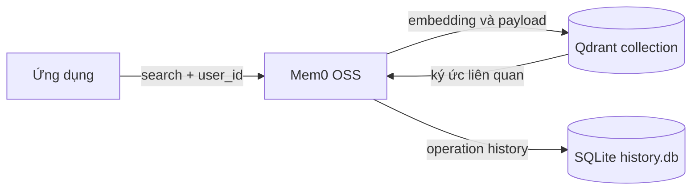
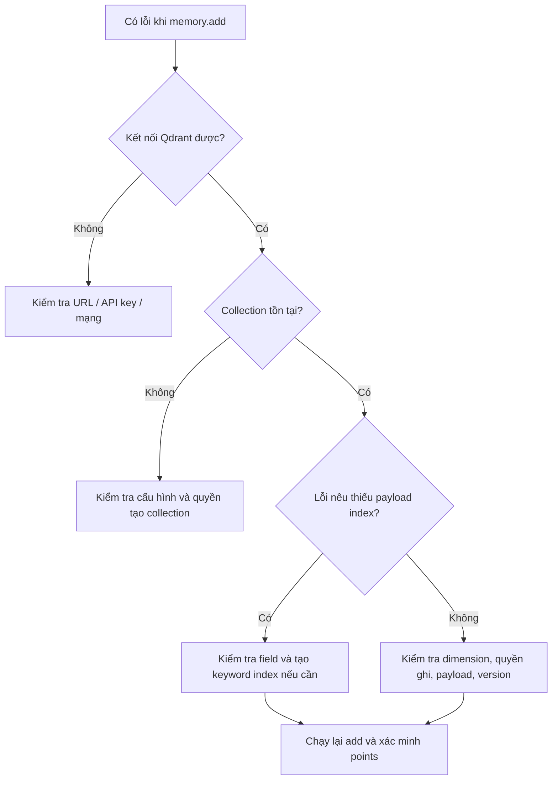

# Bài 05. Tùy biến Mem0 với Qdrant và xử lý lỗi chỉ mục

## 1. Tóm tắt

Qdrant là vector database có thể làm backend lưu trữ ký ức cho Mem0 OSS. Bài này trình bày cách chuyển từ kho cục bộ sang Qdrant Server/Cloud, xác minh collection và khắc phục lỗi về payload index được gặp trong một số cấu hình.

## 2. Mục tiêu học tập

Người học có thể phân biệt Qdrant local, server và cloud; cấu hình vector store cho Mem0; kiểm tra vector đã được thêm và chỉ tạo payload index `user_id` khi cần.

## 3. Vai trò của Qdrant trong kiến trúc



Qdrant chứa các điểm vector và thông tin payload liên quan đến ký ức. SQLite history thường ghi sự thay đổi/thao tác. Hai nơi lưu dữ liệu không thay thế cho nhau.

## 4. Cài đặt và chạy Qdrant ở local

```bash
pip install -U mem0ai qdrant-client
# Cần Docker để chạy lệnh dưới đây:
docker run --rm -p 6333:6333 qdrant/qdrant
```

Docker như trên phù hợp để thử nghiệm; để dữ liệu sống sót sau khi xóa container, cấu hình volume/persistence theo tài liệu Qdrant. Nếu đã dùng Qdrant embedded qua `path`, không bắt buộc chạy Docker.

```python
from mem0 import Memory

config = {
    "vector_store": {
        "provider": "qdrant",
        "config": {
            "collection_name": "mem0_course",
            "host": "localhost",
            "port": 6333,
        },
    },
}
memory = Memory.from_config(config)
memory.add("Người dùng thích cà phê", user_id="user_demo")
```

Không dùng đồng thời `path` (embedded) và `host`/`port` (server) trong cùng một backend, trừ khi phiên bản thư viện có mô tả rõ cách kết hợp.

## 5. Kết nối Qdrant Cloud

Qdrant Cloud cung cấp cluster, URL endpoint và API key. Bạn cần tạo cluster trong giao diện quản trị, nhận endpoint thực tế, giữ key bí mật. Hạn mức/gói giá có thể thay đổi; không nên dựa vào con số dung lượng miễn phí trong ví dụ cũ để lập kế hoạch triển khai.

```python
import os
from mem0 import Memory

config = {
    "vector_store": {
        "provider": "qdrant",
        "config": {
            "collection_name": "mem0_course_cloud",
            "url": os.environ["QDRANT_URL"],
            "api_key": os.environ["QDRANT_API_KEY"],
        },
    },
}
memory = Memory.from_config(config)
memory.add(
    [{"role": "user", "content": "Tôi thích tạo RAG Agent."}],
    user_id="user_demo",
)
```

Dùng `QDRANT_URL` là URL cluster do nhà cung cấp hiển thị (thường HTTPS), không tự ghép endpoint hoặc chèn API key vào URL. Kết nối qua endpoint HTTP(S) của Cloud không nhất thiết cần cổng gRPC.

## 6. Xác minh dữ liệu bằng Qdrant Client

```python
import os
from qdrant_client import QdrantClient

client = QdrantClient(
    url=os.environ["QDRANT_URL"],
    api_key=os.environ["QDRANT_API_KEY"],
)

print(client.get_collections())
```

Nếu collection mới tồn tại nhưng có **0 points** sau lỗi `add`, điều đó chưa chứng minh memory đã được ghi. Cần kiểm tra phản hồi thao tác thêm, log lỗi và số points. Một lượt thoại có thể tạo nhiều memories/points; không mặc định số points bằng số messages.

## 7. Xử lý lỗi payload index của `user_id`

Một số phiên bản/cấu hình Mem0–Qdrant có thể báo thiếu payload index cho trường dùng lọc người dùng. Khi thông báo lỗi xác định đúng trường `user_id`, có thể tạo keyword index:

```python
from qdrant_client.models import PayloadSchemaType

collection = "mem0_course_cloud"
client.create_payload_index(
    collection_name=collection,
    field_name="user_id",
    field_schema=PayloadSchemaType.KEYWORD,
)
```

**Đây là bước sửa lỗi có điều kiện, không bắt buộc mọi dự án phải chạy.** Trước khi tạo, kiểm tra tên trường trong payload thực tế và collection được Mem0 dùng. Các phiên bản mới hoặc cấu hình khác có thể tự quản lý index; cũng có trường hợp lỗi nằm ở quyền tài khoản, kích thước vector hoặc nhầm collection.

## 8. Quy trình debug có hệ thống



Sau sửa lỗi, kiểm tra `search(..., filters={"user_id": ...})` và xác nhận kết quả đúng người dùng. Đừng đăng công khai logs chứa API key hoặc dữ liệu riêng tư.

## 9. Bài thực hành

Chạy Mem0 với Qdrant server local, tạo collection `mem0_course`, thêm sở thích của hai `user_id`, tìm kiếm có filter. Nếu có Qdrant Cloud, đổi backend theo biến môi trường và kiểm tra điểm vector. Ghi lại tên collection, số ký ức sinh ra và lỗi thực tế (nếu có), không ghi khóa bí mật vào báo cáo.

## 10. Câu hỏi ôn tập

**Câu 1.** Qdrant được dùng chủ yếu để làm gì trong bài này?  
A. Biên dịch Python.  
B. Lưu và tìm điểm vector của các ký ức.  
C. Thay thế `user_id`.  
D. Tạo system prompt.

**Đáp án:** B. **Giải thích:** Qdrant là vector store cho memory.

**Câu 2.** Sau khi Mem0 báo lỗi, collection đã được tạo nhưng không có points. Kết luận nào hợp lý?  
A. Mọi ký ức chắc chắn lưu thành công.  
B. LangGraph đã lỗi.  
C. Tất cả API key đều sai.  
D. Việc tạo collection có thể đã thành công nhưng thao tác chèn thất bại.

**Đáp án:** D. **Giải thích:** Tạo collection và ghi points là hai bước khác nhau.

**Câu 3.** Kiểu index phù hợp khi lọc giá trị chuỗi `user_id` trong ví dụ là gì?  
A. `KEYWORD`.  
B. `FLOAT`.  
C. `GEO`.  
D. `INTEGER` bắt buộc.

**Đáp án:** A. **Giải thích:** Mã định danh dạng chuỗi được lọc chính xác như keyword.

**Câu 4.** Khi nào nên chủ động tạo payload index thủ công?  
A. Trước mọi lần gọi `search`, không cần xem lỗi.  
B. Sau khi xóa API key.  
C. Khi backend yêu cầu hoặc truy vấn cần index và đã xác minh đúng collection/field.  
D. Khi muốn tạo file Markdown.

**Đáp án:** C. **Giải thích:** Index phụ thuộc backend, schema và phiên bản; không phải thủ tục bắt buộc vô điều kiện.

**Câu 5.** Vì sao `history.db` và Qdrant không nên bị nhầm làm một?  
A. Vì cả hai đều chứa hình ảnh.  
B. Vì SQLite history và vector store phục vụ các chức năng lưu trữ khác nhau.  
C. Vì chỉ Qdrant hỗ trợ Python.  
D. Vì SQLite không tồn tại trên Linux.

**Đáp án:** B. **Giải thích:** Lịch sử thao tác và tập vector memories là hai lớp dữ liệu riêng.

## 11. Tổng kết

Qdrant là lựa chọn linh hoạt cho vector memory. Cấu hình đúng URL/API key, collection và phạm vi user; kiểm tra dữ liệu thực tế sau ghi. Chỉ tạo payload index thủ công khi backend thực sự cần.

**Tham khảo:** https://docs.mem0.ai/open-source/configuration · https://qdrant.tech/documentation/frameworks/mem0/
