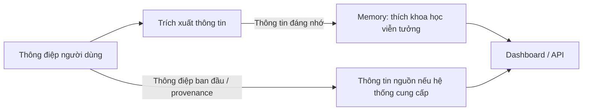

# Bài 06. Mem0 Platform: Cloud memory, dashboard và dữ kiện trích xuất

## 1. Tóm tắt

Thay vì tự vận hành vector database, LLM/embedding và history store, ứng dụng có thể dùng dịch vụ Mem0 Platform. Bài này giới thiệu `MemoryClient`, cách lưu và tìm ký ức trên cloud, kiểm tra dữ liệu qua dashboard và hiểu khác biệt giữa nội dung hội thoại và memory đã được trích xuất.

## 2. Mục tiêu học tập

Người học có thể sử dụng Mem0 Platform API key, gọi `add`/`search`, kiểm tra `metadata`, phân biệt memory được trích xuất với tin nhắn nguồn và giải thích sự khác biệt giữa OSS và Platform.

## 3. Mem0 OSS và Platform khác nhau thế nào?

| Tiêu chí | Mem0 OSS | Mem0 Platform |
| --- | --- | --- |
| Cách khởi tạo | `Memory()` hoặc `Memory.from_config(...)` | `MemoryClient(api_key=...)` |
| Nơi chạy bộ nhớ | Do người phát triển lựa chọn/vận hành | Dịch vụ do nhà cung cấp quản lý |
| Vector store | Tùy cấu hình, như Qdrant | Được dịch vụ quản lý |
| Hạ tầng | Tự chịu trách nhiệm cấu hình và vận hành | Bớt phần vận hành hạ tầng |
| Kiểm tra dữ liệu | Công cụ riêng/log/API | Có dashboard quản trị |
| Lưu ý | Tự lo lưu trữ, quyền và nâng cấp | Phải cân nhắc dữ liệu đưa lên cloud, quyền và chi phí |

Chỉ dùng **một** cách khởi tạo cho một luồng trong bài thực hành; không trộn method signature của OSS và Platform một cách tùy tiện.

## 4. Khởi tạo `MemoryClient`

Tạo API key từ dashboard chính thức và đặt vào biến môi trường `MEM0_API_KEY`:

```python
import os
from mem0 import MemoryClient

client = MemoryClient(api_key=os.environ["MEM0_API_KEY"])

messages = [
    {"role": "user", "content": "Mình tên là An và thích phim khoa học viễn tưởng."},
    {"role": "assistant", "content": "Mình sẽ dùng sở thích đó khi gợi ý phim."},
]
client.add(messages, user_id="an_001")
```

Dữ liệu ví dụ là giả lập; chỉ gửi dữ liệu cá nhân có quyền xử lý lên cloud. Nếu người dùng đã yêu cầu không lưu thông tin, ứng dụng phải tôn trọng lựa chọn đó.

## 5. Truy xuất ký ức trên cloud

```python
result = client.search(
    "Người dùng thích thể loại phim nào?",
    filters={"user_id": "an_001"},
)
for item in result.get("results", []):
    print(item.get("memory"))
```

Mem0 có thể trích xuất ký ức tương đương “Thích phim khoa học viễn tưởng”. Văn bản thực tế có thể được chuẩn hóa hoặc diễn đạt lại, không nhất thiết giống nguyên câu người dùng nói.

## 6. Hiểu cách memory được trích xuất

Ví dụ nhập hai thông tin: “Mình định xem phim tối nay” và “Mình thích khoa học viễn tưởng hơn phim giật gân”. Hệ thống có thể ưu tiên giữ sở thích thể loại, thay vì lưu chi tiết chỉ có giá trị trong một buổi tối.



Ký ức có thể là **một phát biểu được rút gọn hoặc chuẩn hóa**; không phải bản sao đầy đủ. Vì mô hình có thể diễn giải sai, dữ liệu quan trọng nên được xác minh với người dùng khi cần.

## 7. Gắn metadata và xem dashboard

```python
client.add(
    [{"role": "user", "content": "Mình thích xây dựng AI Agent."}],
    user_id="an_001",
    metadata={"category": "technology_interest", "source_app": "demo"},
)
```

Trong dashboard, xem danh sách người dùng, từng memory, các trường metadata và thông tin nguồn (nếu được hiển thị trong gói/tính năng hiện có). Kiểm tra đúng `user_id` trước khi kết luận rằng dữ liệu đã vào tài khoản mong muốn.

## 8. Trích xuất suy luận so với lưu trực tiếp

Một số API/phiên bản cho phép điều chỉnh chế độ xử lý thông tin, chẳng hạn tùy chọn `infer=False` trong OSS để tránh bước trích xuất mặc định và lưu theo đầu vào. Trước khi áp dụng trên **Platform**, cần kiểm tra phiên bản SDK và tài liệu của endpoint tương ứng: không mặc định mọi bản đều nhận `infer` giống nhau.

- **Trích xuất:** phù hợp để lưu sự kiện/sở thích ngắn gọn, giảm lặp và bớt dữ liệu tạm.
- **Lưu trực tiếp:** hữu ích khi cần giữ một phát biểu cụ thể, nhưng có thể tăng số bản ghi và chứa thông tin dư thừa.

Chế độ nào tốt hơn tùy mục tiêu, chi phí và yêu cầu bảo toàn nguyên văn. Với assistant cá nhân, thường cần cơ chế chọn lọc thông tin lâu dài thay vì ghi mọi phát biểu.

## 9. Quyền riêng tư và khả năng kiểm soát dữ liệu

Memory có thể chứa sở thích, nghề nghiệp, thói quen và thông tin nhạy cảm. Khi dùng Platform, cần xem chính sách lưu trữ/chia sẻ của nhà cung cấp, cấu hình quyền, cơ chế xóa, cũng như nhu cầu truyền dữ liệu sang nhà cung cấp model. Không công khai dashboard hoặc khóa truy cập. Trong hệ thống nhiều tài khoản, `user_id` cần gắn với phiên đăng nhập đã xác thực.

## 10. Bài thực hành

Tạo hai `user_id` giả lập: `alice_demo` thích khoa học viễn tưởng, `bob_demo` thích phiêu lưu. Thêm memory cho từng người, tìm kiếm theo filter, xác minh qua dashboard. Trả lời: mỗi message tạo bao nhiêu ký ức, metadata nằm ở đâu, và có thông tin nào bị trích xuất sai không?

## 11. Câu hỏi ôn tập

**Câu 1.** Đối tượng SDK nào thường dùng cho Mem0 Platform trong Python?  
A. `MemoryClient`.  
B. `StateGraph`.  
C. `QdrantClient` duy nhất.  
D. `InMemorySaver`.

**Đáp án:** A. **Giải thích:** `MemoryClient` kết nối dịch vụ cloud qua API key.

**Câu 2.** Truy vấn Platform theo một người dùng nên dùng cách nào?  
A. Bỏ toàn bộ filter.  
B. Chỉ truyền `thread_id`.  
C. `client.search(query, filters={"user_id": ...})`.  
D. Chỉ gọi `get_all` không phân biệt user.

**Đáp án:** C. **Giải thích:** Bộ lọc giúp giới hạn phạm vi ký ức đúng người.

**Câu 3.** Ký ức Mem0 có nhất thiết nguyên văn tin nhắn nguồn không?  
A. Luôn nguyên văn.  
B. Không; có thể là dữ kiện được trích xuất hoặc chuẩn hóa.  
C. Luôn có 100 ký tự.  
D. Luôn là câu của assistant.

**Đáp án:** B. **Giải thích:** Tính năng chính của memory layer là lưu thông tin có ích, không chỉ lưu chat log.

**Câu 4.** Vì sao cần kiểm tra `infer` với phiên bản Platform cụ thể?  
A. Vì `infer` là loại cơ sở dữ liệu.  
B. Vì nó thay thế mã API key.  
C. Vì nó luôn bắt buộc.  
D. Vì chữ ký API và tính năng có thể khác giữa phiên bản và OSS/Platform.

**Đáp án:** D. **Giải thích:** Không nên chuyển nguyên code của hai backend khi chưa đối chiếu tài liệu.

**Câu 5.** Rủi ro chính khi lưu mọi tin nhắn trực tiếp làm memory là gì?  
A. Tăng thông tin dư thừa và giảm ích lợi của bộ nhớ chọn lọc.  
B. Không thể dùng Python.  
C. Không tạo được `user_id`.  
D. LangGraph mất `START`.

**Đáp án:** A. **Giải thích:** Quá nhiều dữ liệu tạm làm tốn lưu trữ và gây nhiễu truy xuất.

## 12. Tổng kết

Mem0 Platform giảm công sức vận hành hạ tầng và có giao diện kiểm tra memory. Dù dùng OSS hay cloud, nguyên tắc vẫn giống nhau: trích xuất đúng dữ kiện, gắn đúng người dùng, kiểm tra thông tin trích xuất và giữ quyền kiểm soát dữ liệu.

**Tham khảo:** https://docs.mem0.ai/platform/quickstart · https://docs.mem0.ai/open-source/configuration
