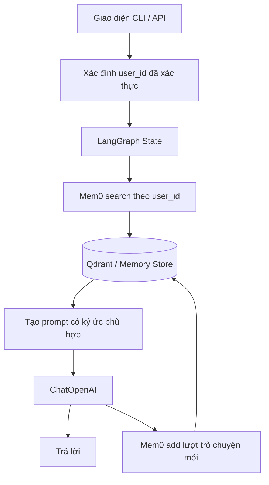

# Bài 07. Đồ án tổng kết: AI Agent cá nhân hóa bằng bộ nhớ dài hạn

## 1. Bài toán

Xây dựng một chatbot đơn giản có thể lưu và truy xuất sở thích của người dùng **giữa những cuộc trò chuyện độc lập**. Đồ án sử dụng Mem0 OSS kết hợp LangGraph; tùy chọn chuyển backend sang Qdrant Cloud hoặc Mem0 Platform.

Tình huống: Thứ Hai, người dùng nói “Mình thích cà phê ít đường”. Trong phiên khác, người dùng hỏi “Hôm nay nên uống gì?”. Agent phải có khả năng tìm lại sở thích liên quan, nhưng không được bịa các thông tin chưa có như mức độ dung nạp caffeine hay tình trạng sức khỏe.

## 2. Mục tiêu sản phẩm

Hệ thống đáp ứng những năng lực sau:

- Có ít nhất hai người dùng thử nghiệm, mỗi người có phạm vi ký ức riêng.
- Trích xuất/lưu sở thích qua `memory.add(...)`.
- Truy xuất ký ức liên quan trước câu trả lời qua `memory.search(...)`.
- Sử dụng LangGraph để phối hợp bước tìm, gọi LLM và lưu thông tin mới.
- Có kịch bản kiểm thử xuyên phiên, truy xuất sai người dùng và xử lý khi không có memory.
- Chỉ lưu các dữ liệu thử nghiệm, không để lộ API key.

## 3. Thiết kế hệ thống



Trong demo CLI, `user_id` được nhập cứng cho mục đích thử nghiệm. Trong ứng dụng thật, cần lấy từ phiên đăng nhập hợp lệ, không tin một chuỗi `user_id` tùy ý do người dùng gửi lên API.

## 4. Cấu trúc tệp đề xuất

```text
course/
  README.md
  01-kien-truc-bo-nho-ai-agent.md
  ...
  07-do-an-tong-ket-agent-ca-nhan-hoa.md
  examples/
    requirements.txt
    agent_langgraph_mem0.py
```

Mã mẫu trong thư mục `examples` triển khai một node LangGraph và Mem0 local có Qdrant path riêng. Có thể thay `Memory.from_config` bằng Mem0 Platform client sau khi đối chiếu chữ ký từng API. Để có backend Qdrant Cloud, thay phần `vector_store.config` theo Bài 05.

## 5. Các mốc triển khai

### 5.1. Mốc 1 — Tạo bộ nhớ và xác minh ghi dữ liệu

Cài dependencies, cấu hình khóa, tạo một đối tượng `Memory`. Thực hiện `add` rồi `search` với cùng `user_id`. Xác minh memory được tạo thực sự, không chỉ collection đã tồn tại.

### 5.2. Mốc 2 — Nối với LangGraph

Định nghĩa state có `messages` và `user_id`. Xây dựng node chatbot: truy xuất memory, đưa memory liên quan vào system context, gọi mô hình, lưu cặp user/assistant của lượt mới. Compile graph và gọi `invoke`.

### 5.3. Mốc 3 — Kiểm tra nhiều phiên

Chạy một lượt nhập sở thích, rồi gọi graph **một lần mới chỉ với câu hỏi ngắn**. Nếu agent trả lời dựa trên sở thích cũ, quan sát kết quả `search` để xác nhận dữ kiện được tìm từ Mem0, không phải ngữ cảnh phiên đang có.

### 5.4. Mốc 4 — Kiểm tra cô lập tài khoản

Thực hiện cùng câu hỏi với `user_id` khác. Hệ thống không được dùng ký ức của người đầu. Nếu thất bại, kiểm tra bộ lọc ở `search` và cơ chế gắn user ID, không chỉ sửa prompt.

## 6. Bộ kịch bản kiểm thử

| Ca | Dữ liệu đầu vào | Kết quả mong đợi |
| --- | --- | --- |
| T1: tạo ký ức | `user_a`: “Tôi thích cà phê ít đường” | Có ký ức thích hợp được lưu hoặc trích xuất |
| T2: xuyên phiên | `user_a`: “Gợi ý một đồ uống” ở lời gọi mới | Có thể cân nhắc sở thích cà phê khi gợi ý |
| T3: người khác | `user_b`: “Tôi thích trà”; sau đó hỏi đồ uống | Không đề cập sở thích riêng của `user_a` |
| T4: memory rỗng | `user_c` hỏi sở thích của mình | Không tự bịa một sở thích cụ thể |
| T5: kiểm tra biến đổi | `user_a` nói không còn thích cà phê | Đánh dấu để kiểm tra ký ức cũ và cách cập nhật |
| T6: không rò rỉ khóa | Chạy script và xem log | Không xuất `OPENAI_API_KEY`, `QDRANT_API_KEY` |

**Lưu ý:** Không mặc định `add` chắc chắn trích xuất một dữ kiện ở mọi lần chạy, vì kết quả phụ thuộc nội dung, model và thuật toán Mem0. Trong kiểm thử, cần ghi lại `add` output và `search` output, không chỉ dựa vào câu trả lời của LLM.

## 7. Tiêu chí hoàn thành

- [ ] Python chạy thành công với key nằm ngoài mã nguồn.
- [ ] `memory.add` và `memory.search` hoạt động trên dữ liệu mẫu.
- [ ] LangGraph có `START`, `chatbot`, `END`, state và output rõ ràng.
- [ ] Hai lượt gọi tách biệt cùng `user_id` có thể truy xuất ký ức đã lưu.
- [ ] Hai `user_id` khác nhau không lộ ký ức sang nhau.
- [ ] Không có lời khẳng định về sở thích khi chưa có dữ liệu phù hợp.
- [ ] Có ảnh chụp hoặc nhật ký đã ẩn thông tin bí mật để chứng minh kết quả.

## 8. Lỗi thường gặp và cách xử lý

| Tình huống | Nguyên nhân khả dĩ | Hành động |
| --- | --- | --- |
| Agent không nhớ qua phiên | Chưa ghi, sai user ID hoặc mất local data | Kiểm tra `add`, `search` và đường dẫn lưu |
| Agent dùng ký ức người khác | Thiếu hoặc sai bộ lọc | Bắt buộc filter ở layer dữ liệu |
| Memory được lưu trùng | Ghi lại toàn lịch sử ở mỗi lượt | Chỉ gửi lượt mới, xem chính sách chống trùng |
| Dữ kiện sai | LLM trích xuất/diễn đạt sai | Cho xem, sửa, xác nhận memory khi cần |
| Qdrant lỗi thiếu index | Chưa có index cho payload được lọc | Xác minh thông báo và tạo index đúng field nếu cần |
| Không nhớ trong cùng phiên | Graph chưa có checkpointer | Thêm checkpointer và `thread_id` cho session history |

## 9. Phần mở rộng có kiểm soát

Khi đã chạy ổn, có thể mở rộng agent gợi ý từ một danh mục sản phẩm hoặc database riêng. **Memory chứa sở thích**, còn **database chứa dữ liệu sản phẩm/món ăn**; không dùng vector memory để thay thế nguồn sự thật của sản phẩm. Ví dụ: `user_a` thích cà phê và yêu cầu “đồ uống ít đường”; hệ thống lấy sở thích từ Mem0 rồi lọc các đồ uống đang có trong database theo thuộc tính `sugar_grams`. Đây là ý tưởng mở rộng kiến trúc; phần kết nối database và truy vấn SQL không phải nội dung thực thi của giáo trình này.

## 10. Câu hỏi ôn tập

**Câu 1.** Thứ tự nào phù hợp cho một lượt trả lời có memory?  
A. Ghi lịch sử mới → bỏ qua memory → trả lời.  
B. Đọc tất cả users → gọi LLM → xóa Qdrant.  
C. Tìm memory phù hợp → tạo prompt → gọi LLM → cân nhắc lưu lượt mới.  
D. Tạo API key mới → bắt đầu lại.

**Đáp án:** C. **Giải thích:** Đây là chu trình đọc–sinh–ghi của agent cá nhân hóa.

**Câu 2.** Cách nào kiểm thử đúng bộ nhớ xuyên phiên?  
A. Gọi lại agent chỉ với câu hỏi mới nhưng cùng `user_id`, xác nhận memory được truy xuất.  
B. Đưa nguyên cả tin nhắn cũ vào prompt câu hỏi mới rồi tuyên bố nhớ dài hạn.  
C. Hỏi lại ngay trong cùng một câu hỏi.  
D. Bỏ qua log và chỉ đọc câu trả lời.

**Đáp án:** A. **Giải thích:** Cần loại bỏ ảnh hưởng của ngữ cảnh truyền trực tiếp để kiểm tra memory.

**Câu 3.** Nguồn dữ liệu nào nên quyết định danh sách đồ uống hiện có trong bài toán mở rộng?  
A. Tên của `thread_id`.  
B. Prompt mặc định.  
C. Điểm similarity của memory.  
D. Database/catalog sản phẩm hiện hành.

**Đáp án:** D. **Giải thích:** Bộ nhớ nắm sở thích; danh mục hiện hành là nguồn sự thật về sản phẩm.

**Câu 4.** Khi không truy xuất được ký ức phù hợp, agent nên làm gì?  
A. Khẳng định người dùng thích cà phê.  
B. Trả lời dựa trên dữ liệu hiện có hoặc hỏi sở thích, không bịa.  
C. Dùng ký ức của user khác.  
D. Tự sửa `user_id` thành tài khoản bất kỳ.

**Đáp án:** B. **Giải thích:** Thiếu memory là tình huống bình thường; không được phỏng đoán dữ liệu cá nhân.

**Câu 5.** Trong production, `user_id` nên được lấy từ đâu?  
A. Một giá trị ngẫu nhiên cho mỗi tin nhắn.  
B. Chuỗi client tự nhập mà không cần kiểm tra.  
C. Danh tính người dùng đã được hệ thống xác thực.  
D. Tên của mô hình AI.

**Đáp án:** C. **Giải thích:** Xác thực và cô lập tenant là điều kiện ngăn lộ bộ nhớ giữa người dùng.

## 11. Tổng kết

Sản phẩm hoàn thành khi có bằng chứng về **lưu đúng người**, **truy xuất đúng ngữ cảnh** và **sử dụng ký ức xuyên phiên**. Hệ thống chỉ đáng tin cậy khi quản lý được dữ liệu sai, quyền riêng tư, sự tạm thời của thông tin và khác biệt giữa memory với dữ liệu nghiệp vụ.

**Tham khảo:** https://docs.mem0.ai/open-source/python-quickstart · https://docs.langchain.com/oss/python/langgraph/graph-api
