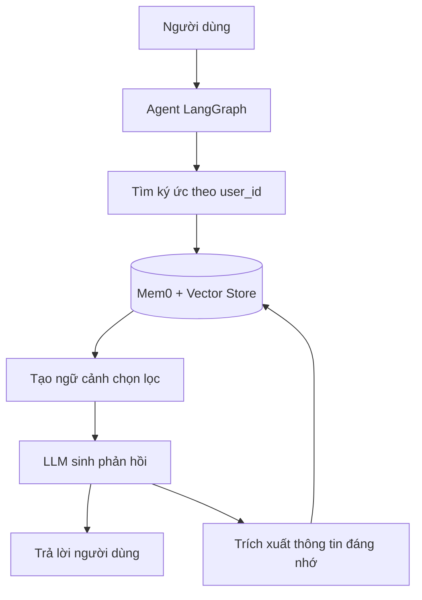

# Khóa học: Xây dựng bộ nhớ dài hạn cho AI Agent với Mem0, LangGraph và Qdrant

> Giáo trình tiếng Việt · Python · Học qua ví dụ và bài thực hành

## 1. Giới thiệu

Một trợ lý AI có thể trả lời tốt trong cuộc trò chuyện hiện tại nhưng quên sở thích của người dùng khi họ bắt đầu phiên mới. Khóa học này hướng dẫn thiết kế một **lớp bộ nhớ dài hạn theo người dùng**: trích xuất thông tin đáng ghi nhớ, tìm lại những ký ức liên quan và sử dụng chúng khi tạo câu trả lời. Trọng tâm là Mem0 (OSS và Platform), LangGraph và Qdrant.

Tình huống xuyên suốt: Thứ Hai, một người dùng nói “Mình thích cà phê”; Chủ Nhật, người đó yêu cầu “Gợi ý đồ uống”. Agent cần tìm lại sở thích từ lần trò chuyện trước, nhưng **không tự suy đoán** các chi tiết chưa biết (ví dụ dị ứng, ngân sách).

## 2. Mục tiêu đầu ra

Sau khóa học, người học có thể:

- Giải thích khác biệt giữa lịch sử hội thoại theo phiên và bộ nhớ dài hạn theo `user_id`.
- Cài đặt Mem0, lưu/tìm/sửa/xem lịch sử ký ức và dùng `metadata`.
- Thiết kế một LangGraph có nút truy xuất ký ức trước khi gọi LLM.
- Chuyển vector store sang Qdrant và xử lý lỗi chỉ mục `user_id` khi gặp.
- So sánh Mem0 OSS tự vận hành với Mem0 Platform có dashboard.
- Kiểm thử tác nhân bằng hai cuộc hội thoại tách biệt, kiểm tra cô lập người dùng.

## 3. Lộ trình

| Bài | Tệp | Nội dung | Sản phẩm |
| --- | --- | --- | --- |
| 01 | [01-kien-truc-bo-nho-ai-agent.md](01-kien-truc-bo-nho-ai-agent.md) | Kiến trúc, memory và session history | Sơ đồ luồng truy xuất/lưu |
| 02 | [02-cai-dat-mem0-va-cau-hinh-cuc-bo.md](02-cai-dat-mem0-va-cau-hinh-cuc-bo.md) | Python, key và cấu hình OSS | Lưu ký ức đầu tiên |
| 03 | [03-thao-tac-ky-uc-crud.md](03-thao-tac-ky-uc-crud.md) | `add`, `search`, `get`, `get_all`, `update`, `history` | Bài tập quản lý ký ức |
| 04 | [04-tich-hop-mem0-voi-langgraph.md](04-tich-hop-mem0-voi-langgraph.md) | `StateGraph`, `State`, `Node`, `START`, `END` | Agent nhớ xuyên phiên |
| 05 | [05-cau-hinh-qdrant.md](05-cau-hinh-qdrant.md) | Qdrant local/Cloud, payload index | Lưu và kiểm tra vector memory |
| 06 | [06-mem0-platform-va-suy-luan-ky-uc.md](06-mem0-platform-va-suy-luan-ky-uc.md) | MemoryClient, dashboard, infer, metadata | Bản thử nghiệm Cloud |
| 07 | [07-do-an-tong-ket-agent-ca-nhan-hoa.md](07-do-an-tong-ket-agent-ca-nhan-hoa.md) | Thiết kế, kiểm thử, tiêu chí hoàn thành | Mini-project cá nhân hóa |

## 4. Cách học

Đọc theo thứ tự. Thực hành bằng tài khoản API thử nghiệm và **dữ liệu giả lập**, không đưa khóa vào mã nguồn. Bài 04 có một ví dụ mã chạy được tại [`examples/agent_langgraph_mem0.py`](examples/agent_langgraph_mem0.py). Bài 05–06 là những lựa chọn triển khai bổ sung, không bắt buộc phải đăng ký dịch vụ trả phí để học phần cốt lõi.



Sơ đồ biểu diễn hai hướng: **đọc ký ức trước khi trả lời** và **ghi ký ức sau lượt hội thoại**. Bộ nhớ không thay thế lịch sử hội thoại, mà bổ sung thông tin lâu dài có liên quan.

## 5. Chuẩn bị

- Python 3.10 trở lên, môi trường ảo và trình soạn thảo mã.
- Khóa API của mô hình/embedding provider được Mem0 cấu hình; ví dụ dùng `OPENAI_API_KEY`.
- Một thư mục có quyền ghi để lưu Qdrant local và SQLite history.
- Tùy chọn: Docker hoặc Qdrant Cloud; Mem0 Platform API key; LangSmith để quan sát.

Chạy ví dụ:

```bash
python -m venv .venv
# Windows PowerShell
.venv\Scripts\Activate.ps1
# Linux/macOS: source .venv/bin/activate
pip install -r examples/requirements.txt
python examples/agent_langgraph_mem0.py
```

Cấu hình key vào biến môi trường của shell hoặc notebook secrets; chương trình sẽ báo lỗi rõ ràng nếu thiếu key.

## 6. Tài liệu tham khảo kỹ thuật

- [Mem0 OSS — Python Quickstart](https://docs.mem0.ai/open-source/python-quickstart)
- [Mem0 OSS — Configuration](https://docs.mem0.ai/open-source/configuration)
- [Mem0 Platform — Quickstart](https://docs.mem0.ai/platform/quickstart)
- [Qdrant — Mem0 integration](https://qdrant.tech/documentation/frameworks/mem0/)
- [LangGraph — Graph API overview](https://docs.langchain.com/oss/python/langgraph/graph-api)

**Lưu ý tương thích (30/10/2026):** API và thuật toán Mem0 có thể thay đổi giữa phiên bản. Các ví dụ dùng hình thức phổ biến trong tài liệu hiện hành; nên kiểm tra hướng dẫn migration khi nâng cấp. Nội dung về việc tạo payload index là phương án khắc phục một lỗi được quan sát trong bài thực hành, không phải bước bắt buộc với mọi phiên bản/triển khai.
