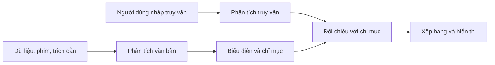

# Bài 01 — Từ tìm kiếm chuỗi đến tìm kiếm toàn văn

## 1. Tóm tắt

Tìm kiếm dữ liệu không chỉ là kiểm tra một chuỗi có chứa ký tự nào đó. Với ứng dụng có hàng nghìn phim, bài viết hoặc công thức nấu ăn, người dùng mong muốn kết quả có mức độ liên quan, tìm được các biến thể của từ và thấy ngay đoạn văn phù hợp. PostgreSQL hỗ trợ các mức độ tìm kiếm khác nhau, từ phép so khớp mẫu đến **Full-Text Search (FTS)** có đánh chỉ mục.

## 2. Mục tiêu học tập

- Phân biệt truy vấn bằng `LIKE`, `ILIKE`, biểu thức chính quy và FTS.
- Viết mẫu tìm kiếm theo tiền tố, hậu tố và số lượng ký tự.
- Mô tả quy trình xây dựng chỉ mục và truy vấn tìm kiếm.
- Quyết định lúc nào nên bắt đầu với PostgreSQL thay vì triển khai ngay Elasticsearch hoặc Algolia.

## 3. So khớp chuỗi truyền thống

Giả sử bảng `quotes(id, author, content)` chứa các câu trích dẫn. Để tìm câu mở đầu bằng `Anyone`, ký hiệu `%` đại diện cho **không hoặc nhiều ký tự**:

```sql
SELECT id, content
FROM quotes
WHERE content LIKE 'Anyone%';
```

Ký hiệu `_` đại diện cho **đúng một ký tự**. Muốn tìm câu kết thúc bằng `strong.` với một ký tự tùy ý ngay trước `trong.`:

```sql
SELECT content FROM quotes WHERE content LIKE '%_trong.';
```

Khác `LIKE`, `ILIKE` không phân biệt chữ hoa/chữ thường theo cơ chế so khớp phụ thuộc locale/collation. Cần nhớ `ILIKE '%light%'` vẫn là so khớp mẫu ký tự, không phải tìm nội dung theo ngữ nghĩa.

```sql
SELECT content FROM quotes WHERE content ILIKE '%light%';
SELECT content FROM quotes WHERE content ~* '^anyone';
```

Toán tử `~` là biểu thức chính quy phân biệt chữ hoa/thường; `~*` thì không. `^` chỉ đầu chuỗi, `$` chỉ cuối chuỗi. Regex mạnh cho kiểm tra mẫu, nhưng bản thân nó không tự xếp hạng những bản ghi liên quan nhất.

## 4. Khi tìm kiếm cần nhiều hơn

| Nhu cầu | So khớp chuỗi | Full-Text Search |
| --- | --- | --- |
| Chứa chuỗi ký tự | Tốt | Theo từ vựng/token |
| Xử lý từ gốc với cấu hình phù hợp | Không | Có |
| Loại bỏ stop words | Không | Có theo cấu hình |
| Tìm cụm từ với thứ tự từ | Làm được bằng mẫu thô | Có toán tử vị trí |
| Xếp hạng mức độ liên quan | Phải tự xây | `ts_rank`, `ts_rank_cd` |
| Gợi ý lỗi chính tả | Không mặc định | Thường phối hợp `pg_trgm` |

FTS không phải **semantic search**: nó không tự hiểu ý nghĩa sâu hoặc mọi từ đồng nghĩa. Mỗi tính năng phụ thuộc cấu hình từ điển, dữ liệu và phần mở rộng sử dụng.

## 5. Hai giai đoạn của công cụ tìm kiếm



Giai đoạn **lập chỉ mục** chuyển văn bản thành đơn vị có thể truy vấn; giai đoạn **tìm kiếm** chuyển đầu vào của người dùng thành điều kiện và so khớp với dữ liệu đã chuẩn bị. Lucene thường là nền tảng bên dưới Elasticsearch; PostgreSQL FTS triển khai quy trình tương tự bằng các kiểu dữ liệu và toán tử riêng.

## 6. Lựa chọn công nghệ

Nếu dữ liệu đã nằm trong PostgreSQL và bài toán ở quy mô nhỏ đến vừa, sử dụng FTS trước giúp giảm một hệ thống cần vận hành, đồng bộ và giám sát. Elasticsearch hoặc dịch vụ tìm kiếm chuyên dụng phù hợp khi yêu cầu lớn hơn về phân tán, khả năng phân tích, các tính năng search đặc thù hoặc hạ tầng tìm kiếm riêng.

**Bài thực hành ngắn:** chạy ba truy vấn `LIKE`, `ILIKE`, `~*` trên dữ liệu mẫu, giải thích vì sao chúng không có điểm xếp hạng.
## Câu hỏi ôn tập

**Câu 1.** Muốn không phân biệt chữ hoa/thường khi tìm chuỗi, cách nào phù hợp?

A. `LIKE`  
B. `ILIKE`  
C. `ts_rank`  
D. `REFRESH`  

**Đáp án: B.** `ILIKE` là toán tử so khớp mẫu không phân biệt hoa/thường.

**Câu 2.** Trong mẫu `LIKE`, dấu `_` biểu diễn gì?

A. Chuỗi bất kỳ độ dài  
B. Không ký tự  
C. Đúng một ký tự  
D. Dấu gạch dưới nguyên văn  

**Đáp án: C.** `_` chỉ khớp một ký tự; `%` mới khớp số lượng bất kỳ.

**Câu 3.** Vì sao cần FTS khi muốn xếp hạng kết quả?

A. Vì FTS luôn trả kết quả nhanh nhất  
B. Vì `LIKE` tự tính điểm  
C. Vì FTS loại bỏ hoàn toàn SQL  
D. Vì FTS có các hàm `ts_rank`/`ts_rank_cd`  

**Đáp án: D.** FTS cung cấp biểu diễn tìm kiếm và hàm tính điểm.

**Câu 4.** FTS có tự hiểu mọi từ đồng nghĩa không?

A. Không, cần cấu hình thích hợp  
B. Có, luôn có  
C. Chỉ khi thêm `ORDER BY`  
D. Chỉ khi dùng `ILIKE`  

**Đáp án: A.** Xử lý từ đồng nghĩa là chức năng phải cấu hình thêm.

**Câu 5.** Khi dữ liệu đã nằm trong PostgreSQL, lợi ích đáng cân nhắc là gì?

A. Không bao giờ cần chỉ mục  
B. Không phải vận hành ngay một hệ tìm kiếm riêng  
C. Tự động có semantic embeddings  
D. Không cần tối ưu truy vấn  

**Đáp án: B.** FTS tận dụng hạ tầng hiện có, nhưng vẫn cần chỉ mục và tối ưu.


## Tổng kết

Hãy tự chạy lại các truy vấn trong bài, đối chiếu kết quả và ghi chú ít nhất một tình huống ứng dụng thực tế. Khi thay đổi dữ liệu, cần kiểm tra cả độ đúng của kết quả lẫn cách PostgreSQL thực thi truy vấn.
