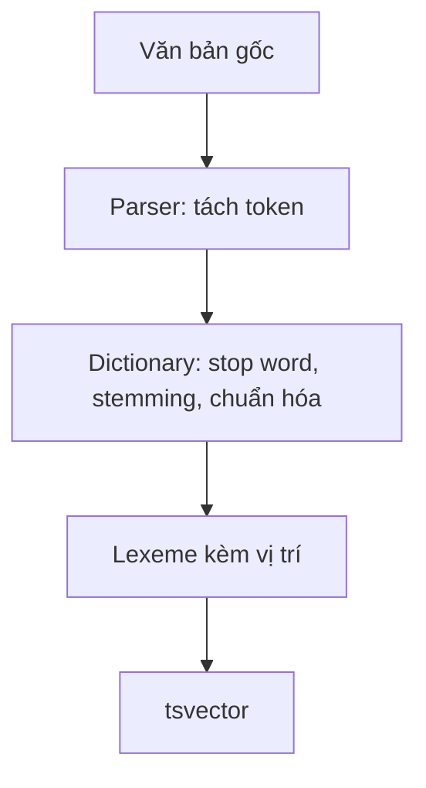

# Bài 02 — `tsvector`, token, lexeme và từ điển

## 1. Tóm tắt

`tsvector` là dạng biểu diễn văn bản đã được chuẩn hóa cho tìm kiếm. Từ ngữ gốc trong chuỗi được tách thành token, xử lý qua từ điển và trở thành **lexeme**; PostgreSQL có thể lưu vị trí của chúng trong tài liệu.

## 2. Mục tiêu học tập

- Tạo `tsvector` bằng `to_tsvector` với cấu hình tường minh.
- Giải thích sự khác nhau giữa token, lexeme và stop word.
- Phân biệt cấu hình `english` và `simple`.
- Kiểm tra xử lý văn bản bằng `ts_parse`, `ts_lexize`, `ts_debug`.

## 3. Tạo biểu diễn tìm kiếm

```sql
SELECT to_tsvector('english', 'The darkness cannot extinguish the light');
SELECT to_tsvector('english', 'Dark darkness darker');
```

Cấu hình `english` có thể loại bỏ từ dừng như `the`, rồi rút gọn một số từ về dạng lexeme. Dãy số sau dấu `:` là vị trí của lexeme trong câu ban đầu. Dữ liệu vị trí hữu ích khi tìm cụm từ hoặc xếp hạng theo mức độ gần nhau.

Hàm có hai cách gọi: `to_tsvector(text)` dùng cấu hình mặc định của phiên làm việc; `to_tsvector(regconfig, text)` truyền cấu hình cụ thể. Trong ứng dụng thực tế, nên **truyền cấu hình rõ ràng** để kết quả không bị thay đổi ngoài ý muốn khi cấu hình mặc định đổi.

## 4. Tên riêng và ngôn ngữ

```sql
SELECT to_tsvector('english', 'The Who');
SELECT to_tsvector('simple', 'The Who');
```

Với tên riêng, một từ được coi là stop word trong tiếng Anh vẫn có thể là phần thiết yếu của tên nhóm nhạc hoặc thương hiệu. `simple` thường giữ lexeme thay vì áp dụng stemming tiếng Anh hay bộ stop word tiếng Anh; vẫn có chuẩn hóa cơ bản, chẳng hạn chữ hoa/thường.

> **Lưu ý tiếng Việt:** PostgreSQL mặc định không có phân tích từ vựng tiếng Việt tương đương bộ stemming tiếng Anh. Dùng `simple` là điểm bắt đầu, nhưng tiếng Việt có nhiều từ ghép gồm các âm tiết cách nhau bởi dấu cách. Muốn tìm chính xác từ ghép, có thể cần tách từ ngoài PostgreSQL hoặc công cụ xử lý tiếng Việt phù hợp.

## 5. Từ token sang lexeme



Parser và từ điển làm các việc khác nhau. `ts_parse` hiển thị những token mà parser nhận diện; `ts_lexize` kiểm tra cách một từ điển cụ thể xử lý một token; `ts_debug` trình bày đầy đủ parser, từ điển và lexeme.

```sql
SELECT * FROM ts_parse('default', 'Light and darkness');
SELECT ts_lexize('english_stem', 'darkness');
SELECT * FROM ts_debug('english', 'Light and darkness');
```

Một mảng lexeme rỗng thường cho thấy token bị loại bỏ, ví dụ stop word. Khi kiểm tra dữ liệu thực, đừng kết luận chỉ dựa vào một ví dụ: số ít, số nhiều, tên riêng, dấu câu và ngôn ngữ đều có thể khiến kết quả thay đổi.

## 6. Tiện ích `unaccent`

`unaccent` có thể giúp chuẩn hóa một số ký tự có dấu, ví dụ để so khớp `café` và `cafe`. Đây là extension; việc cài extension không tự động biến toàn bộ cấu hình FTS thành không dấu.

```sql
CREATE EXTENSION IF NOT EXISTS unaccent;
SELECT unaccent('café');
```

Nếu muốn kết hợp `unaccent` trong pipeline FTS, cần tạo hoặc thay đổi cấu hình text search dùng từ điển tương ứng. Với tiếng Việt, loại bỏ dấu có thể làm mất phân biệt nghĩa; nên xem đó là lựa chọn có đánh đổi.

**Thực hành:** chạy `to_tsvector('english',...)` và `to_tsvector('simple',...)` trên `The Who`, `running quickly`, sau đó so sánh lexeme.
## Câu hỏi ôn tập

**Câu 1.** Dữ liệu nào mô tả đúng `tsvector`?

A. Một bảng vật lý riêng  
B. Biểu diễn lexeme và vị trí phục vụ tìm kiếm  
C. Một endpoint HTTP  
D. Một kiểu lưu ảnh  

**Đáp án: B.** `tsvector` chứa lexeme đã chuẩn hóa và có thể mang thông tin vị trí.

**Câu 2.** Tại sao tên riêng đôi khi nên dùng cấu hình `simple`?

A. Vì luôn nhanh hơn mọi cấu hình  
B. Vì bắt buộc dùng cho số  
C. Vì tránh loại bỏ các từ quan trọng như stop word tiếng Anh  
D. Vì tự nhận diện mọi ngôn ngữ  

**Đáp án: C.** Tên riêng có thể chứa từ phổ biến mà cấu hình tiếng Anh loại bỏ.

**Câu 3.** Hàm nào hiển thị cả quá trình nhận diện token và từ điển?

A. `ts_debug`  
B. `ts_rank`  
C. `pg_trgm`  
D. `string_agg`  

**Đáp án: A.** `ts_debug` rất hữu ích khi truy vết quy trình chuẩn hóa.

**Câu 4.** `unaccent` tự động làm mọi FTS không dấu ngay sau khi tạo extension?

A. Đúng  
B. Chỉ trên index GiST  
C. Chỉ trong Spring Boot  
D. Không, cần tích hợp vào pipeline cấu hình  

**Đáp án: D.** Extension cung cấp chức năng, còn cấu hình FTS phải dùng đúng từ điển.

**Câu 5.** Với tiếng Việt, `simple` có hạn chế gì?

A. Không lưu được văn bản  
B. Không tự giải quyết hoàn toàn bài toán tách từ ghép tiếng Việt  
C. Không hoạt động trên PostgreSQL  
D. Không so khớp chữ cái  

**Đáp án: B.** Cấu hình mặc định không thay thế bộ phân đoạn từ tiếng Việt chuyên dụng.


## Tổng kết

Hãy tự chạy lại các truy vấn trong bài, đối chiếu kết quả và ghi chú ít nhất một tình huống ứng dụng thực tế. Khi thay đổi dữ liệu, cần kiểm tra cả độ đúng của kết quả lẫn cách PostgreSQL thực thi truy vấn.
