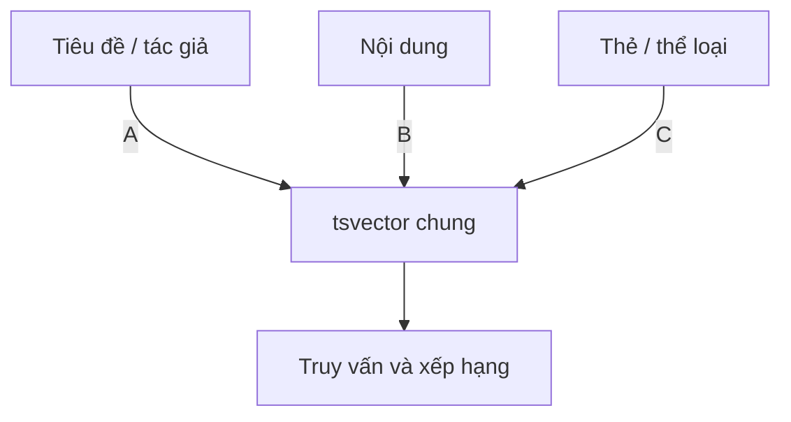

# Bài 04 — Tìm kiếm tài liệu kết hợp nhiều trường

## 1. Tóm tắt

Một kết quả tìm kiếm trên website có thể phụ thuộc tiêu đề, nội dung, tác giả và thẻ. Thay vì chỉ xét từng cột riêng lẻ, ta có thể tạo **một tài liệu tìm kiếm logic** từ nhiều trường và gán trọng số cho từng phần.

## 2. Mục tiêu học tập

- Ghép nhiều `tsvector` bằng `||`.
- Dùng `COALESCE` để xử lý dữ liệu `NULL`.
- Gán trọng số `A/B/C/D` bằng `setweight`.
- Phân biệt tài liệu logic với hàng dữ liệu gốc.

## 3. Tài liệu tìm kiếm là gì?

Giả sử một câu trích dẫn có tác giả, phần nội dung và tag. Truy vấn chỉ trên `content` sẽ bỏ lỡ người tìm theo tác giả hay tag. Tạo một `tsvector` hợp nhất khắc phục vấn đề đó:

```sql
SELECT
    setweight(to_tsvector('simple', COALESCE(author, '')), 'A')
 || setweight(to_tsvector('english', COALESCE(content, '')), 'B')
 AS search_doc
FROM quotes;
```

`||` nối các vector, đồng thời duy trì thông tin vị trí tương đối theo quy tắc của `tsvector`. Với trường dạng tag lưu ở bảng quan hệ, dùng `string_agg` để tổng hợp chuỗi tag trước khi chuyển đổi. Không nên viết subquery không được tối ưu lặp lại trên mỗi hàng nếu dữ liệu lớn.

## 4. Trọng số tác động đến xếp hạng

`setweight` gắn nhãn quan trọng vào lexeme: A cao nhất theo bộ trọng số mặc định của hàm xếp hạng, sau đó B, C, D. Bộ trọng số mặc định trong các hàm ranking tương ứng D=0.1, C=0.2, B=0.4, A=1.0. Đây là **trọng số**, không phải điểm số cố định của một kết quả.

Ví dụ, trên trang nội dung, tiêu đề khớp `Albert` thường nên được ưu tiên hơn một lần nhắc thoáng qua trong mô tả. Với trang trích dẫn, tên tác giả cũng có thể được ưu tiên cao. Việc gán trọng số là lựa chọn sản phẩm và cần kiểm chứng qua các truy vấn điển hình.



Sơ đồ thể hiện ba phần của một tài liệu tìm kiếm thống nhất. Cần giữ `NULL` không làm triệt tiêu phép ghép; có thể dùng `COALESCE` trên từng trường văn bản.

## 5. Cách đặt cấu hình theo trường

Tên người, tên phim và danh mục có thể cần `simple` để tránh loại bỏ các tên riêng giống stop word. Với bài viết tiếng Anh, `english` có thể hữu ích vì có stemming. Nhưng hãy kiểm thử khả năng khớp với cùng truy vấn: nếu tài liệu dùng `simple` cho tên còn truy vấn dùng `english`, một số từ dừng sẽ không thể khớp như mong đợi.

Một hệ thống nhiều bảng nên ánh xạ được kết quả về `(source_type, source_id)`, vì `id=1` của một bộ phim không phải `id=1` của một câu trích dẫn.

**Thực hành:** mở `sql/00-khoi-tao.sql`, đọc phần `search_documents` và giải thích trường nào được đánh trọng số A, B, C.
## Câu hỏi ôn tập

**Câu 1.** Vì sao cần `COALESCE` khi xây dựng tài liệu từ nhiều cột?

A. Để sinh ID tự động  
B. Để xử lý cột NULL trước khi chuyển thành vector  
C. Để tạo thêm chỉ mục ngầm  
D. Để đổi encoding  

**Đáp án: B.** `COALESCE` thay NULL bằng giá trị thích hợp trước khi ghép dữ liệu.

**Câu 2.** Trọng số mặc định cao nhất thuộc nhãn nào?

A. D  
B. C  
C. B  
D. A  

**Đáp án: D.** Trong ranking mặc định, A thường có trọng số cao nhất.

**Câu 3.** Toán tử nào ghép hai `tsvector`?

A. `||`  
B. `@@`  
C. `~*`  
D. `%`  

**Đáp án: A.** `||` là toán tử nối vector.

**Câu 4.** Khi hợp nhất kết quả phim và trích dẫn, định danh hợp lý là?

A. Chỉ title  
B. Chỉ id  
C. `(source_type, source_id)`  
D. Chỉ rank  

**Đáp án: C.** Định danh kết hợp tránh trùng khóa từ hai bảng khác nhau.

**Câu 5.** Tại sao `simple` có thể hữu ích với tên riêng?

A. Vì tự dịch tên  
B. Vì có thể giữ lexeme bị loại trong cấu hình có stop words  
C. Vì đánh dấu HTML  
D. Vì luôn tạo score 1  

**Đáp án: B.** Cấu hình đơn giản ít làm biến đổi tên riêng hơn stemming ngôn ngữ.


## Tổng kết

Hãy tự chạy lại các truy vấn trong bài, đối chiếu kết quả và ghi chú ít nhất một tình huống ứng dụng thực tế. Khi thay đổi dữ liệu, cần kiểm tra cả độ đúng của kết quả lẫn cách PostgreSQL thực thi truy vấn.
