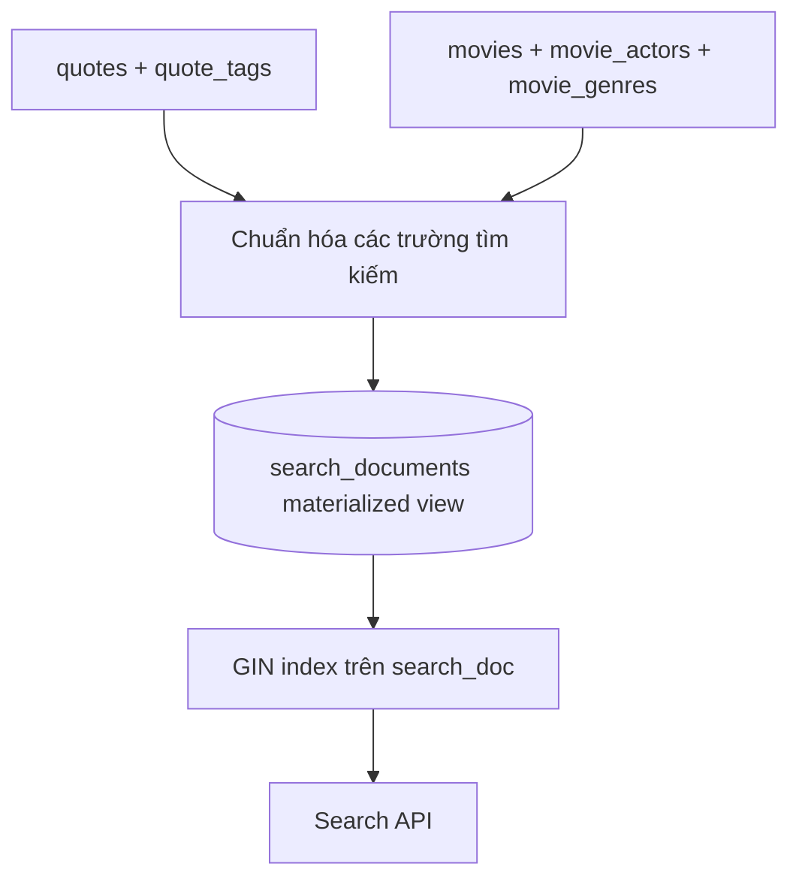

# Bài 07 — Tìm kiếm trên nhiều bảng bằng materialized view

## 1. Tóm tắt

Một ứng dụng có thể lưu phim ở bảng `movies`, diễn viên ở `movie_actors`, trích dẫn ở `quotes`, thẻ ở `quote_tags`. Người dùng chỉ thấy một ô tìm kiếm. **Materialized view** cho phép tập hợp kết quả của một câu SQL nhiều bảng thành dữ liệu được lưu vật lý và lập chỉ mục.

## 2. Mục tiêu học tập

- Xây dựng tài liệu tìm kiếm từ nhiều bảng bằng `UNION ALL`.
- Tạo unique index và GIN index trên materialized view.
- Phân biệt `REFRESH MATERIALIZED VIEW` và `... CONCURRENTLY`.
- Thiết kế chiến lược cập nhật chỉ mục khi dữ liệu thay đổi.

## 3. Chuẩn hóa mô hình kết quả

Mỗi loại nội dung được chuyển thành các trường chung: `source_type`, `source_id`, `title`, `body`, `metadata`, `search_doc`. `source_type` phân biệt phim và câu trích dẫn; `source_id` giữ ID để điều hướng về bản gốc. `UNION ALL` kết hợp tài liệu, tránh chi phí khử trùng lặp không cần thiết.



Sơ đồ cho thấy dữ liệu quan hệ vẫn là nguồn sự thật; materialized view là bản chụp kết quả cho mục đích truy vấn nhanh. File `sql/00-khoi-tao.sql` chứa ví dụ hoàn chỉnh với hai nguồn dữ liệu.

## 4. Tạo và đánh chỉ mục

Sau khi tạo materialized view từ SQL chuẩn hóa, cần hai loại chỉ mục khác nhiệm vụ:

```sql
CREATE UNIQUE INDEX search_documents_identity_uidx
ON search_documents (source_type, source_id);

CREATE INDEX search_documents_search_gin
ON search_documents USING GIN (search_doc);
```

Unique index với các cột đơn giản bao phủ tất cả hàng là điều kiện quan trọng để `REFRESH MATERIALIZED VIEW CONCURRENTLY` được chấp nhận. GIN index phục vụ tra cứu `search_doc`.

## 5. Làm mới khi dữ liệu thay đổi

```sql
REFRESH MATERIALIZED VIEW search_documents;
-- Sau khi unique index hợp lệ đã tồn tại:
REFRESH MATERIALIZED VIEW CONCURRENTLY search_documents;
```

Materialized view **không tự cập nhật** sau `INSERT`, `UPDATE`, `DELETE` ở bảng nguồn. Bản làm mới thông thường có thể chặn truy vấn trong quá trình refresh; phiên bản `CONCURRENTLY` cho phép tiếp tục đọc nhưng vẫn có chi phí, khóa và yêu cầu riêng. Không nên mặc định chạy `REFRESH ... CONCURRENTLY` từ trigger mỗi khi một hàng thay đổi: refresh toàn bộ liên tục sẽ tốn chi phí và tạo rủi ro cạnh tranh giao dịch.

Trong hệ thống thật, có thể chọn lịch refresh theo đợt, worker sau khi dữ liệu đổi hoặc bảng chỉ mục tự duy trì riêng theo event. Quyết định dựa vào yêu cầu **độ mới dữ liệu** và tần suất ghi.

## 6. Kiểm tra độ mới

Thêm một phim, truy vấn tìm kiếm trước refresh sẽ chưa thấy phim mới. Chạy lệnh refresh rồi thử lại để xác nhận hành vi. Với nội dung cần xuất hiện tức thì, giải pháp dựa trên materialized view định kỳ sẽ chưa đủ.

**Thực hành:** thực hiện lab trong `thuc-hanh/lab-01-chay-postgres.md`, truy vấn phim/trích dẫn bằng một ô tìm kiếm và giải thích lý do dùng cặp khóa `(source_type, source_id)`.
## Câu hỏi ôn tập

**Câu 1.** Materialized view khác view thường ở điểm nào?

A. Lưu kết quả truy vấn vật lý  
B. Chỉ chứa JSON  
C. Không có index được  
D. Tự đồng bộ tức thì  

**Đáp án: A.** Materialized view lưu dữ liệu vật lý và cần refresh.

**Câu 2.** Chỉ mục nào hỗ trợ `CONCURRENTLY` refresh?

A. Chỉ GIN  
B. Một unique index đủ điều kiện bao phủ mọi hàng  
C. Hash index bất kỳ  
D. Index partial với WHERE  

**Đáp án: B.** `CONCURRENTLY` yêu cầu unique index đáp ứng điều kiện của PostgreSQL.

**Câu 3.** Để tìm kiếm từ nhiều bảng có chung cấu trúc kết quả, lựa chọn nào phù hợp?

A. `TRUNCATE`  
B. `VACUUM`  
C. `UNION ALL`  
D. `DROP TABLE`  

**Đáp án: C.** `UNION ALL` hợp nhất các tập bản ghi đã chuẩn hóa.

**Câu 4.** Điều gì xảy ra nếu thay đổi dữ liệu nguồn mà chưa refresh?

A. View tự cập nhật ngay  
B. Index GIN tự sửa nội dung view  
C. PostgreSQL xóa dữ liệu gốc  
D. Dữ liệu view có thể cũ  

**Đáp án: D.** Materialized view là bản chụp cần làm mới.

**Câu 5.** Vì sao refresh trong trigger cho từng hàng có thể nguy hiểm?

A. Dễ gây nhiều lần refresh tốn kém và lock  
B. Vì trigger không tồn tại  
C. Vì GIN cần xóa  
D. Vì mọi trigger đều bất hợp pháp  

**Đáp án: A.** Khối lượng ghi cao có thể khiến làm mới liên tục tốn tài nguyên.


## Tổng kết

Hãy tự chạy lại các truy vấn trong bài, đối chiếu kết quả và ghi chú ít nhất một tình huống ứng dụng thực tế. Khi thay đổi dữ liệu, cần kiểm tra cả độ đúng của kết quả lẫn cách PostgreSQL thực thi truy vấn.
