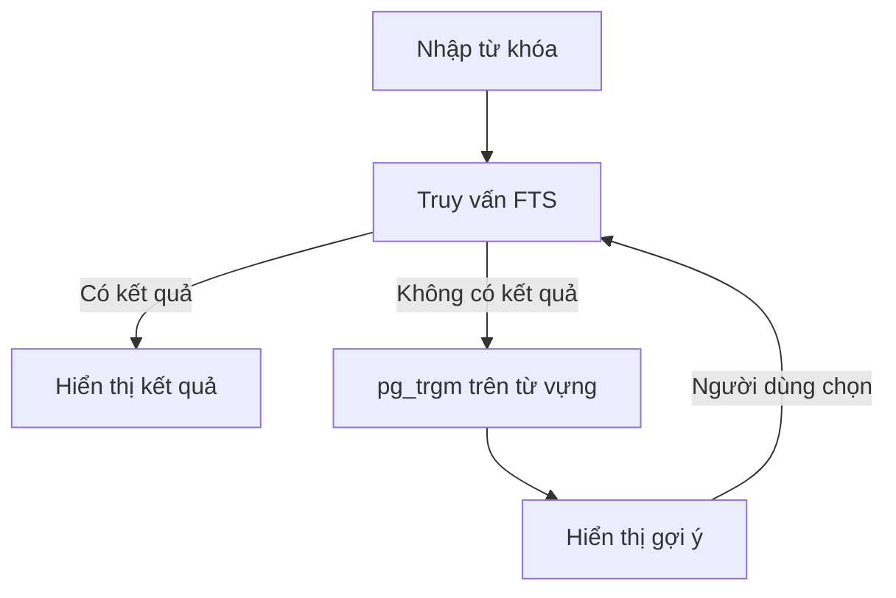

# Bài 08 — `pg_trgm` và gợi ý khi gõ sai chính tả

## 1. Tóm tắt

FTS thường tìm theo từ được chuẩn hóa, nhưng không bảo đảm nhận ra từ bị gõ sai. PostgreSQL cung cấp extension `pg_trgm`, phân tách chuỗi thành các cụm ba ký tự để đo độ tương tự. Kết hợp `pg_trgm` với tập từ của FTS tạo cơ chế **“Có phải bạn muốn tìm...”**.

## 2. Mục tiêu học tập

- Kích hoạt `pg_trgm`, quan sát trigram và tính độ tương tự.
- Tạo tập từ vựng bằng `ts_stat`.
- Xây GIN index theo `gin_trgm_ops`.
- Thiết kế fallback gợi ý khi không có kết quả FTS.

## 3. Trigram và similarity

```sql
CREATE EXTENSION IF NOT EXISTS pg_trgm;
SELECT show_trgm('something');
SELECT similarity('something', 'somthing') AS similarity_score;
SELECT 'something' % 'somthing' AS is_similar;
```

`show_trgm` cho biết các trigram được tạo, có tính đến phần đệm biên từ. `similarity` thường cho điểm trong đoạn từ 0 đến 1; toán tử `%` so điểm với ngưỡng `pg_trgm.similarity_threshold` của phiên làm việc. Có thể thay ngưỡng cho từng phiên:

```sql
SET pg_trgm.similarity_threshold = 0.3;
```

Không nên thay ngưỡng ở cấp hệ thống mà chưa đo false positive/false negative. Trigram dựa vào ký tự, không biết người dùng định tìm từ nào về mặt nghĩa.

## 4. Tạo từ vựng từ tài liệu

```sql
SELECT word, ndoc, nentry
FROM ts_stat('SELECT search_doc FROM search_documents')
ORDER BY ndoc DESC
LIMIT 20;
```

`ts_stat` trích lexeme từ tập `tsvector`, với số tài liệu chứa từ (`ndoc`) và số lần xuất hiện (`nentry`). Với hệ thống đã có `search_documents`, có thể lưu từ thành materialized view `search_terms` rồi lập chỉ mục:

```sql
CREATE INDEX search_terms_trgm_gin
ON search_terms USING GIN (word gin_trgm_ops);
```

Cần refresh `search_terms` sau `search_documents` để bộ từ không bị lạc hậu. Lexeme đã stem có thể khác cách viết ban đầu; trong sản phẩm thực tế, danh sách gợi ý có thể cần nguồn thuật ngữ hiển thị riêng thay vì chỉ dùng lexeme.

## 5. Gợi ý từ gần nhất

```sql
SELECT word, similarity(word, 'somthing') AS score
FROM search_terms
WHERE word % 'somthing'
ORDER BY score DESC, word ASC
LIMIT 5;
```

Ứng dụng có thể tìm FTS trước. Nếu không có kết quả, dùng từ vựng để gợi ý; khi người dùng bấm vào gợi ý, chạy lại truy vấn FTS với từ đã sửa. Với nhiều từ bị gõ sai, cần xử lý từng token và ngữ cảnh; một gợi ý duy nhất không phải lúc nào cũng đúng.



## 6. Những điểm dễ sai

Không áp dụng sửa chính tả ép buộc khi câu truy vấn hợp lệ nhưng chưa có nội dung. Tên riêng và từ tiếng Việt có dấu có thể bị gợi ý sai; đo trên từ khóa thật của người dùng. Trigram cũng hỗ trợ một số kiểu so khớp chuỗi, nhưng không thay thế ranking và stemming của FTS.

**Thực hành:** thêm một trích dẫn có từ `something`, cập nhật hai view theo thứ tự và thử nhập `somthing`.
## Câu hỏi ôn tập

**Câu 1.** Extension nào cung cấp trigram similarity?

A. `unaccent`  
B. `pg_trgm`  
C. `hstore`  
D. `postgis`  

**Đáp án: B.** `pg_trgm` cung cấp các hàm/toán tử đo tương tự chuỗi.

**Câu 2.** `ts_stat` chủ yếu cung cấp gì?

A. Từ vựng và thống kê lexeme  
B. Dữ liệu vị trí GPS  
C. Chỉ số latency HTTP  
D. Dòng log ứng dụng  

**Đáp án: A.** Hàm xuất các lexeme và tần suất từ tài liệu FTS.

**Câu 3.** `%` với `pg_trgm` có ý nghĩa gì?

A. Phép chia số học  
B. LIKE wildcard  
C. Phép nối chuỗi  
D. So sánh tương tự với ngưỡng  

**Đáp án: D.** Toán tử này kiểm tra độ tương tự dựa theo ngưỡng cài đặt.

**Câu 4.** Nên làm gì trước khi tạo gợi ý viết sai?

A. Xóa index  
B. Luôn hỏi AI  
C. Thử truy vấn FTS và xem có kết quả không  
D. Chỉ so sánh ID  

**Đáp án: C.** Fallback giúp tránh gợi ý không cần thiết cho truy vấn đã hợp lệ.

**Câu 5.** Điểm yếu của từ vựng từ lexeme là?

A. Luôn chứa câu đầy đủ  
B. Từ đã stem có thể không phải cách viết muốn hiển thị  
C. Không thể tạo index  
D. Không có dấu cách  

**Đáp án: B.** Cần cân nhắc từ điển gợi ý thân thiện với người dùng.


## Tổng kết

Hãy tự chạy lại các truy vấn trong bài, đối chiếu kết quả và ghi chú ít nhất một tình huống ứng dụng thực tế. Khi thay đổi dữ liệu, cần kiểm tra cả độ đúng của kết quả lẫn cách PostgreSQL thực thi truy vấn.
