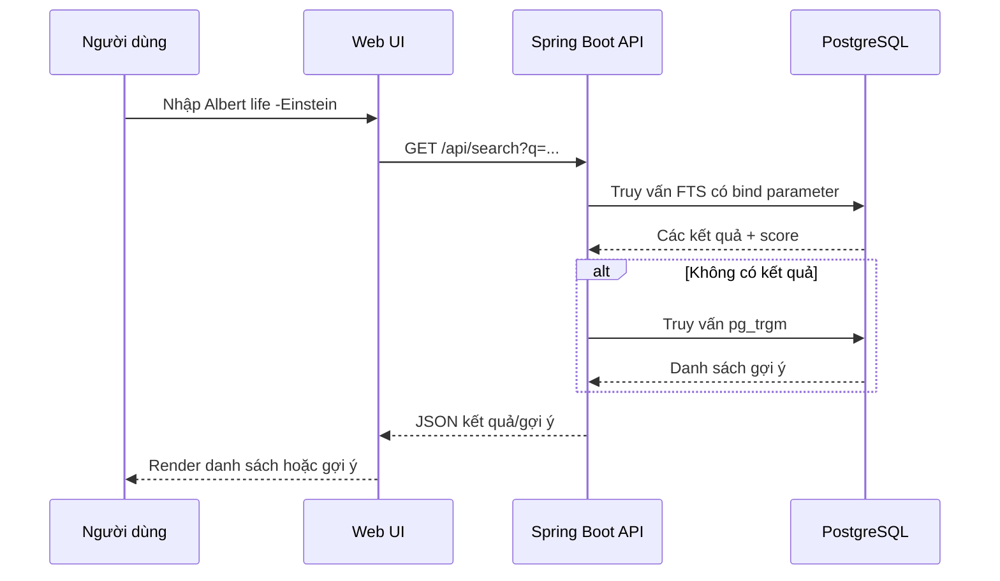

# Bài 09 — Tích hợp công cụ tìm kiếm vào Spring Boot

## 1. Tóm tắt

Phần giao diện chỉ cần một ô nhập, nhưng backend phải chuyển chuỗi tìm kiếm thành SQL có tham số, trả về danh sách kết quả chuẩn hóa, tính điểm, cắt đoạn nội dung và có thể gợi ý sửa chính tả. Một cấu trúc API rõ ràng giúp tách việc tìm kiếm khỏi UI.

## 2. Mục tiêu học tập

- Phân chia vai trò frontend, controller, service và repository.
- Viết câu SQL tìm kiếm có bind parameters.
- Thiết kế phản hồi gồm kết quả và gợi ý.
- Giải thích debounce, phân trang, giới hạn truy vấn và an toàn hiển thị.

## 3. Kiến trúc gợi ý



Ứng dụng gợi ý có `SearchController` nhận và kiểm tra tham số; `SearchService` điều phối fallback; `SearchRepository` thực thi truy vấn. Có thể dùng Spring JDBC/JdbcTemplate hoặc cơ chế tương đương. Đây là kiến trúc minh họa; dependency thực tế cần chọn phù hợp project.

## 4. SQL có tham số

Ví dụ sau dùng named bind parameter `:query` theo cơ chế truy vấn phía ứng dụng, **không** phải cú pháp gõ trực tiếp vào `psql`:

```sql
WITH input AS (
  SELECT websearch_to_tsquery('english', :query) AS tsq
)
SELECT d.source_type, d.source_id, d.title,
       ts_rank(d.search_doc, input.tsq) AS score
FROM search_documents d CROSS JOIN input
WHERE d.search_doc @@ input.tsq
ORDER BY score DESC, d.source_type, d.source_id
LIMIT :limit;
```

Đừng ghép chuỗi SQL với nội dung user, đặc biệt ở `ORDER BY`, `LIMIT` hoặc tạo query động. Kiểm tra độ dài `q`, chặn `limit` quá lớn và xử lý truy vấn rỗng. Thêm rate limiting phù hợp nếu API công khai.

## 5. JSON phản hồi

```json
{
  "query": "Albert life -Einstein",
  "results": [
    {"sourceType":"movie", "sourceId": 1, "title":"Defending Your Life", "score":0.42}
  ],
  "suggestions": []
}
```

Các số liệu trong JSON là **ví dụ minh họa định dạng**, không phải kết quả đã đo từ database. Khi triển khai thật, điểm xếp hạng do SQL tính, response chứa các trường thực tế lấy từ dữ liệu.

## 6. Hai cách tạo trải nghiệm nhập liệu

- **Search on submit:** chỉ gửi truy vấn khi bấm tìm. Thích hợp cho chuỗi phức tạp và giúp tiết kiệm request.
- **Search as you type:** gửi truy vấn sau một khoảng dừng nhập (debounce); cần hủy/loại bỏ response của yêu cầu cũ để tránh dữ liệu hiển thị lộn thứ tự.

Không tự động thay từ khóa người dùng bằng gợi ý. Phải phân biệt trạng thái không có kết quả, lỗi mạng và lỗi server. Đừng trả chuỗi HTML không được kiểm soát rồi nhúng bằng `innerHTML`.

**Thực hành:** thiết kế endpoint trả tối đa 10 kết quả FTS; nếu rỗng, trả tối đa 5 từ gợi ý. Kiểm tra truy vấn chứa dấu trừ và dấu ngoặc kép.
## Câu hỏi ôn tập

**Câu 1.** Thành phần nào nên chứa SQL truy vấn?

A. UI component  
B. SearchRepository  
C. Router frontend  
D. CSS file  

**Đáp án: B.** Repository phụ trách truy cập dữ liệu.

**Câu 2.** Điều nào giảm rủi ro SQL injection?

A. Ghép SQL bằng chuỗi  
B. Tin đầu vào người dùng  
C. Tắt log  
D. Bind parameter đúng cách  

**Đáp án: D.** Tham số được truyền riêng khỏi cú pháp SQL.

**Câu 3.** Debounce dùng để?

A. Giảm số lần gọi API khi gõ  
B. Xóa database  
C. Tạo chỉ mục  
D. Ép người dùng tải trang  

**Đáp án: A.** Debounce gửi yêu cầu sau một khoảng dừng nhập.

**Câu 4.** Khi response cũ về sau response mới, frontend nên?

A. Ghi đè luôn  
B. Tăng LIMIT  
C. Bỏ qua response cũ để tránh hiển thị sai  
D. Xóa query  

**Đáp án: C.** Đảm bảo kết quả tương ứng với truy vấn mới nhất.

**Câu 5.** Khi không có kết quả, response nên phân biệt điều gì?

A. Chỉ kiểu font  
B. Không kết quả hợp lệ với lỗi server/mạng  
C. Chỉ định dạng ngày  
D. Chỉ tên API  

**Đáp án: B.** Trạng thái rõ ràng giúp UX và debug chính xác.


## Tổng kết

Hãy tự chạy lại các truy vấn trong bài, đối chiếu kết quả và ghi chú ít nhất một tình huống ứng dụng thực tế. Khi thay đổi dữ liệu, cần kiểm tra cả độ đúng của kết quả lẫn cách PostgreSQL thực thi truy vấn.
