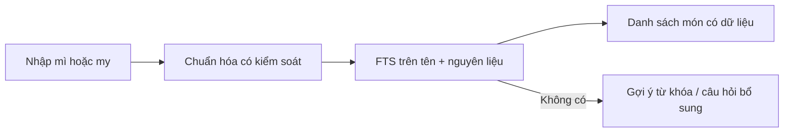

# Lab 02 — Chuyển kỹ thuật FTS sang tìm kiếm món ăn

## 1. Tình huống

Ứng dụng lưu danh sách món ăn; người dùng nhập **mì** và muốn xem món có tên hoặc nguyên liệu liên quan. Đây là bài thực hành chuyển giao kỹ thuật từ bài toán phim/trích dẫn sang thư viện món ăn. Không nhầm tìm kiếm từ khóa với một AI có thể tự sáng tạo công thức.

## 2. Thiết lập

Chạy SQL mẫu trong `sql/02-mon-an-demo.sql` **sau** khi đã tạo cơ sở dữ liệu từ `sql/00-khoi-tao.sql`.

## 3. Kiến trúc tìm kiếm món ăn

Với tiếng Việt, `to_tsvector('simple',...)` có thể tách riêng các âm tiết cách dấu cách. Thực hành này minh họa một bản tối giản; sản phẩm lớn nên thử bộ tách từ tiếng Việt, từ đồng nghĩa có kiểm soát và đánh giá thực nghiệm. Muốn khớp `my` với `mì` phải có quy tắc chuẩn hóa/cấu hình phù hợp; đừng ngầm coi FTS mặc định luôn làm được.

## 4. Bài tập

1. Chạy truy vấn FTS cho `mì`, sau đó cho `trứng`.
2. Thay đổi trọng số để tên món được ưu tiên hơn thành phần nguyên liệu.
3. Kiểm tra một món không có tên chứa `mì` nhưng nguyên liệu có `mì`.
4. Đề xuất luồng hỏi lại khi không tìm thấy món: loại nguyên liệu, thời gian nấu, món nước hay món khô.

## 5. Tiêu chí hoàn thành

- [ ] Có truy vấn SQL trả tên món phù hợp.
- [ ] Nêu được hạn chế khi tách từ tiếng Việt.
- [ ] Phân biệt gợi ý từ khóa, hỏi làm rõ nhu cầu và sinh công thức mới.
- [ ] Không bịa món chưa có trong database thành kết quả truy xuất.
