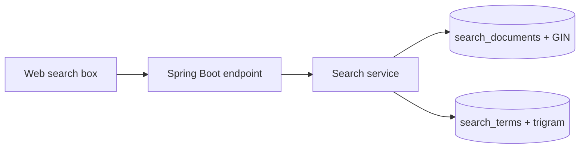

# Project 01 — Công cụ tìm kiếm phim và trích dẫn

## 1. Bài toán

Xây dựng tính năng tìm kiếm từ một ô nhập, tìm trên dữ liệu phim và câu trích dẫn được lưu ở các bảng riêng. Người dùng có thể tìm nhiều từ, loại từ không mong muốn, xem đoạn khớp và nhận gợi ý khi gõ sai.

## 2. Mục tiêu sản phẩm

- Một giao diện hỗ trợ Search on submit và tùy chọn Search as you type.
- Một REST endpoint lấy query `q`, trả JSON gồm kết quả hoặc gợi ý.
- PostgreSQL thực hiện FTS, ranking, indexing và trigram fallback.

## 3. Kiến trúc

Backend tìm FTS trước, chỉ gọi bảng gợi ý khi thiếu kết quả. Query luôn phải được bind parameter. Giao diện chịu trách nhiệm render an toàn dữ liệu trả về.

## 4. Milestone

**M1 — Dữ liệu:** chạy `lab-01`, xác nhận hai loại tài liệu trong view.  
**M2 — Search:** endpoint `GET /api/search?q=Albert&limit=10`, trả loại nội dung, ID, title, score.  
**M3 — Ranking và highlight:** sắp xếp giảm dần theo điểm, hiển thị lý do khớp.  
**M4 — Gợi ý:** nhập lỗi chính tả, cho tối đa năm lựa chọn.  
**M5 — UX & kiểm thử:** debounce nếu search-as-you-type, loading/empty/error states và các query phủ định/cụm từ.

## 5. Kiểm thử bắt buộc

| Input | Kỳ vọng |
| --- | --- |
| `Albert` | Có kết quả liên quan tới tên Albert |
| `Albert life -Einstein` | Không trả tài liệu chứa lexeme Einstein theo cấu hình truy vấn |
| `"beautiful day"` | Chỉ chọn tài liệu có cụm từ đúng |
| `somthing` | Có gợi ý gần từ hợp lệ nếu tìm kiếm rỗng |
| Chuỗi rỗng | Xử lý hợp lệ, không quét vô hạn |
| Query rất dài | Có giới hạn hoặc thông báo lỗi rõ ràng |

## 6. Definition of Done

- [ ] API sử dụng tham số, không ghép SQL nguy hiểm.
- [ ] Mọi kết quả có `source_type`, `source_id` và URL điều hướng phù hợp.
- [ ] Ranking có tie-break và giới hạn số lượng kết quả.
- [ ] Không render HTML chưa được sanitize.
- [ ] Có kiểm thử INSERT + refresh + tìm kiếm.
- [ ] Có README hướng dẫn chạy.

## 7. Câu hỏi bảo vệ

1. Tại sao cần thêm unique index cho `CONCURRENTLY` refresh?
2. Tại sao GIN không giải quyết tất cả vấn đề ranking?
3. Bạn sẽ thay đổi kiến trúc thế nào khi yêu cầu dữ liệu vừa thêm phải tìm được ngay?
4. Khác biệt giữa từ sai chính tả và câu hỏi cần hiểu ngữ nghĩa là gì?
