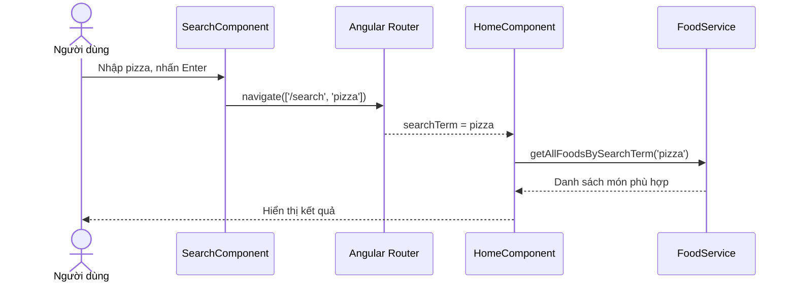

# Bài 01 — Tổng quan và kiến trúc tìm kiếm món ăn

## 1. Tóm tắt

Ta sẽ xây dựng một cơ chế tìm kiếm mà người dùng nhập tên món ăn và chuyển đến URL mang từ khóa. Từ URL, Angular đọc giá trị rồi lọc danh sách đã có. Ví dụ, tìm `pizza` sẽ hiển thị những món chứa chuỗi đó trong tên.

## 2. Mục tiêu học tập

- Mô tả được sự khác biệt giữa tìm kiếm tại frontend và tìm kiếm trên server.
- Xác định vai trò của `FoodService`, `AppRoutingModule`, `HomeComponent` và `SearchComponent`.
- Vẽ và giải thích luồng từ thao tác nhập đến kết quả hiển thị.

## 3. Vấn đề cần giải quyết

Giả sử màn hình trang chủ có các món `Pizza phô mai`, `Bánh mì bò`, `Pizza hải sản` và `Phở gà`. Khi nhập `pizza`, kết quả mong đợi gồm hai món pizza. Nếu nhập `PIZZA`, kết quả vẫn không đổi. Khi quay lại `/`, toàn bộ danh sách phải xuất hiện.

Một giải pháp chỉ cất từ khóa trong biến nội bộ của component dễ mất trạng thái khi người dùng làm mới trang. Do đó, ta dùng đường dẫn chứa tham số tìm kiếm, chẳng hạn `/search/pizza`, để biểu diễn trạng thái.

## 4. Các thành phần trong kiến trúc

| Thành phần | Trách nhiệm |
| --- | --- |
| `FoodService` | Trả danh sách tất cả món, lọc theo từ khóa |
| `AppRoutingModule` | Ghép đường dẫn với component được hiển thị |
| `router-outlet` | Vùng hiển thị nội dung của route hiện tại |
| `HomeComponent` | Đọc từ khóa từ URL và chọn danh sách phù hợp |
| `SearchComponent` | Nhận thao tác tìm kiếm và chuyển URL |

`SearchComponent` chỉ cần điều hướng. `HomeComponent` giữ nhiệm vụ hiển thị. `FoodService` giữ logic lọc, giúp không lặp logic trong nhiều component.

## 5. Tìm kiếm chuỗi và những gì nó chưa làm

Phương thức `includes()` chỉ kiểm tra sự xuất hiện của một chuỗi con. Vì vậy `pizza` có thể khớp `Pizza hải sản`. Nhưng từ khóa `mỳ` chưa chắc khớp `mì` vì khác ký tự, và truy vấn có ý nghĩa tương tự nhưng dùng từ khác cũng không tự được nhận biết. Đây chưa phải một hệ thống xử lý tiếng Việt có dấu, không dấu hoặc gợi ý ngữ nghĩa.

Đồng thời, vì toàn bộ danh sách đã được đưa vào client, thao tác lọc được thực hiện ngay trên mảng JavaScript. Với dữ liệu lớn hoặc dữ liệu nằm trong cơ sở dữ liệu từ xa, kiến trúc nên được cân nhắc lại.

## 6. Thực hành ngắn

Hãy lập bảng ba hành động: mở `/`, mở `/search/pizza`, và mở `/search/PIZZA`. Với mỗi hành động, dự đoán route nhận được, nhánh xử lý ở `HomeComponent`, số món được hiển thị trong ví dụ bốn món nêu trên.

**Checkpoint:** Tự giải thích được vì sao URL chứa `searchTerm` hữu ích khi chia sẻ liên kết.

## 7. Câu hỏi ôn tập

**Câu 1.** Thành phần nào nên đảm nhiệm logic lọc tên món theo chuỗi?  
A. `router-outlet`  
B. `AppRoutingModule`  
C. `FoodService`  
D. Thẻ `<button>`  
**Đáp án: C.** **Giải thích:** Service chuyên xử lý dữ liệu và cho phép tái sử dụng logic.

**Câu 2.** Lợi ích chính của `/search/pizza` so với chỉ lưu từ khóa trong biến cục bộ là gì?  
A. Có thể chia sẻ và khôi phục trạng thái tìm kiếm từ URL  
B. Tự động tạo cơ sở dữ liệu  
C. Tự sửa lỗi chính tả  
D. Giảm kích thước ảnh  
**Đáp án: A.** **Giải thích:** URL mang trạng thái có thể mở lại, lưu dấu trang và chia sẻ.

**Câu 3.** `router-outlet` dùng để làm gì?  
A. Lọc mảng  
B. Chuyển chữ thành chữ thường  
C. Tạo món ăn  
D. Hiển thị component theo route  
**Đáp án: D.** **Giải thích:** Router đặt component của route đang kích hoạt trong outlet.

**Câu 4.** Cơ chế `includes()` hỗ trợ trực tiếp dạng tìm kiếm nào?  
A. Hiểu ý nghĩa ngữ cảnh  
B. Khớp chuỗi con  
C. Tìm theo embedding  
D. Tự nhận dạng hình ảnh  
**Đáp án: B.** **Giải thích:** `includes()` trả về true khi tên món chứa từ khóa dưới dạng chuỗi con.

**Câu 5.** Ai đọc tham số URL để quyết định hiển thị món nào?  
A. `HomeComponent`  
B. Trình biên dịch CSS  
C. Thẻ `<input>`  
D. Trình quản lý gói npm  
**Đáp án: A.** **Giải thích:** `HomeComponent` lắng nghe route và gọi service cho dữ liệu tương ứng.

## 8. Tổng kết

Tính năng tìm kiếm gồm bốn công việc độc lập: nhận đầu vào, thay đổi route, lọc dữ liệu và hiển thị. Chia trách nhiệm rõ ràng giúp mã dễ đọc và dễ kiểm tra.
