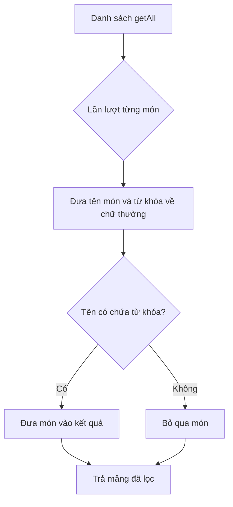

# Bài 02 — Lọc món ăn với FoodService

## 1. Tóm tắt

`FoodService` là nơi quản lý dữ liệu món ăn trong ứng dụng. Ta bổ sung phương thức `getAllFoodsBySearchTerm(searchTerm: string)` dùng `filter()` và `includes()` để trả các món có tên chứa từ khóa.

## 2. Mục tiêu học tập

- Viết được phép lọc mảng dựa trên thuộc tính `name`.
- Giải thích tại sao cần chuyển hai chuỗi về cùng kiểu chữ.
- Dự đoán kết quả cho các trường hợp từ khóa khác nhau.

## 3. Chuẩn bị

Mở file service tương ứng trong `src/app/services/` (thường là `food.service.ts`). Giả định service đã có `getAll()` trả về một mảng các đối tượng món ăn, và mỗi đối tượng có `name: string`.

Một ví dụ đơn giản của dữ liệu đang có:

```typescript
const foods = [
  { id: 1, name: 'Pizza phô mai' },
  { id: 2, name: 'Bánh mì bò' },
  { id: 3, name: 'Pizza hải sản' },
  { id: 4, name: 'Phở gà' }
];
```

Đây là dữ liệu minh họa để học cơ chế lọc; không cần thay thế dữ liệu hoặc model vốn có của ứng dụng.

## 4. Thực hiện phép lọc

Thêm phương thức vào lớp `FoodService` đang tồn tại:

```typescript
getAllFoodsBySearchTerm(searchTerm: string) {
  return this.getAll().filter(food =>
    food.name.toLowerCase().includes(searchTerm.toLowerCase())
  );
}
```

`filter()` xét từng phần tử. Với phần tử nào biểu thức trong callback trả `true`, phần tử ấy được đưa vào mảng kết quả. `includes()` cho biết tên món có chứa chuỗi nhập hay không.

`toLowerCase()` được dùng ở **cả hai vế**: tên món và từ khóa. Không làm như vậy sẽ khiến `pizza`, `Pizza` và `PIZZA` có thể cho các kết quả khác nhau.



Sơ đồ trên thể hiện logic của `filter`: có thể giữ hoặc loại từng món, nhưng mảng dữ liệu nguồn không bị sửa tại chỗ.

## 5. Ví dụ từng bước

Từ khóa: `PIZZA`.

1. Từ khóa chuyển thành `pizza`.
2. `Pizza phô mai` chuyển thành `pizza phô mai`, có chứa `pizza` → giữ.
3. `Bánh mì bò` không chứa `pizza` → bỏ.
4. `Pizza hải sản` có chứa `pizza` → giữ.
5. `Phở gà` không chứa `pizza` → bỏ.

Kết quả là hai món pizza.

## 6. Điểm dễ sai và giới hạn

- **Chỉ chuyển từ khóa sang chữ thường:** Tên có chữ hoa sẽ không được chuẩn hóa tương ứng.
- **Tìm trên sai trường:** Dùng `food.title` sẽ lỗi nếu model thật sự chỉ có `food.name`.
- **Dữ liệu bất biến:** `filter()` trả mảng mới, không tự thay mảng ban đầu.
- **Chuỗi rỗng:** `name.includes('')` là `true` đối với mọi tên. Ở ứng dụng, ta sẽ quyết định riêng nên hiển thị tất cả món khi chưa tìm kiếm.
- **Dấu tiếng Việt:** `toLowerCase()` không tự chuyển `mỳ` thành `mì` hay bỏ dấu.
- **Khoảng trắng:** Chuỗi `' pizza '` không tương đương `'pizza'`; có thể thêm `.trim()` ở nơi nhận đầu vào, như trong bài thực hành.

## 7. Thực hành

Viết một lời gọi `getAllFoodsBySearchTerm('BÒ')` trên dữ liệu mẫu và dự đoán món nào xuất hiện. Sau đó thử `'pizza'`, `'PIZZA'`, `'phở'`, và từ khóa không tồn tại. Ghi lại vì sao mỗi món được giữ hoặc bị loại.

**Checkpoint:** Hai cách viết `pizza` và `PIZZA` cho kết quả như nhau.

## 8. Câu hỏi ôn tập

**Câu 1.** `Array.filter()` có tác dụng gì?  
A. Sắp xếp mảng  
B. Trả mảng gồm những phần tử thỏa điều kiện  
C. Đổi tên thuộc tính  
D. Chuyển mảng thành URL  
**Đáp án: B.** **Giải thích:** `filter()` tạo một mảng kết quả bằng cách giữ những phần tử có callback trả true.

**Câu 2.** Muốn `Pizza` và `pizza` khớp như nhau, cách nào phù hợp nhất?  
A. Chỉ chuyển tên về chữ hoa  
B. Chỉ chuyển từ khóa về chữ thường  
C. Xóa trường name  
D. Chuẩn hóa cùng kiểu chữ ở cả tên và từ khóa  
**Đáp án: D.** **Giải thích:** Hai giá trị phải cùng quy tắc trước khi so sánh chuỗi.

**Câu 3.** `includes('')` với tên món thông thường cho kết quả gì?  
A. `true`  
B. `false`  
C. Lỗi cú pháp  
D. `null`  
**Đáp án: A.** **Giải thích:** Chuỗi rỗng được coi là chuỗi con của mọi chuỗi JavaScript.

**Câu 4.** Vì sao nhập `mỳ` có thể không ra món có `mì`?  
A. Vì Angular không hỗ trợ tiếng Việt  
B. Vì `filter()` không xử lý chữ cái  
C. Vì hai từ có ký tự khác nhau; so khớp chuỗi đơn giản không đồng nhất chúng  
D. Vì URL bắt buộc không có dấu  
**Đáp án: C.** **Giải thích:** So khớp literal không tự xử lý biến thể từ ngữ.

**Câu 5.** Tìm `pizza` nhưng nhận cả món `Pasta` có thể là do điều gì?  
A. `getAll()` tự tạo món mới  
B. Điều kiện lọc đang bỏ qua hoặc dùng sai tên trường  
C. `router-outlet` có màu sai  
D. Dùng phím Enter thay click  
**Đáp án: B.** **Giải thích:** Logic lọc phải xét chính xác trường tên món và điều kiện chứa từ khóa.

## 9. Tổng kết

Kỹ thuật cốt lõi là `filter()` kết hợp `toLowerCase()` và `includes()`. Nó phù hợp để tìm chuỗi con trên một danh sách món ăn đã được tải vào frontend.
