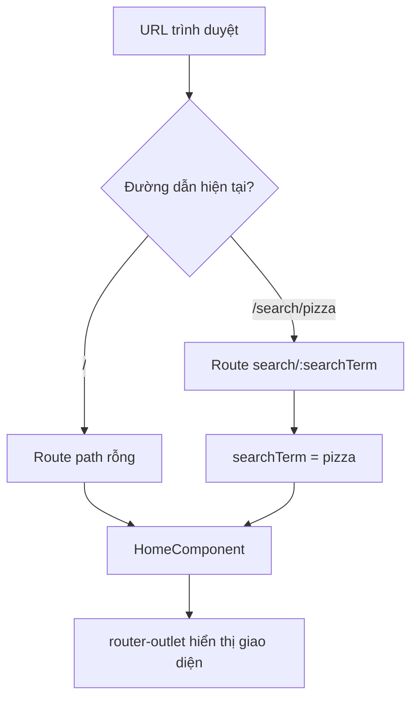

# Bài 03 — Cấu hình Angular Router cho tìm kiếm

## 1. Tóm tắt

Angular Router ánh xạ đường dẫn trình duyệt đến component. Ta cần route trang chủ `''`, route tìm kiếm `'search/:searchTerm'`, đồng thời đặt `<router-outlet>` để nội dung route được xuất hiện trên giao diện.

## 2. Mục tiêu học tập

- Phân biệt segment cố định `search` với tham số động `:searchTerm`.
- Khai báo route mặc định và route có tham số.
- Giải thích vai trò của `router-outlet` và kiểm tra URL trực tiếp.

## 3. Tạo hai route

Trong cấu trúc Angular dùng `AppRoutingModule`, mở `src/app/app-routing.module.ts`. Đưa hai route vào mảng `routes` đang có:

```typescript
import { NgModule } from '@angular/core';
import { RouterModule, Routes } from '@angular/router';
import { HomeComponent } from './components/pages/home/home.component';

const routes: Routes = [
  { path: '', component: HomeComponent },
  { path: 'search/:searchTerm', component: HomeComponent }
];

@NgModule({
  imports: [RouterModule.forRoot(routes)],
  exports: [RouterModule]
})
export class AppRoutingModule {}
```

Đường dẫn import `HomeComponent` ở đây chỉ là **ví dụ theo cấu trúc thư mục thường gặp**; hãy chỉnh theo dự án thật. Nếu file routing đã có các route khác, thêm route mới mà không xóa các route đang dùng. Đảm bảo `AppRoutingModule` được import trong `AppModule`.

`search` là chuỗi cố định. `:searchTerm` là tham số động: `/search/pizza` thì `searchTerm = 'pizza'`; `/search/noodle` thì `searchTerm = 'noodle'`.

## 4. Thay vùng hiển thị bằng router outlet

Trong `src/app/app.component.html`, thay cách hiển thị cố định `<app-home></app-home>` bằng:

```html
<router-outlet></router-outlet>
```

Nếu cần header hoặc footer cố định, có thể để chúng bên ngoài `router-outlet`:

```html
<app-header></app-header>
<router-outlet></router-outlet>
<app-footer></app-footer>
```

Ví dụ thứ hai chỉ áp dụng nếu các component header và footer thực sự tồn tại trong dự án.

## 5. Cơ chế định tuyến



Cả hai đường dẫn cùng hiển thị `HomeComponent`. Khác biệt nằm ở việc route thứ hai mang một tham số để component lọc dữ liệu.

## 6. Kiểm tra sau khi cấu hình

1. Chạy ứng dụng ở môi trường phát triển như cách dự án đang sử dụng.
2. Mở `/`: trang chủ phải hiển thị.
3. Mở thủ công `/search/pizza`: trang chủ vẫn hiển thị thay vì trang trắng.
4. Nếu chưa có logic đọc tham số, nội dung có thể chưa lọc. Điều đó là bình thường ở giai đoạn này.

**Lưu ý triển khai:** Ứng dụng SPA có thể hoạt động khi điều hướng nội bộ nhưng bị `404` khi làm mới `/search/pizza` trên server production nếu server không cấu hình trả về `index.html` cho các đường dẫn frontend.

## 7. Thực hành ngắn

Viết hai ví dụ URL khác nhau và xác định giá trị tham số `searchTerm` của từng URL. Quan sát giao diện khi đổi URL thủ công trên trình duyệt.

## 8. Câu hỏi ôn tập

**Câu 1.** Trong `search/:searchTerm`, dấu `:` đánh dấu điều gì?  
A. URL ngoài hệ thống  
B. Chỉ thị CSS  
C. Tham số đường dẫn  
D. Đối tượng dữ liệu  
**Đáp án: C.** **Giải thích:** Router gắn giá trị segment tương ứng vào tham số có tên `searchTerm`.

**Câu 2.** Route nào thích hợp cho trang chủ?  
A. `{ path: '', component: HomeComponent }`  
B. `{ path: ':', component: HomeComponent }`  
C. `{ path: '/search', component: FoodService }`  
D. `{ path: 'name', component: RouterModule }`  
**Đáp án: A.** **Giải thích:** `path: ''` là cách khai báo đường dẫn mặc định trong ví dụ này.

**Câu 3.** Khi bỏ `<router-outlet>`, hậu quả điển hình là gì?  
A. Hàm `filter()` đổi kết quả  
B. CSS tự bị xóa  
C. URL không thể có ký tự chữ  
D. Component route không có vị trí xuất hiện  
**Đáp án: D.** **Giải thích:** Router cần một outlet để đặt nội dung được điều hướng.

**Câu 4.** Vì sao hai route có thể cùng dùng `HomeComponent`?  
A. Vì không thể tạo nhiều component  
B. Vì component đó có thể hiển thị tất cả hoặc danh sách được lọc tùy tham số  
C. Vì HTML không cho phép danh sách  
D. Vì Angular yêu cầu mọi route dùng chung một component  
**Đáp án: B.** **Giải thích:** Component dùng cùng template nhưng thay dữ liệu dựa trên route.

**Câu 5.** Làm mới `/search/pizza` trên hosting bị 404, nhưng điều hướng trong app lại được. Khả năng nào cần kiểm tra trước?  
A. Font-size của input  
B. Dấu cách trong tên món  
C. Cấu hình SPA fallback của máy chủ  
D. Màu nền button  
**Đáp án: C.** **Giải thích:** Server cần trả ứng dụng frontend khi request trực tiếp vào URL con.

## 9. Tổng kết

`RouterModule`, tham số động và `router-outlet` tạo nên nền tảng để URL đại diện cho từ khóa tìm kiếm.
