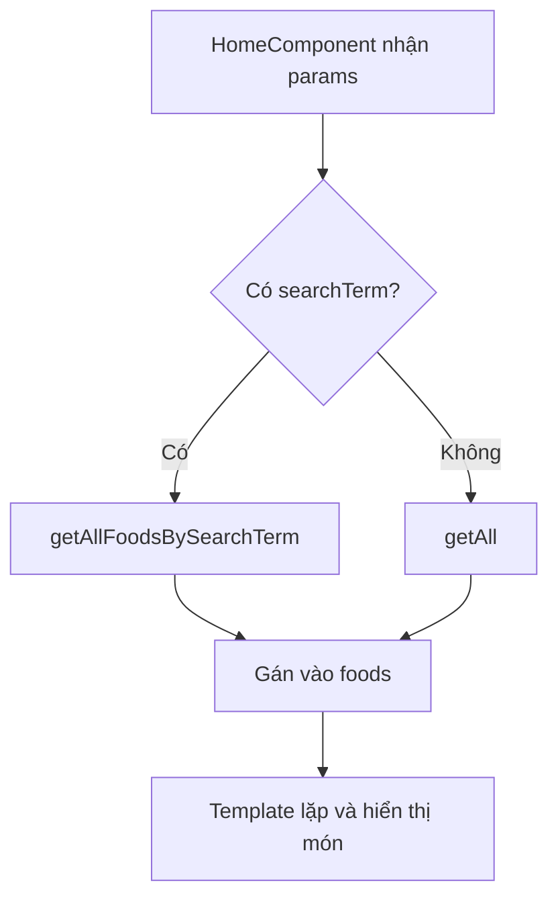

# Bài 04 — Đọc tham số route trong HomeComponent

## 1. Tóm tắt

`HomeComponent` sẽ theo dõi thay đổi route. Nếu URL có `searchTerm`, nó lấy kết quả từ `FoodService.getAllFoodsBySearchTerm()`. Nếu URL không có tham số, nó lấy toàn bộ món từ `getAll()`.

## 2. Mục tiêu học tập

- Sử dụng `ActivatedRoute` để truy cập route hiện hành.
- Lựa chọn nhánh lọc và nhánh hiển thị tất cả.
- Giải thích vì sao dùng subscription thay vì chỉ đọc tham số đúng một lần.

## 3. Đọc `ActivatedRoute`

`ActivatedRoute` biểu diễn thông tin về route đang kích hoạt đối với một component, gồm các tham số đường dẫn. Trong `home.component.ts`, có thể viết phần logic cần thiết như sau (giữ lại các phần khác đã có trong component):

```typescript
import { ActivatedRoute } from '@angular/router';
import { FoodService } from 'src/app/services/food.service';

// Trong lớp HomeComponent:
constructor(
  private foodService: FoodService,
  private activatedRoute: ActivatedRoute
) {
  this.activatedRoute.params.subscribe(params => {
    const searchTerm = params['searchTerm'];

    if (searchTerm) {
      this.foods = this.foodService.getAllFoodsBySearchTerm(searchTerm);
    } else {
      this.foods = this.foodService.getAll();
    }
  });
}
```

Đây là **đoạn mã cần tích hợp**, không phải toàn bộ lớp `HomeComponent`. `this.foods` cần được khai báo theo kiểu mảng món ăn mà dự án đang sử dụng. Đường dẫn import service cũng cần phù hợp với cấu trúc thực tế.

## 4. Vì sao dùng `params.subscribe()`?

Khi đang ở `/search/pizza` và điều hướng đến `/search/burger`, Angular có thể giữ lại cùng `HomeComponent` và chỉ cập nhật tham số. Với subscription trên `params`, callback được gọi khi tham số thay đổi và danh sách được tính lại.

Một cách khác dễ đọc hơn khi chỉ cần một tham số là sử dụng `paramMap`:

```typescript
this.activatedRoute.paramMap.subscribe(paramMap => {
  const searchTerm = paramMap.get('searchTerm');
  this.foods = searchTerm
    ? this.foodService.getAllFoodsBySearchTerm(searchTerm)
    : this.foodService.getAll();
});
```

**Chỉ chọn một trong hai cách** để tránh đăng ký lặp. Trong trường hợp route đơn giản, cả hai đều phục vụ được bài toán. Với subscription tùy chỉnh phức tạp, hãy áp dụng quy tắc quản lý vòng đời/cleanup của dự án để tránh rò rỉ tài nguyên.

## 5. Truy cập thuộc tính có index signature

Trong một số cấu hình TypeScript bật `noPropertyAccessFromIndexSignature`, truy cập `params.searchTerm` có thể gây cảnh báo vì tham số được khai báo qua index signature. Cách an toàn và rõ ràng là dùng:

```typescript
const searchTerm = params['searchTerm'];
```

Không cần tắt kiểm tra TypeScript trong `tsconfig.json` chỉ vì trường hợp này. Cách truy cập bằng ngoặc vuông giải quyết ngay tại nơi cần thiết.

## 6. Luồng hai nhánh



Để template thể hiện kết quả, phần lặp danh sách hiện có phải đọc chính biến `foods` vừa được cập nhật. Nếu template đang dùng mảng khác, việc lọc trong TypeScript vẫn có thể đúng nhưng giao diện không đổi.

## 7. Kiểm tra từng trường hợp

| URL | Kỳ vọng |
| --- | --- |
| `/` | Tất cả món |
| `/search/pizza` | Chỉ món có tên chứa `pizza` |
| `/search/PIZZA` | Kết quả giống `pizza` |
| `/search/khong-co-mon` | Danh sách rỗng hoặc UI trạng thái không có kết quả |

## 8. Thực hành

Sửa `HomeComponent` để dùng `paramMap` hoặc `params`; sau đó điều hướng tuần tự từ `/` đến `/search/pizza` rồi `/search/burger` mà không tải lại toàn bộ trang. Theo dõi số món để chắc chắn kết quả thực sự thay đổi.

## 9. Câu hỏi ôn tập

**Câu 1.** `ActivatedRoute` cung cấp thông tin gì trong bài này?  
A. Màu nền  
B. Tham số của route đang kích hoạt  
C. Thông tin CPU  
D. File ảnh món ăn  
**Đáp án: B.** **Giải thích:** Component dùng `ActivatedRoute` để đọc `searchTerm`.

**Câu 2.** Nếu URL không có `searchTerm`, nên làm gì?  
A. Hiển thị mảng rỗng bắt buộc  
B. Xóa toàn bộ route  
C. Chặn người dùng  
D. Gọi `getAll()` để hiển thị tất cả  
**Đáp án: D.** **Giải thích:** Trang chủ mặc định phải hiển thị đầy đủ món.

**Câu 3.** Lý do nên lắng nghe `params` thay đổi là gì?  
A. URL có thể đổi tham số khi component vẫn được tái sử dụng  
B. CSS tự thay tên class  
C. Service không thể gọi trong constructor  
D. Angular bắt buộc dùng SQL  
**Đáp án: A.** **Giải thích:** Theo dõi tham số giúp dữ liệu cập nhật khi người dùng tìm từ khóa tiếp theo.

**Câu 4.** Cách truy cập nào phù hợp với index signature trong cấu hình chặt của TypeScript?  
A. `params->searchTerm`  
B. `params(searchTerm)`  
C. `params['searchTerm']`  
D. `params::searchTerm`  
**Đáp án: C.** **Giải thích:** Cú pháp ngoặc vuông phù hợp thuộc tính được khai báo qua index signature.

**Câu 5.** Service trả mảng đúng nhưng UI không đổi. Nên kiểm tra điều gì?  
A. Màu viền nút  
B. Template có đang hiển thị biến `foods` được cập nhật không  
C. Dung lượng ổ cứng  
D. Phông chữ tiêu đề  
**Đáp án: B.** **Giải thích:** Template cần đọc đúng trạng thái danh sách mà component đã thay đổi.

## 10. Tổng kết

Khi URL trở thành nguồn cung cấp từ khóa, `HomeComponent` chỉ cần chọn một trong hai dữ liệu: đã lọc hoặc toàn bộ. Sự lắng nghe tham số làm cho kết quả luôn đồng bộ với route.
