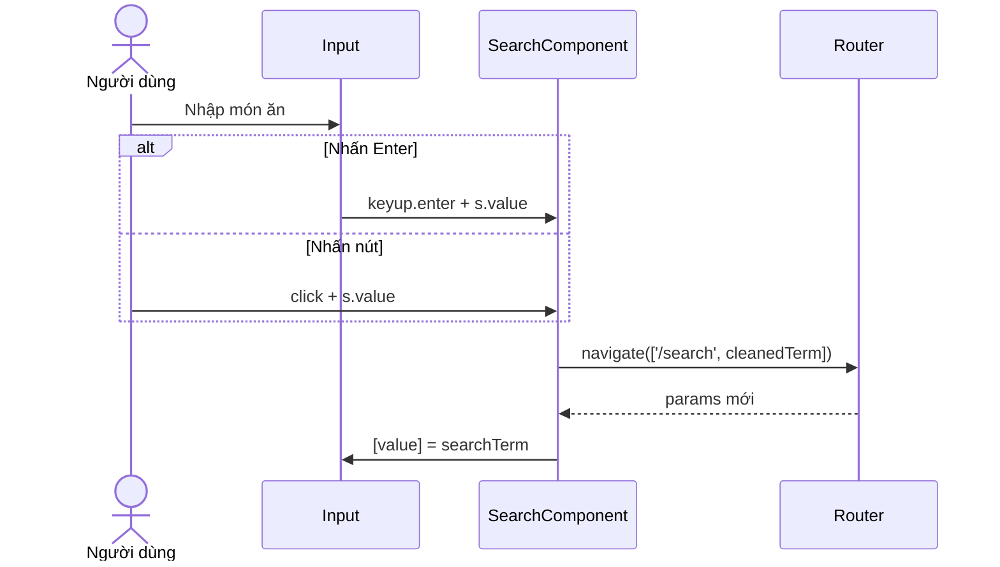

# Bài 05 — Xây dựng SearchComponent

## 1. Tóm tắt

`SearchComponent` là ô tìm kiếm dùng bên trong trang chủ, không phải một trang riêng. Nó đọc từ khóa hiện tại từ route, hiển thị từ khóa trong ô nhập và điều hướng đến `/search/<từ-khóa>` khi người dùng nhấn Enter hoặc nút tìm kiếm.

## 2. Mục tiêu học tập

- Tạo một component bằng Angular CLI.
- Kết nối template reference variable với sự kiện phím Enter và click.
- Điều hướng bằng `Router.navigate()` và đọc từ khóa từ `ActivatedRoute`.
- Giải thích vai trò của tham số constructor có access modifier.

## 3. Tạo component

Tại thư mục frontend của dự án, mở terminal và chạy một trong các lệnh tương đương:

```bash
ng generate component components/partials/search
```

Hoặc dạng ngắn:

```bash
ng g c components/partials/search
```

Angular CLI sẽ tạo các file thành phần mới theo cấu trúc của dự án. Với `NgModule`, hãy đảm bảo `SearchComponent` nằm trong `declarations` của module phù hợp (Angular CLI thường xử lý việc này nếu xác định được module).

Trong template `home.component.html`, đặt thành phần gần đầu danh sách món:

```html
<app-search></app-search>
<!-- Phần giao diện danh sách món hiện có -->
```

## 4. Phần TypeScript của component

```typescript
import { Component } from '@angular/core';
import { ActivatedRoute, Router } from '@angular/router';

@Component({
  selector: 'app-search',
  templateUrl: './search.component.html',
  styleUrls: ['./search.component.css']
})
export class SearchComponent {
  searchTerm = '';

  constructor(
    private activatedRoute: ActivatedRoute,
    private router: Router
  ) {
    this.activatedRoute.params.subscribe(params => {
      this.searchTerm = params['searchTerm'] ?? '';
    });
  }

  search(term: string): void {
    const cleanedTerm = term.trim();
    if (cleanedTerm) {
      this.router.navigate(['/search', cleanedTerm]);
    }
  }
}
```

`private` trước `activatedRoute` và `router` vừa khai báo dependency injection vừa tạo thuộc tính có thể dùng trong cả lớp. Nếu constructor chỉ khai báo tham số không có access modifier, tham số đó không tự trở thành thuộc tính của instance.

`Router.navigate(['/search', cleanedTerm])` tạo đường dẫn theo các segment. Cách này tiện hơn việc ghép chuỗi URL thủ công khi từ khóa chứa khoảng trắng hoặc ký tự đặc biệt. `trim()` ở đây là cải tiến thực hành để loại khoảng trắng đầu/cuối; logic chính vẫn giống yêu cầu tìm kiếm.

## 5. Phần HTML của component

Trong `search.component.html`:

```html
<div class="search-container">
  <input
    #s
    type="text"
    placeholder="Tìm kiếm món ăn"
    [value]="searchTerm"
    (keyup.enter)="search(s.value)"
  />
  <button type="button" (click)="search(s.value)">
    Tìm kiếm
  </button>
</div>
```

`#s` là **template reference variable**. Vì đặt trên thẻ `input`, ta có thể đọc nội dung bằng `s.value`. Sự kiện `(keyup.enter)` chạy khi người dùng thả phím Enter. Sự kiện `(click)` trên button gọi cùng một phương thức tìm kiếm.

`[value]="searchTerm"` liên kết thuộc tính đầu vào với biến trong component, nhờ đó khi mở `/search/pizza` từ liên kết trực tiếp, ô nhập sẽ hiển thị từ khóa đã dùng. Đây là property binding một chiều, **không phải** `[(ngModel)]`.

## 6. Luồng tương tác



Như vậy, nhập liệu và điều hướng được tách biệt: gõ chữ chưa phải là tìm, chỉ khi có sự kiện Enter hoặc click mới thay đổi route.

## 7. Những lưu ý quan trọng

- Nút `type="button"` tránh tự kích hoạt gửi form nếu component được đưa vào một form khác.
- Nếu tìm kiếm từ khóa rỗng cần quay về trang chủ, có thể chọn hành vi này khi hoàn thiện sản phẩm. Ví dụ trên chỉ điều hướng khi `cleanedTerm` không rỗng.
- Nếu SearchComponent được đặt bên trong một vùng route con, cần xem lại vị trí nhận `ActivatedRoute`; trong kiến trúc bài học, SearchComponent được đặt trực tiếp trong `HomeComponent` tương ứng với route đang dùng.
- Đừng quên `router-outlet` và route `/search/:searchTerm`; riêng component giao diện không đủ để tạo chức năng tìm kiếm.

## 8. Thực hành

Tạo SearchComponent, thêm nó vào `HomeComponent`, gõ `pizza` rồi thử Enter và nút click. Cuối cùng mở trực tiếp `/search/pizza` và xác nhận ô nhập nhận lại từ khóa.

## 9. Câu hỏi ôn tập

**Câu 1.** `#s` trên input có mục đích gì?  
A. Khai báo template reference variable để truy cập input trong template  
B. Tạo CSS ID bắt buộc  
C. Tạo route  
D. Gọi service tự động  
**Đáp án: A.** **Giải thích:** Biến tham chiếu giúp truy cập `s.value` khi người dùng tương tác.

**Câu 2.** `(keyup.enter)="search(s.value)"` được kích hoạt khi nào?  
A. Khi tải CSS  
B. Khi input bị xóa  
C. Khi người dùng nhấn và thả Enter  
D. Khi ứng dụng khởi động  
**Đáp án: C.** **Giải thích:** Angular chỉ lắng nghe sự kiện keyup tương ứng phím Enter.

**Câu 3.** `Router.navigate(['/search', 'pizza'])` biểu diễn hành động gì?  
A. Gọi API SQL  
B. Chuyển đến route tìm kiếm với tham số `pizza`  
C. Đổi CSS  
D. Đổi tên file  
**Đáp án: B.** **Giải thích:** Router điều hướng bằng mảng segment của đường dẫn.

**Câu 4.** Vì sao cần `[value]="searchTerm"`?  
A. Để lọc mảng tự động  
B. Để thêm animation  
C. Để dùng HTTP  
D. Để hiển thị từ khóa trong ô nhập khi route mang tham số  
**Đáp án: D.** **Giải thích:** Input nhận giá trị của biến đã được đồng bộ từ URL.

**Câu 5.** Tại sao dùng `private router: Router` trong constructor?  
A. Để có thuộc tính `this.router` trong lớp và để Angular inject dependency  
B. Để thay Router bằng CSS  
C. Để không cần định tuyến  
D. Để tạo database  
**Đáp án: A.** **Giải thích:** Parameter property giúp lưu dependency thành thuộc tính của instance.

## 10. Tổng kết

Một `SearchComponent` gọn chỉ cần trạng thái từ khóa, listener route, hàm điều hướng và template xử lý hai sự kiện. Cách tách riêng cho phép tái sử dụng ô tìm kiếm ở các trang có cùng cấu trúc định tuyến.
