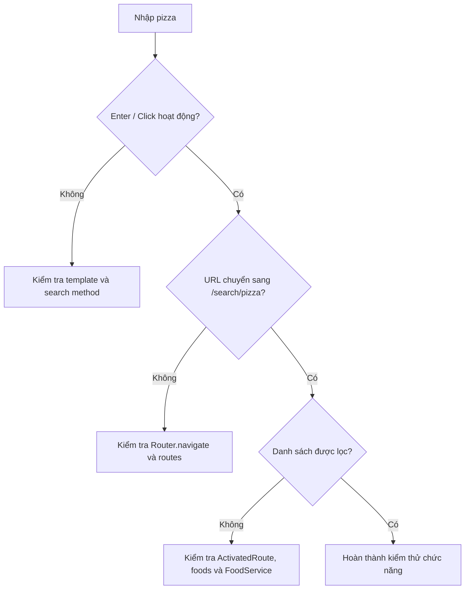

# Bài 07 — Lab tích hợp tìm kiếm món ăn đầu-cuối

## 1. Tổng quan

Bài thực hành kết nối các mảnh chức năng thành một trải nghiệm nhất quán: nhập `pizza` → điều hướng đến `/search/pizza` → lọc trong `FoodService` → hiển thị danh sách → làm mới vẫn đọc lại từ khóa từ URL.

## 2. Mục tiêu

- Triển khai được luồng dữ liệu từ `SearchComponent` đến `HomeComponent`.
- Kiểm tra route mặc định và route tìm kiếm.
- Phát hiện lỗi khi các file đã chỉnh sửa chưa kết nối với nhau.

## 3. Chuẩn bị

Cần dự án Angular có cấu trúc dùng `AppModule`/`AppRoutingModule`, một trang `HomeComponent` đang render danh sách món và `FoodService` có phương thức `getAll()`.

Cây tệp tham khảo (đường dẫn tùy dự án):

```text
src/app/
├── app-routing.module.ts
├── app.component.html
├── services/
│   └── food.service.ts
└── components/
    ├── pages/home/
    │   ├── home.component.ts
    │   └── home.component.html
    └── partials/search/
        ├── search.component.ts
        ├── search.component.html
        └── search.component.css
```

## 4. Các bước triển khai

### 4.1. Bước 1 — Thêm phương thức lọc

Thêm vào `FoodService`:

```typescript
getAllFoodsBySearchTerm(searchTerm: string) {
  return this.getAll().filter(food =>
    food.name.toLowerCase().includes(searchTerm.toLowerCase())
  );
}
```

**Checkpoint:** Gọi thử phương thức với `pizza` và xác nhận chỉ còn tên chứa từ khóa.

### 4.2. Bước 2 — Cấu hình route

Trong `AppRoutingModule`:

```typescript
const routes: Routes = [
  { path: '', component: HomeComponent },
  { path: 'search/:searchTerm', component: HomeComponent }
];
```

Trong `app.component.html`:

```html
<router-outlet></router-outlet>
```

**Checkpoint:** Cả `/` và `/search/pizza` đều hiển thị được `HomeComponent`.

### 4.3. Bước 3 — Kết nối dữ liệu trang chủ

Đọc tham số route và cập nhật `foods`:

```typescript
this.activatedRoute.params.subscribe(params => {
  const searchTerm = params['searchTerm'];
  this.foods = searchTerm
    ? this.foodService.getAllFoodsBySearchTerm(searchTerm)
    : this.foodService.getAll();
});
```

Đảm bảo `ActivatedRoute`, `FoodService` đã inject và template của Home thực sự đọc biến `foods`.

**Checkpoint:** Sửa URL thủ công thành `/search/pizza` và thấy danh sách thay đổi.

### 4.4. Bước 4 — Thêm SearchComponent

Tạo component với Angular CLI nếu chưa có. Trong component, khai báo `searchTerm`, đăng ký lắng nghe params và viết `search(term)` để điều hướng. Trong template, dùng `#s`, `(keyup.enter)`, `(click)` và `[value]` theo Bài 05. Nhúng `<app-search></app-search>` ở đầu trang chủ.

**Checkpoint:** Cả Enter lẫn nút Tìm kiếm đều thay đổi URL.

### 4.5. Bước 5 — Hoàn thiện CSS

Dùng CSS ở Bài 06 và kiểm tra kích thước màn hình hẹp. Đảm bảo ô nhập và nút cao bằng nhau, góc bo ở đúng phía và focus hiển thị rõ.

**Checkpoint:** Dùng được chuột lẫn bàn phím.

## 5. Sơ đồ kiểm tra tích hợp



Sơ đồ mô tả thứ tự debug: từ tương tác UI đến router, cuối cùng đến lớp xử lý dữ liệu.

## 6. Bảng kiểm thử nhanh

| Mã | Thao tác | Kỳ vọng |
| --- | --- | --- |
| T01 | Mở `/` | Hiện tất cả món |
| T02 | Gõ `pizza`, Enter | URL `/search/pizza`, danh sách được lọc |
| T03 | Gõ `Pizza`, click nút | Kết quả không phân biệt hoa thường |
| T04 | Mở `/search/pizza` trực tiếp | Input hiển thị `pizza` và kết quả tương ứng |
| T05 | Đổi từ `pizza` sang `burger` | Kết quả thay đổi theo URL mới |
| T06 | Tìm chuỗi không tồn tại | Không hiện món không phù hợp |
| T07 | Về `/` | Hiện tất cả món |

## 7. Debug

Nếu Enter không chạy, xác minh `(keyup.enter)` nằm đúng thẻ input và `#s` tồn tại. Nếu URL đúng mà món không đổi, kiểm tra `HomeComponent` có lắng nghe route không. Nếu component không được nhận diện, kiểm tra `declarations`/`imports` của Angular. Nếu trực tiếp reload URL bị 404 trên production, kiểm tra cấu hình máy chủ SPA fallback.

## 8. Sản phẩm bàn giao

- Các file `.ts`, `.html` và `.css` đã chỉnh sửa trong dự án.
- Ảnh chụp ba màn hình: tất cả món, kết quả `pizza`, kết quả không có món.
- Nhật ký kiểm thử bảy trường hợp T01–T07.

## 9. Checklist hoàn thành

- [ ] Bộ lọc hoạt động đúng.
- [ ] Route mặc định hoạt động.
- [ ] Route tìm kiếm hoạt động.
- [ ] Ô tìm kiếm có thể nhập và submit bằng hai cách.
- [ ] Từ khóa trong ô nhập đồng bộ với URL.
- [ ] Đổi URL cập nhật kết quả.
- [ ] Không gây lỗi Angular/TypeScript trong console.

## 10. Câu hỏi ôn tập

**Câu 1.** URL đã đổi nhưng danh sách không thay đổi. Vị trí nào nên kiểm tra trước?  
A. Màu nền nút  
B. `HomeComponent` đọc route và gọi FoodService  
C. Chiều rộng input  
D. File favicon  
**Đáp án: B.** **Giải thích:** Luồng sau điều hướng phải đi qua đọc param và lọc dữ liệu.

**Câu 2.** Cần chèn SearchComponent ở đâu để thấy thanh tìm kiếm trên trang chủ?  
A. Trong `tsconfig.json`  
B. Trong CSS global  
C. Trong `food.service.ts`  
D. Trong template của `HomeComponent`  
**Đáp án: D.** **Giải thích:** Selector `<app-search>` được dùng nơi muốn hiển thị component.

**Câu 3.** Trước khi thêm CSS, điều gì quan trọng nhất?  
A. Luồng tìm kiếm đúng chức năng  
B. Ảnh món phải có độ phân giải 4K  
C. Mọi món có cùng giá  
D. Thay tên dự án  
**Đáp án: A.** **Giải thích:** Xác nhận luồng chức năng giúp tách lỗi logic khỏi lỗi giao diện.

**Câu 4.** Khi đổi `/search/pizza` thành `/search/burger` mà không tạo component mới, cơ chế nào giúp cập nhật?  
A. `:hover`  
B. `font-weight`  
C. Subscription route params  
D. Tính năng in trang  
**Đáp án: C.** **Giải thích:** Lắng nghe route params cho phép cập nhật dữ liệu khi tham số thay đổi.

**Câu 5.** Trường hợp nào cho thấy URL thực sự lưu được trạng thái tìm kiếm?  
A. CSS có màu đỏ  
B. Mở lại `/search/pizza` và thấy từ khóa cùng kết quả  
C. Thu nhỏ trình duyệt  
D. Đổi ngôn ngữ hệ điều hành  
**Đáp án: B.** **Giải thích:** Có thể khôi phục tìm kiếm từ URL là tiêu chí cốt lõi.

## 11. Tổng kết

Lab hoàn thành khi các tầng tìm kiếm, điều hướng, hiển thị và tương tác đã nối thành một luồng xuyên suốt. Không chỉ kiểm tra từng file; cần kiểm tra toàn bộ hành vi người dùng thực tế.
