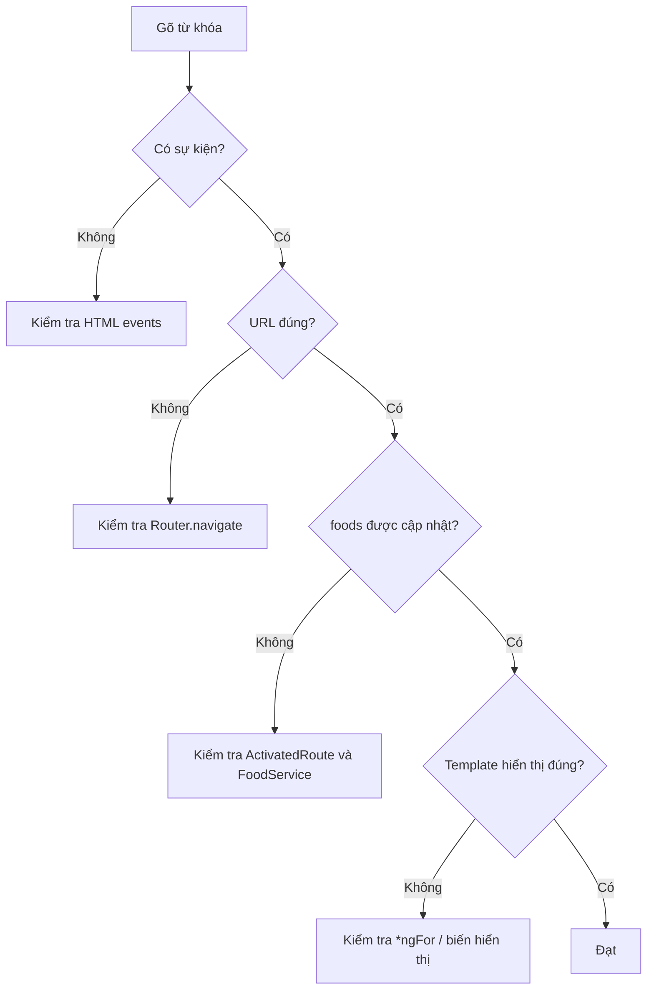

# Bài 08 — Kiểm thử và xử lý lỗi

## 1. Tóm tắt

Một chức năng tìm kiếm thành công cần đáp ứng nhiều trường hợp hơn việc nhập đúng tên món. Bài này hệ thống hóa các lỗi xuất hiện tại dữ liệu, router, component, template, CSS và môi trường triển khai.

## 2. Mục tiêu học tập

- Phân loại được lỗi theo lớp xử lý.
- Thiết kế bảng kiểm thử chức năng cho các trường hợp quan trọng.
- Chọn bước debug hợp lý dựa trên triệu chứng.

## 3. Ma trận lỗi và hướng kiểm tra

| Triệu chứng | Nơi kiểm tra | Hướng xử lý |
| --- | --- | --- |
| Tìm `PIZZA` nhưng không ra món | `FoodService` | Kiểm tra `toLowerCase()` ở cả hai vế |
| URL `/search/pizza` không tải component | Routing và `router-outlet` | Kiểm tra khai báo route và outlet |
| URL thay đổi, danh sách giữ nguyên | `HomeComponent` | Kiểm tra subscription và biến `foods` |
| Gõ Enter không chạy | `search.component.html` | Kiểm tra `#s` và `(keyup.enter)` |
| Click nút không chạy | HTML/TS component | Kiểm tra `(click)` và phương thức `search()` |
| Input không giữ từ khóa khi mở URL | `SearchComponent` | Kiểm tra params subscription và `[value]` |
| Góc bo bị lộn | CSS | Kiểm tra thứ tự `border-radius` |
| Reload URL bị 404 trên hosting | Cấu hình server | Bật SPA fallback về `index.html` |

## 4. Bộ ca kiểm thử chức năng

Dùng tập dữ liệu ít nhất gồm một món pizza, một món không phải pizza và một món với tên viết hoa/thường khác nhau.

| Ca | Input / hành động | Tiêu chí đạt |
| --- | --- | --- |
| TC01 | Vào trang chủ | Hiển thị toàn bộ danh sách |
| TC02 | Tìm `pizza` | Chỉ tên chứa `pizza` |
| TC03 | Tìm `PIZZA` | Kết quả bằng TC02 |
| TC04 | Tìm chuỗi không tồn tại | Không hiển thị nhầm món |
| TC05 | Enter | Điều hướng và lọc |
| TC06 | Click Tìm kiếm | Điều hướng và lọc |
| TC07 | Mở URL trực tiếp | Khôi phục từ khóa và kết quả |
| TC08 | Chuyển giữa hai từ khóa | Danh sách cập nhật |
| TC09 | Từ khóa có khoảng trắng hai đầu | `trim()` loại phần thừa trước khi điều hướng |
| TC10 | Tìm chuỗi rỗng | Không điều hướng trong phiên bản bài học |

## 5. Khám phá các trường hợp đặc biệt

**Từ khóa có dấu:** Dữ liệu `mì` và truy vấn `my` không tự khớp. Nếu yêu cầu sản phẩm là bỏ dấu tiếng Việt, phải bổ sung bước chuẩn hóa riêng, và kiểm thử thêm. Không nên coi đó là hành vi mặc định của `includes()`.

**Từ khóa rỗng:** Mã trong `SearchComponent` chặn chuỗi rỗng. Nếu mong muốn nút Tìm kiếm với input trống đưa về `/`, thay đổi rõ hành vi của `search()` và cập nhật kiểm thử.

**Đường dẫn trực tiếp:** `router.navigate()` hoạt động ở client không đảm bảo rằng web server production hiểu `/search/pizza`. Hãy cấu hình fallback để máy chủ trả ứng dụng Angular cho các đường dẫn frontend.

**Dữ liệu quá lớn:** Lọc trong mảng phía client có thể không còn phù hợp khi tất cả dữ liệu phải tải trước. Khi đó cần chuyển cân nhắc lọc phía backend và phân trang. Đây là giới hạn kiến trúc, không phải lỗi của `filter()`.

## 6. Quy trình debug tối thiểu

Nên gỡ lỗi từng tầng thay vì thay đổi đồng thời cả TypeScript và CSS; như vậy dễ xác định nguyên nhân thực sự.

## 7. Thực hành kiểm thử

Cố ý xóa `[value]="searchTerm"` khỏi HTML, mở `/search/pizza` trực tiếp và mô tả triệu chứng. Khôi phục thuộc tính, rồi tạm thời bỏ `toLowerCase()` của một vế trong `FoodService` và so sánh truy vấn `pizza` với `PIZZA`.

## 8. Câu hỏi ôn tập

**Câu 1.** Enter hoạt động nhưng click nút không hoạt động. Nên xem gì?  
A. File router outlet  
B. `toLowerCase()`  
C. Binding `(click)` trong HTML  
D. Border radius  
**Đáp án: C.** **Giải thích:** Hai đường kích hoạt dùng event khác nhau nhưng gọi cùng hàm tìm kiếm.

**Câu 2.** Kết quả đúng nhưng input trống khi mở trực tiếp URL tìm kiếm. Thành phần nào cần kiểm tra trước?  
A. `SearchComponent` và `[value]`  
B. CSS padding  
C. Ảnh món ăn  
D. Bảng giá món  
**Đáp án: A.** **Giải thích:** Input hiển thị lại từ khóa nhờ đồng bộ route và property binding.

**Câu 3.** Chỉ tìm được `pizza` mà không tìm được `PIZZA`, lỗi có thể nằm ở đâu?  
A. `router-outlet`  
B. `height`  
C. `opacity`  
D. Chuẩn hóa chuỗi trong `FoodService`  
**Đáp án: D.** **Giải thích:** Hai chuỗi phải cùng kiểu chữ để so sánh không phân biệt hoa thường.

**Câu 4.** Điều gì cần làm nếu production trả 404 khi reload `/search/pizza`?  
A. Đổi font-size  
B. Kiểm tra cấu hình SPA fallback trên server  
C. Xóa toàn bộ route  
D. Chuyển CSS sang inline  
**Đáp án: B.** **Giải thích:** Request trực tiếp phải được server trả về ứng dụng frontend để Router xử lý.

**Câu 5.** Nếu mảng món ăn rất lớn và phải tải toàn bộ về client, cân nhắc nào phù hợp?  
A. Chỉ tăng border radius  
B. Cắt bớt ô nhập  
C. Đánh giá tìm kiếm phía server và phân trang  
D. Đổi tên `SearchComponent`  
**Đáp án: C.** **Giải thích:** Lọc và tải dữ liệu ở frontend có giới hạn về quy mô.

## 9. Tổng kết

Kiểm thử tìm kiếm cần quan sát không chỉ kết quả lọc, mà còn tương tác, URL, trạng thái input và cách ứng dụng hoạt động khi tải lại trang. Mỗi triệu chứng nên dẫn đến một nơi kiểm tra cụ thể.
