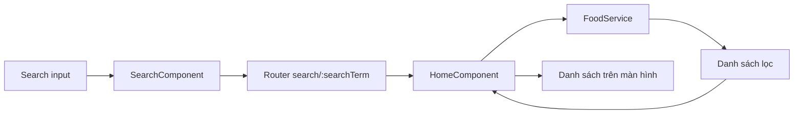

# Bài 09 — Đồ án cuối khóa: Thanh tìm kiếm Food Mine

## 1. Bài toán

Hoàn thiện tính năng tìm kiếm cho một trang danh sách món ăn của Food Mine. Người dùng phải có thể tìm món theo tên bằng Enter hoặc nút Tìm kiếm, chia sẻ URL kết quả và quay lại danh sách đầy đủ.

## 2. Yêu cầu sản phẩm

**Bắt buộc:**

1. Trang `/` hiển thị tất cả món.
2. Route `/search/:searchTerm` nhận từ khóa.
3. Tìm kiếm tên món không phân biệt hoa thường.
4. `SearchComponent` đọc lại từ khóa từ route và hiển thị ở input.
5. Nhấn Enter hoặc click nút đều có tác dụng tìm kiếm.
6. CSS căn giữa input và button, có hover và focus state rõ ràng.
7. Có kiểm thử cho trường hợp không tìm thấy món.

**Mở rộng tự chọn:**

- Hiển thị trạng thái "Không tìm thấy món phù hợp" khi danh sách rỗng.
- Nút xóa từ khóa và quay lại `/`.
- Chuẩn hóa khoảng trắng đầu/cuối truy vấn.
- Đếm số kết quả đang hiển thị.

Không bắt buộc tích hợp backend hoặc AI cho đồ án này.

## 3. Kiến trúc phải đạt

Sơ đồ khẳng định rằng việc điều hướng và việc lọc diễn ra ở hai lớp khác nhau, tránh đưa phép lọc trực tiếp vào phần nhập liệu.

## 4. Các mốc hoàn thành

### 4.1. Mốc 1 — Dữ liệu và route

Tạo phương thức lọc, thêm hai route và `router-outlet`. Chạy thử URL thủ công. **Bàn giao:** Service và routing hoạt động.

### 4.2. Mốc 2 — Tích hợp trạng thái

Cấu hình `HomeComponent` lắng nghe tham số và render mảng kết quả. **Bàn giao:** Điều hướng URL thay đổi danh sách.

### 4.3. Mốc 3 — Giao diện và tương tác

Tạo SearchComponent, xử lý Enter/click và đồng bộ giá trị input. **Bàn giao:** Tìm kiếm hoàn chỉnh trên giao diện.

### 4.4. Mốc 4 — Kiểm thử và cải tiến

Chạy đủ test case, ghi kết quả thực tế và sửa lỗi. **Bàn giao:** Báo cáo kiểm thử ngắn.

## 5. Bảng tự chấm

| Tiêu chí | Điểm tối đa |
| --- | ---: |
| Lọc đúng, không phân biệt hoa thường | 20 |
| Route `/` và `/search/:searchTerm` chính xác | 20 |
| HomeComponent cập nhật khi tham số đổi | 20 |
| Enter / click và đồng bộ ô nhập | 20 |
| CSS, kiểm thử và xử lý trạng thái rỗng | 20 |
| **Tổng** | **100** |

## 6. Definition of Done

- [ ] Có thể tìm `pizza` và `PIZZA` cho cùng kết quả.
- [ ] Không tìm thấy món thì không hiển thị sai dữ liệu.
- [ ] Sao chép URL tìm kiếm sang tab mới vẫn đọc đúng từ khóa.
- [ ] Trình duyệt Back/Forward cho kết quả tương ứng URL.
- [ ] Code không phát sinh lỗi build TypeScript hoặc lỗi router.
- [ ] Lưu bằng chứng kiểm thử và mô tả giới hạn kiến trúc frontend.

## 7. Câu hỏi bảo vệ đồ án

1. Vì sao xử lý lọc nằm trong `FoodService` thay vì đặt tất cả ở `SearchComponent`?
2. Tại sao cần `ActivatedRoute.params.subscribe()` khi có thể đọc giá trị một lần?
3. Vì sao `/search/pizza` có lợi cho chia sẻ liên kết và refresh?
4. `toLowerCase()` giải quyết vấn đề nào, và chưa giải quyết vấn đề nào của tiếng Việt?
5. Nếu dữ liệu có hàng trăm nghìn món, hướng mở rộng kiến trúc nên là gì?

## 8. Gợi ý đánh giá

Đánh giá trước hết theo **hành vi người dùng**: người dùng có thật sự tìm được món mong muốn qua URL và giao diện hay không. Sau đó kiểm tra phân tách trách nhiệm giữa service, router và component. Chỉ làm đẹp giao diện khi luồng chức năng đã ổn định.
