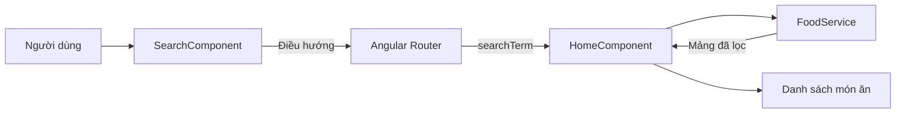

# Khóa học: Xây dựng chức năng tìm kiếm món ăn bằng Angular

> **Lộ trình thực hành Food Mine** · Tiếng Việt · Angular với cấu trúc `NgModule` và Angular Router · Dạng Markdown tự học

## 1. Giới thiệu

Một website món ăn có thể hiển thị hàng chục công thức hoặc sản phẩm. Nếu người dùng phải cuộn để tìm "pizza", trải nghiệm sẽ nhanh chóng trở nên bất tiện. Trong khóa học này, chúng ta tạo một ô tìm kiếm cho phép nhập tên món, nhấn **Enter** hoặc nút **Tìm kiếm**, sau đó hiển thị các món phù hợp.

Điểm quan trọng là **URL phản ánh từ khóa đang tìm**. Ví dụ: `/search/pizza`. Người dùng có thể làm mới trang, sao chép liên kết hoặc dùng nút Back của trình duyệt mà vẫn truy cập đúng trạng thái tìm kiếm.

Khóa học hướng dẫn lọc dữ liệu **ở phía frontend** trên mảng món ăn có sẵn trong `FoodService`; **không** triển khai tìm kiếm SQL, Elasticsearch, vector database hoặc AI.

## 2. Kết quả cần đạt

Sau khi hoàn thành, người học có thể:

- Giải thích luồng dữ liệu từ ô nhập đến danh sách món ăn.
- Viết bộ lọc chuỗi không phân biệt chữ hoa/chữ thường với `toLowerCase()` và `includes()`.
- Khai báo route mặc định và route động `/search/:searchTerm`.
- Đọc tham số route bằng `ActivatedRoute` và cập nhật danh sách khi URL thay đổi.
- Tạo `SearchComponent` tái sử dụng, xử lý Enter và sự kiện click.
- Thiết kế thanh tìm kiếm với HTML/CSS và xác minh các kịch bản kiểm thử.

## 3. Điều kiện đầu vào

Có kiến thức cơ bản về HTML, CSS, TypeScript, component, service và Angular CLI. Mở một dự án Angular đã có `HomeComponent`, `FoodService`, dữ liệu món ăn và `AppRoutingModule`. Tài liệu dùng **dạng Angular dựa trên `NgModule`**. Nếu đang dùng Angular standalone, ý tưởng vẫn giữ nguyên nhưng cách cấu hình `imports`, router và component sẽ khác.

## 4. Lộ trình

| Thứ tự | Tài liệu | Năng lực hình thành |
| --- | --- | --- |
| 1 | [01 — Thiết kế chức năng](01-tong-quan-kien-truc.md) | Hiểu yêu cầu và luồng tìm kiếm |
| 2 | [02 — FoodService](02-loc-du-lieu-voi-foodservice.md) | Lọc tên món ăn |
| 3 | [03 — Router](03-dinh-tuyen-va-router-outlet.md) | Tạo URL tìm kiếm |
| 4 | [04 — HomeComponent](04-doc-tham-so-va-hien-thi-ket-qua.md) | Kết nối route với dữ liệu |
| 5 | [05 — SearchComponent](05-xay-dung-search-component.md) | Xử lý nhập liệu và điều hướng |
| 6 | [06 — CSS](06-thiet-ke-giao-dien-tim-kiem.md) | Hoàn thiện giao diện |
| 7 | [07 — Lab tích hợp](07-lab-tich-hop-dau-cuoi.md) | Triển khai luồng hoàn chỉnh |
| 8 | [08 — Kiểm thử và debug](08-kiem-thu-va-xu-ly-loi.md) | Xác minh chất lượng |
| 9 | [09 — Bài tập cuối khóa](09-do-an-cuoi-khoa.md) | Tự phát triển và đánh giá |

## 5. Sơ đồ tổng quan

Sơ đồ diễn tả tìm kiếm **tại trình duyệt**: URL là nơi chứa từ khóa; `FoodService` trả dữ liệu đã lọc; `HomeComponent` cập nhật màn hình.

## 6. Cách học

Đọc từng bài, tự gõ mã vào dự án đang có, thực hiện mục **Thực hành**, rồi trả lời trắc nghiệm trước khi xem đáp án. Mỗi bài cố gắng hoàn thành checkpoint của mình. Các tên tệp và API mẫu có thể cần điều chỉnh theo cấu trúc dự án thực tế, đặc biệt tên model món ăn.

## 7. Phạm vi và quy ước

- `getAll()` đại diện cho hàm lấy danh sách món ăn đang tồn tại trong service.
- Trường `name` đại diện cho tên món ăn.
- `getAllFoodsBySearchTerm(searchTerm)` là phương thức mới sẽ được tạo trong khóa học.
- Với dự án có cấu hình router khác, vẫn giữ nguyên mục tiêu là **route tham số + router outlet + component đọc tham số**.
- Trình duyệt phải cấu hình server fallback về `index.html` khi triển khai production để tải lại một URL như `/search/pizza` không gặp 404 từ máy chủ.

## 8. Tiêu chí hoàn thành toàn khóa

- [ ] URL mặc định hiển thị tất cả món.
- [ ] `/search/pizza` chỉ hiển thị tên món có chứa `pizza` (không phân biệt chữ hoa/chữ thường).
- [ ] Nhấn Enter và click nút tìm kiếm có kết quả nhất quán.
- [ ] Từ khóa hiển thị trong ô tìm kiếm khi mở URL trực tiếp.
- [ ] Đổi từ khóa trên cùng trang khiến danh sách cập nhật.
- [ ] Làm mới URL tìm kiếm vẫn hiển thị đúng kết quả khi máy chủ hỗ trợ định tuyến frontend.

**Sản phẩm cuối:** Chức năng tìm kiếm tên món ăn hoạt động đầu-cuối trên giao diện Angular.
