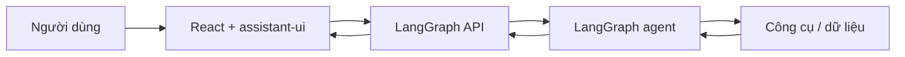

# assistant-ui và tư duy thiết kế Agentic UX

> **Loại:** Lesson · **Trọng tâm:** Khái niệm nền tảng và quyết định thiết kế giao diện.

## 1. Tóm tắt

Một AI agent không chỉ sinh văn bản. Nó có thể lựa chọn công cụ, truy vấn dữ liệu, tạo nội dung có cấu trúc, tạm dừng để đợi người dùng chấp thuận rồi tiếp tục. Nếu xây dựng giao diện chỉ gồm một ô nhập và vùng hiển thị text, những khả năng này trở nên khó nhìn thấy, khó kiểm soát và dễ khiến người dùng hiểu nhầm trạng thái của hệ thống.

`assistant-ui` là thư viện thành phần React phục vụ việc xây dựng giao diện chat AI. Khi kết hợp với LangGraph, phần frontend biểu diễn **quá trình thực thi của agent** chứ không chỉ câu trả lời cuối cùng. Một agent đáng tin cậy phải cho thấy điều gì đang diễn ra, phân biệt kết quả với đề xuất hành động, và trao quyền quyết định cho người dùng tại những bước có rủi ro.

## 2. Mục tiêu học tập

Sau bài này, bạn có thể:

- Giải thích khác biệt giữa chatbot hỏi–đáp và ứng dụng agent có công cụ.
- Phân loại thông tin phù hợp để hiển thị bằng text, thẻ kết quả, hay hộp thoại phê duyệt.
- Mô tả vai trò riêng của LangGraph và assistant-ui trong cùng sản phẩm.
- Đề xuất ít nhất ba trạng thái UX phải được thể hiện khi agent chạy.

## 3. Từ chatbot văn bản đến ứng dụng agent

### 3.1. Trải nghiệm chatbot cơ bản

Một ứng dụng chat đơn giản thường có vòng lặp: người dùng nhập câu hỏi, backend gọi LLM, rồi frontend in câu trả lời. Giao diện này phù hợp với yêu cầu giải thích hoặc sáng tạo nội dung. Khi nội dung dài, việc phát từng phần bằng streaming giúp người dùng thấy ứng dụng phản hồi ngay.

Điểm hạn chế xuất hiện khi câu trả lời dựa trên dữ liệu bên ngoài. Chẳng hạn, câu hỏi “Giá cổ phiếu Meta hiện tại là bao nhiêu?” cần gọi công cụ cung cấp dữ liệu. Nếu chỉ in một con số, người dùng không biết hệ thống đã gọi công cụ nào, dữ liệu được cập nhật lúc nào, hoặc kết quả có lỗi không.

### 3.2. Một chuỗi hành động có thể quan sát

Với agent, quá trình có thể gồm: nhận yêu cầu → suy luận lựa chọn công cụ → gọi công cụ → nhận kết quả → biểu diễn dữ liệu → tiếp tục phản hồi. Giao diện nên phân biệt **đang gọi công cụ**, **đã có kết quả**, **gặp lỗi** và **đang chờ quyết định**.

Ví dụ, một thẻ giá có thể hiển thị mã cổ phiếu, giá, mức thay đổi và thời điểm cập nhật. Những trường này thuộc dữ liệu công cụ; nếu thiếu dữ liệu thì hiển thị trạng thái chưa có, không tự suy diễn con số.

## 4. Bốn năng lực UX cốt lõi

| Năng lực | Vấn đề giải quyết | Cách thể hiện |
| --- | --- | --- |
| Token streaming | Chờ toàn bộ phản hồi quá lâu | Nội dung xuất hiện dần và có nút dừng |
| Tool-call visibility | Không biết agent đang dùng thông tin gì | Tên công cụ, input, trạng thái, output |
| Generative UI | Dữ liệu cấu trúc khó đọc dưới dạng text | Card, bảng, biểu đồ, form |
| Human-in-the-loop | Hành động có tác động ngoài hệ thống chat | Bản xem trước, xác nhận/từ chối |

Không phải mọi câu trả lời đều phải có card. Một câu hỏi khái niệm có thể đáp bằng Markdown. Ngược lại, dữ liệu có nhiều thuộc tính hoặc hành động cần quyết định có thể hưởng lợi từ UI chuyên biệt. Nguyên tắc là **định dạng phục vụ tác vụ**, không cố định mọi phản hồi theo một khuôn mẫu.

## 5. Vai trò của các thành phần

- **LangGraph:** định nghĩa trạng thái, node, luồng điều khiển, tool execution và điểm tạm dừng.
- **LangGraph API / server:** cung cấp đường giao tiếp để chạy, streaming và đọc trạng thái thread.
- **assistant-ui:** quản lý runtime hiển thị chat, render message và các tương tác của người dùng.
- **React/Next.js:** cung cấp bố cục trang, routing, state của ứng dụng và tích hợp trải nghiệm sản phẩm.

Sơ đồ cho thấy frontend không nên tự tạo ra kết quả “mua thành công” chỉ vì người dùng bấm xác nhận. Việc có thực thi hay không phải do backend quyết định và thông báo trở lại.

## 6. Ví dụ và thực hành

Xét ba câu hỏi của một người dùng: “Mã chứng khoán Meta là gì?”, “Cho xem giá hiện tại của Meta”, “Mua năm cổ phiếu Meta”. Hãy thiết kế ba dạng phản hồi khác nhau.

1. Câu hỏi mã chứng khoán: có thể trả về text và dấu vết công cụ tìm kiếm.
2. Câu hỏi giá: nên có price card nếu tool trả về dữ liệu có cấu trúc.
3. Yêu cầu mua: hiển thị dự thảo giao dịch, số lượng, đơn giá, tổng chi phí dự kiến và nút xác nhận/từ chối; không gửi lệnh thật trước khi có chấp thuận.

**Lỗi thường gặp:** coi “tool có kết quả” đồng nghĩa “giao dịch hoàn tất”; cho phép model tự điền thiếu số liệu tài chính; hoặc quên trạng thái loading/error.

## 7. Tổng kết

Agentic UX là một lớp thiết kế sản phẩm gắn trực tiếp với năng lực và trạng thái của agent. Streaming giúp phản hồi mượt, tool calls giúp minh bạch, Generative UI giúp dễ hiểu dữ liệu và Human-in-the-loop giúp kiểm soát các hành động quan trọng.

## 8. Câu hỏi ôn tập

### Câu 1

Đặc điểm nào phân biệt rõ ứng dụng agent với chatbot chỉ gọi LLM?

A. Chỉ hiển thị văn bản Markdown  
B. Có khả năng gọi công cụ và thực hiện luồng nhiều bước  
C. Dùng màu nền tối  
D. Luôn trả lời chậm hơn

**Đáp án:** B

**Giải thích:** Agent có thể phối hợp công cụ và điều khiển luồng xử lý ngoài việc sinh văn bản.

### Câu 2

Khi kết quả của tool trả về giá, mã và thời điểm cập nhật, cách hiển thị nào hữu ích nhất?

A. Thẻ dữ liệu có nhãn và thời gian  
B. Ẩn toàn bộ dữ liệu công cụ  
C. Chỉ phát âm thanh  
D. Bỏ qua công cụ

**Đáp án:** A

**Giải thích:** Thẻ có nhãn giúp đọc dữ liệu có cấu trúc và kiểm tra thời điểm cập nhật.

### Câu 3

Thành phần nào nên quyết định có thực thi giao dịch sau phê duyệt?

A. CSS  
B. Trình duyệt tự suy diễn  
C. Backend LangGraph và công cụ thực thi  
D. Phần text streaming

**Đáp án:** C

**Giải thích:** Chỉ backend thực thi hành động và trả trạng thái xác nhận đáng tin cậy.

### Câu 4

Vì sao streaming cải thiện UX?

A. Đảm bảo kết quả đúng tuyệt đối  
B. Loại bỏ mọi độ trễ mạng  
C. Không cần backend  
D. Hiển thị nội dung dần thay vì đợi toàn bộ phản hồi

**Đáp án:** D

**Giải thích:** Người dùng có tín hiệu tiến triển trước khi câu trả lời hoàn tất.

### Câu 5

Một truy vấn giải thích đơn giản nên được hiển thị thế nào?

A. Luôn buộc phải là biểu đồ  
B. Dùng Markdown nếu phù hợp mục tiêu  
C. Luôn mở hộp phê duyệt  
D. Ẩn câu trả lời

**Đáp án:** B

**Giải thích:** Định dạng tùy theo tác vụ, không cần UI tùy biến cho mọi câu trả lời.
