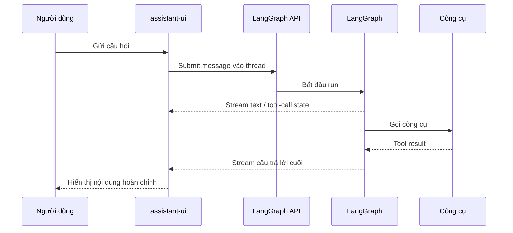

# Kiến trúc luồng sự kiện, message và trạng thái agent

> **Loại:** Lesson · **Trọng tâm:** Event flow, quyền sở hữu trạng thái và ranh giới dữ liệu.

## 1. Tóm tắt

Một ứng dụng chat với LangGraph có ít nhất hai loại trạng thái: trạng thái giao diện tạm thời (đang nhập, panel đang mở) và trạng thái agent trên server (lịch sử hội thoại, kết quả công cụ, trạng thái phê duyệt). Đồng bộ đúng hai phía giúp tránh tình trạng frontend hiện “hoàn tất” khi backend vẫn đang chạy.

## 2. Mục tiêu học tập

- Vẽ được sơ đồ truyền dữ liệu giữa React, runtime và LangGraph API.
- Phân biệt message, tool call, tool result, stream event và interrupt.
- Xác định nguồn sự thật cho thread, trạng thái giao dịch và giao diện hiển thị.
- Giải thích vì sao reconnect, reload hoặc chuyển thread phải khôi phục trạng thái server.

## 3. Khung kiến trúc ba lớp

### 3.1. Presentation layer

React và assistant-ui chịu trách nhiệm hiển thị hội thoại, ô nhập, kết quả công cụ và điều khiển. UI có thể quản lý trạng thái phụ như tab đang mở hoặc nút đang focus. Tuy nhiên UI không được tự gán rằng tool thực thi thành công trước khi nhận xác nhận.

### 3.2. Runtime/transport layer

`@assistant-ui/react-langgraph` là lớp kết nối hội thoại React với LangGraph. Lớp này chuyển đổi sự kiện streaming và trạng thái từ server thành dữ liệu mà các thành phần UI có thể render. `@langchain/langgraph-sdk` cung cấp client kết nối API.

### 3.3. Agent layer

LangGraph giữ graph, state, công cụ và các điều kiện chuyển node. State của graph có thể chứa `messages` và dữ liệu tùy biến. Phần cần duy trì qua phiên có thể dựa trên thread/checkpoint của server.

## 4. Một lượt hỏi–đáp diễn ra thế nào?

Luồng stream có thể chứa nhiều loại sự kiện. UI không nên giả định mọi chunk là token văn bản; chunk có thể phản ánh bước công cụ hoặc cập nhật state. Một lỗi parsing sự kiện có thể khiến card hiện dữ liệu nửa chừng như đã hoàn tất.

## 5. Mô hình dữ liệu và bảng trách nhiệm

| Đối tượng | Ý nghĩa | Nguồn quyết định |
| --- | --- | --- |
| User message | Nội dung người dùng nhập | Client gửi, server lưu |
| AI message | Nội dung do model/agent tạo | Agent |
| Tool call | Tên công cụ và arguments | Agent |
| Tool result | Giá trị do công cụ trả | Backend/tool |
| Thread ID | Định danh phiên hội thoại | LangGraph server |
| Interrupt | Điểm cần dữ liệu/quyết định người dùng | LangGraph state |
| Visual component | Cách vẽ kết quả trên màn hình | Frontend, từ dữ liệu tin cậy |

### 5.1. Dữ liệu có cấu trúc không đồng nghĩa quyền thực thi

Một payload `{"symbol":"META","quantity":5}` chỉ mô tả **yêu cầu**. Nó không xác thực người dùng, không kiểm tra số dư và không có nghĩa đã đặt lệnh. Backend phải thẩm định quyền, ràng buộc nghiệp vụ và ghi lại kết quả thực thi.

### 5.2. Idempotency và hành động lặp

Khi mạng lỗi và frontend thử lại, request có thể đến backend hai lần. Các công cụ gây thay đổi dữ liệu nên dùng khóa idempotency hay cơ chế chống thực thi lặp ở server. Đây là yêu cầu quan trọng với đặt hàng, chuyển tiền, gửi email và các hành động tương tự.

## 6. Bài tập phân tích

Vẽ lại sơ đồ luồng cho câu “Mua 5 cổ phiếu”. Chèn một bước interrupt trước công cụ thực thi. Ghi rõ dữ liệu phải lưu vào state khi trang bị reload và phân biệt ba trạng thái: `proposed`, `approved`, `executed`.

**Checkpoint:** khi user từ chối, không có lệnh thực thi; khi user refresh trong lúc đợi phê duyệt, yêu cầu vẫn có thể được tải lại từ server nếu cấu hình checkpoint/interrupt đúng.

## 7. Tổng kết

Thiết kế đúng ranh giới trạng thái giúp giao diện nhất quán, an toàn và phục hồi được sau mất kết nối. Frontend trình bày; LangGraph điều phối; backend và công cụ có thẩm quyền xác nhận hành động.

## 8. Câu hỏi ôn tập

### Câu 1

Nguồn trạng thái tin cậy cho một giao dịch đã thực thi là gì?

A. Một icon màu xanh ở frontend  
B. Response của backend/công cụ đã xác nhận  
C. Dòng dự đoán của LLM  
D. Nút bấm xác nhận

**Đáp án:** B

**Giải thích:** Trạng thái thực thi phải do server và hệ thống nghiệp vụ xác nhận.

### Câu 2

Khi người dùng tải lại trang lúc đang đợi phê duyệt, cần khôi phục gì?

A. Chỉ font chữ  
B. Chỉ input placeholder  
C. Interrupt/checkpoint từ thread trên server  
D. Mã CSS

**Đáp án:** C

**Giải thích:** Interrupt và checkpoint lưu trạng thái tạm dừng để nối lại đúng.

### Câu 3

Thông tin nào mô tả lời đề xuất chứ chưa phải hành động đã làm?

A. Payload yêu cầu mua  
B. Biên nhận đã thực thi  
C. Log thành công từ broker  
D. Kết quả xác nhận của API

**Đáp án:** A

**Giải thích:** Thông số đề xuất không chứng minh giao dịch đã được thực hiện.

### Câu 4

Idempotency giải quyết nguy cơ gì?

A. Sai màu thẻ  
B. Lỗi Markdown  
C. Tên tool dài  
D. Một hành động bị thực thi hai lần khi gửi lại request

**Đáp án:** D

**Giải thích:** Đặc biệt quan trọng với các lệnh ghi dữ liệu hoặc giao dịch.

### Câu 5

Thành phần nào có nhiệm vụ hiển thị các sự kiện trên UI?

A. Hệ điều hành  
B. assistant-ui runtime và React  
C. DNS server  
D. Trình biên dịch Java

**Đáp án:** B

**Giải thích:** Runtime chuyển trạng thái/sự kiện thành dữ liệu cho React render.

