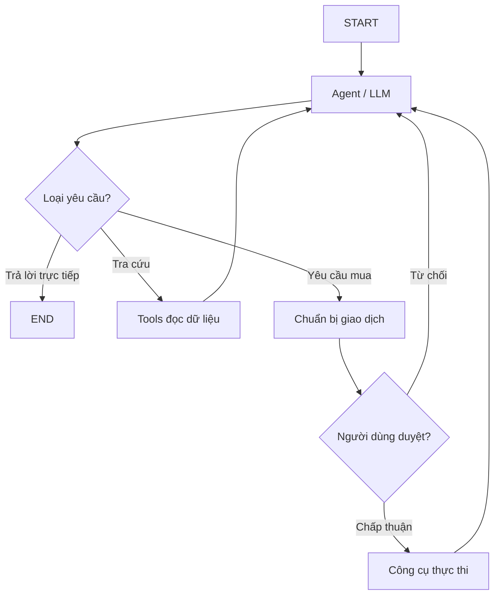

# Đọc LangGraph: node agent, tools và nhánh phê duyệt

> **Loại:** Lesson · **Trọng tâm:** Điều phối agent trong graph thay vì workflow giao diện cố định.

## 1. Tóm tắt

LangGraph mô hình hóa logic agent bằng graph: node thực hiện công việc, edge quyết định bước tiếp theo, và state lưu thông tin xuyên suốt run. Ở ví dụ stockbroker, agent có thể trả lời trực tiếp, dùng công cụ tìm kiếm/giá, hoặc chuyển vào nhánh chuẩn bị và phê duyệt thao tác mua.

## 2. Mục tiêu

- Chỉ ra ý nghĩa của `backend/langgraph.json`.
- Phân biệt model node, tool node và node có hiệu ứng ghi dữ liệu.
- Mô tả điều kiện chuyển sang nhánh approval.
- Phân tích vì sao agent chọn tool động nhưng thao tác rủi ro vẫn bị ràng buộc.

## 3. Các thành phần của một graph

### 3.1. State và message

State là tập dữ liệu được các node đọc/ghi. Trường `messages` thường chứa lịch sử hội thoại, câu trả lời và thông tin tool calls. Bên cạnh đó, hệ thống có thể lưu đề xuất giao dịch, danh tính người dùng hoặc cờ chờ duyệt. Không nên trộn trực tiếp state nghiệp vụ với state trang trí giao diện.

### 3.2. Model node

Model node gọi LLM với system prompt và các tool được phép dùng. LLM có thể đề nghị gọi tool bằng arguments. System prompt định hướng hành vi nhưng không phải lớp bảo mật; quyền truy cập dữ liệu và xác thực hành động cần được kiểm soát bằng backend.

### 3.3. Tool node

Tool node nhận lời gọi đã có schema, thực thi hàm phù hợp và trả kết quả cho graph. Các công cụ đọc dữ liệu (search, price lookup) khác về rủi ro so với công cụ ghi dữ liệu (order, update database). Schema và validate input là điều kiện cần, không thay thế authorization.

## 4. Luồng xử lý dạng graph



Sơ đồ là mô hình giải thích. Tên node và điều kiện thực tế cần kiểm tra trong bản clone. Ý tưởng quan trọng là nhánh duyệt nằm **trước** node có thể thay đổi dữ liệu.

## 5. Đọc cấu hình dự án

Mở `backend/langgraph.json` để xác định entry point của graph và các thành phần server. Sau đó truy cập source code agent do entry point chỉ tới, lần theo trình tự: state definition → model invocation → tool binding → conditional routing → approval flow.

Trong LangGraph Studio, sơ đồ trực quan cho phép bạn xem node đang chạy và trạng thái chuyển node. Studio phù hợp để debug graph, nhưng không phải giao diện trải nghiệm người dùng cuối: nó ưu tiên thông tin thực thi và kiểm tra logic hơn là thẩm mỹ hay khả năng thao tác.

## 6. Thực hành và lỗi thường gặp

Bổ sung một công cụ đọc dữ liệu tưởng tượng tên `company_profile`, nhận `ticker` và trả `name`, `industry`, `website`. Viết giao ước dữ liệu trước:

```json
{
  "tool": "company_profile",
  "args": {"ticker": "META"},
  "result": {
    "name": "Meta Platforms",
    "industry": "Technology",
    "website": "https://www.meta.com"
  }
}
```

Đây là **ví dụ schema minh họa**, không phải khẳng định API có sẵn trong repo. Sau đó mô tả đường đi từ agent qua tool node rồi quay lại model node.

**Lỗi cần tránh:** đặt toàn bộ logic rẽ nhánh trong React; cho model trực tiếp thực hiện thao tác ghi; hoặc chỉ kiểm tra quyền bằng cách “dặn” model trong prompt.

## 7. Tổng kết

LangGraph giúp agent chọn đường đi linh hoạt, nhưng các đường đi nguy hiểm vẫn được backend giới hạn. UI hiển thị trung thực những gì graph đang thực hiện, không tự quyết định nghiệp vụ.

## 8. Câu hỏi ôn tập

### Câu 1

File nào trong repository xác định cấu hình graph?

A. frontend/.env.local  
B. backend/langgraph.json  
C. tailwind.config.ts  
D. README.md duy nhất

**Đáp án:** B

**Giải thích:** README chỉ hướng dẫn; langgraph.json là điểm tra cứu cấu hình graph.

### Câu 2

Model node chủ yếu làm gì?

A. Render CSS  
B. Lưu mật khẩu trong browser  
C. Gọi model với prompt và tool phù hợp  
D. Bắt buộc đặt lệnh mua

**Đáp án:** C

**Giải thích:** Model node tạo quyết định/ngôn ngữ và có thể phát lệnh gọi tool.

### Câu 3

Luồng giao dịch an toàn đặt bước approval ở đâu?

A. Trước công cụ có tác động ghi  
B. Sau khi đã mua  
C. Sau khi đóng tab  
D. Thay toàn bộ xác thực

**Đáp án:** A

**Giải thích:** Phê duyệt phải diễn ra trước khi thực thi hành động rủi ro.

### Câu 4

LangGraph Studio phù hợp nhất cho công việc nào?

A. Thiết kế landing page  
B. Chỉnh typography  
C. Mua thật trên sàn  
D. Quan sát và debug graph

**Đáp án:** D

**Giải thích:** Studio ưu tiên quan sát graph và luồng thực thi.

### Câu 5

Vì sao system prompt không đủ làm lớp bảo mật?

A. Vì prompt không có dấu câu  
B. Vì quyền và xác thực phải được thực thi bằng code backend  
C. Vì prompt luôn trống  
D. Vì agent không gọi tool

**Đáp án:** B

**Giải thích:** Model có thể đề nghị thao tác, nhưng backend phải kiểm soát quyền thực tế.
