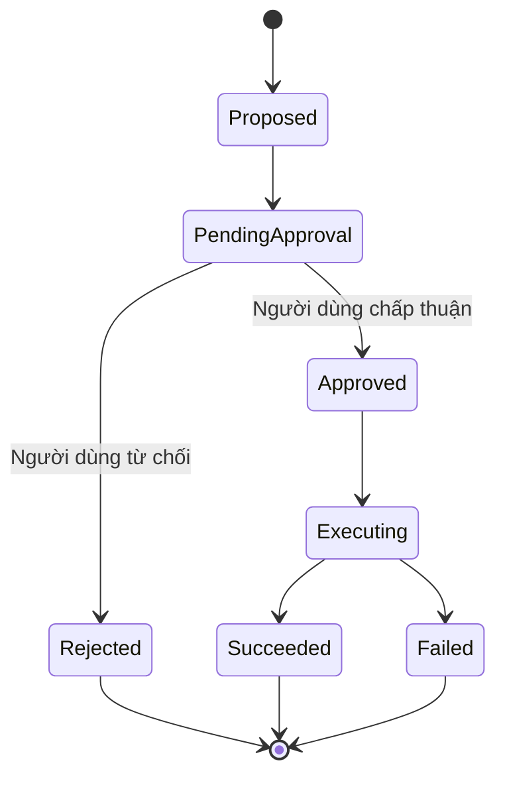

# Human-in-the-loop: tạm dừng agent để người dùng phê duyệt

> **Loại:** Lesson · **Trọng tâm:** Tách ý định của agent khỏi quyết định cuối cùng của người dùng.

## 1. Tóm tắt

Trong các tác vụ thuần đọc, agent có thể gọi công cụ rồi trả câu trả lời. Với tác vụ có thể gây thay đổi tài khoản, cơ sở dữ liệu hoặc chi phí thực tế, quy trình phải có ranh giới kiểm soát. Human-in-the-loop (HITL) là cơ chế cho phép graph tạm dừng, yêu cầu quyết định rồi tiếp tục theo trạng thái đã được ghi nhận.

## 2. Mục tiêu

- Giải thích tại sao approval là yêu cầu nghiệp vụ, không chỉ tính năng UI.
- Thiết kế payload đề xuất có đủ thông tin để quyết định.
- Phân biệt `approve`, `reject`, `pending` và `executed`.
- Chỉ ra vai trò của checkpoint và interrupt trong khôi phục trạng thái.

## 3. Vì sao cần người dùng trong vòng lặp?

Yêu cầu “Mua 5 cổ phiếu” không chỉ là yêu cầu sinh văn bản. Nó có thể dẫn tới việc chi tiền hoặc thay đổi tài sản. Dù agent chọn tool chính xác, người dùng vẫn phải có cơ hội kiểm tra mã, số lượng, đơn giá và chi phí trước khi chấp nhận. Một xác nhận an toàn cũng nên làm rõ liệu giá chỉ là ước tính hay lệnh thực thi có thể khớp ở giá khác.

HITL không chỉ phù hợp cho tài chính. Mẫu thiết kế tương tự hữu ích với việc gửi email đại diện người dùng, xóa tệp, cập nhật bản ghi quan trọng hoặc đặt lịch có phí.

## 4. Mô hình trạng thái approval



`Approved` khác `Succeeded`: có chấp thuận chưa chắc đã thực thi thành công. Tool thực thi có thể thất bại vì hạn mức, hết phiên đăng nhập, giá thay đổi hoặc hệ thống bên ngoài không hoạt động.

## 5. Approval payload và biên bản quyết định

Bản đề xuất nên chứa `action_type`, đối tượng, số lượng, mức giá hoặc mức tối đa, đơn vị tiền, tác động dự kiến, thời hạn đề xuất và mã yêu cầu. Với giao dịch thật, phía server phải kiểm tra lại giá và quyền khi thực thi.

```json
{
  "request_id": "demo-001",
  "action_type": "buy_stock",
  "symbol": "META",
  "quantity": 5,
  "estimated_unit_price": null,
  "currency": "USD",
  "status": "pending_approval"
}
```

Đây là payload thiết kế minh họa; `null` biểu thị chưa có giá hợp lệ. Không được tự tính tổng tiền từ dữ liệu thiếu. Quyết định gửi về backend nên gắn với `request_id` cụ thể thay vì chỉ có chuỗi `yes` mơ hồ.

## 6. Sử dụng interrupt và checkpoint

LangGraph có khả năng tạm dừng run để chờ input. Assistant-ui LangGraph Runtime có thể phục hồi trạng thái interrupt nếu `load` trả cả `messages` và `interrupts` từ server:

```typescript
load: async (externalId) => {
  const state = await client.threads.getState(externalId);
  return {
    messages: state.values.messages,
    interrupts: state.tasks[0]?.interrupts,
  };
}
```

Cấu trúc trên là một phần của cấu hình runtime, không phải function chạy độc lập. Checkpoint giúp lưu thời điểm tạm dừng; khi trang reload, hệ thống có thể đưa người dùng trở lại cùng quyết định còn dang dở.

## 7. Thực hành và tổng kết

Mô tả ba tình huống: user duyệt, user từ chối, user rời trang rồi quay lại. Với mỗi tình huống, vẽ trạng thái trước/sau, xác định ai được quyền gửi quyết định và node nào được phép thực thi công cụ.

**Điều kiện hoàn thành:** không có lệnh có side effect được gọi khi người dùng chưa phê duyệt; việc từ chối không bị diễn giải thành chấp thuận; trạng thái cuối luôn do backend xác nhận.

## 8. Câu hỏi ôn tập

### Câu 1

Human-in-the-loop giải quyết chủ yếu vấn đề gì?

A. Thay đổi font chat  
B. Kiểm soát hành động có tác động trước khi thực thi  
C. Ẩn tool call  
D. Tăng số lượng token

**Đáp án:** B

**Giải thích:** Người dùng có quyền xác nhận hoặc từ chối thao tác rủi ro.

### Câu 2

Trạng thái nào KHÔNG tương đương với thực thi thành công?

A. Approved  
B. Succeeded  
C. Confirmed by backend  
D. Executed successfully

**Đáp án:** A

**Giải thích:** Được duyệt mới là quyền cho bước thực thi, chưa phải kết quả.

### Câu 3

Dữ liệu nào giúp gắn quyết định đúng đề xuất?

A. CSS class  
B. Thời gian build  
C. request_id  
D. Kích thước trình duyệt

**Đáp án:** C

**Giải thích:** Mã yêu cầu duy nhất liên kết sự chấp thuận với đề xuất.

### Câu 4

Từ chối đề xuất nên có hệ quả gì?

A. Tự gửi lại lệnh  
B. Đánh dấu thành công  
C. Thực thi tool rồi rollback  
D. Không gọi công cụ ghi dữ liệu

**Đáp án:** D

**Giải thích:** Nhánh reject phải dừng hành động.

### Câu 5

Khi nạp lại thread đang chờ, `load` nên trả thêm gì?

A. Ảnh đại diện  
B. Interrupts  
C. Theme name  
D. API key

**Đáp án:** B

**Giải thích:** Interrupt là trạng thái quyết định đang tạm dừng của graph.
