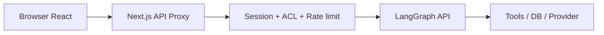

# Triển khai production: proxy, phân quyền và độ tin cậy

> **Loại:** Lesson · **Trọng tâm:** Từ demo cho tới ứng dụng chạy với người dùng thật.

## 1. Tóm tắt

Một frontend LangGraph chạy được ở local chưa mặc nhiên an toàn khi triển khai. Nếu đưa API key lên client, không xác thực thread hoặc bỏ qua rate limit, kẻ khác có thể gọi backend dưới quyền ứng dụng. Production yêu cầu kiến trúc proxy, session, authorization, kiểm soát traffic và xử lý lỗi rõ ràng.

## 2. Mục tiêu

- Phân biệt cấu hình development và production.
- Nêu các lớp bảo vệ cần có trên proxy API.
- Xác định những hành động phải audit và idempotent.
- Lập checklist vận hành khi backend hoặc provider lỗi.

## 3. Production proxy

### 3.1. Vì sao không gọi trực tiếp bằng secret từ trình duyệt?

Mọi giá trị `NEXT_PUBLIC_` có thể đi vào bundle frontend. Người dùng hoặc công cụ trình duyệt có thể đọc giá trị này. Vì thế, API key của LangGraph Cloud và provider phải nằm ở server-side environment; browser chỉ gọi API ứng dụng cùng origin, ví dụ `/api/...`.

### 3.2. Kiến trúc

Proxy không nên là một open proxy cho mọi URL. Chỉ cho phép endpoint và HTTP method cần thiết. Bắt buộc kiểm tra phiên đăng nhập và quyền với từng thread/run trước khi chuyển request. Việc kiểm tra Origin/Fetch Metadata có ích nhưng **không thay thế authentication**.

## 4. Chính sách bảo mật trọng tâm

| Rủi ro | Biện pháp |
| --- | --- |
| Lộ credential | Server-side env, secret manager, rotate key |
| Truy cập thread của người khác | Auth + kiểm tra ownership ở backend |
| Lạm dụng API | Rate limit, quota, log cảnh báo |
| Prompt injection qua tool output | Treat tool data untrusted, giới hạn tool permissions |
| Action lặp khi retry | Idempotency + audit log |
| HTML không an toàn | Render component đã định nghĩa, sanitize khi cần |
| Thất bại provider | Timeout, fallback, lỗi rõ ràng |

## 5. Quan sát vận hành

Tối thiểu theo dõi tỷ lệ lỗi tool, độ trễ phản hồi đầu tiên, số request đang chạy, tỷ lệ approval từ chối, số lượt retry và chi phí provider. Thiết lập cảnh báo cho các lỗi ảnh hưởng nhiều người dùng; trong dashboard có thể ẩn dữ liệu nhạy cảm nhưng vẫn giữ request trace có thể đối chiếu.

Trong môi trường có hành động thực tế, log cần phân biệt đề xuất, phê duyệt và thực thi. Không hiển thị thông điệp “Đã gửi” khi mới tạo draft.

## 6. Checklist go-live

- [ ] Frontend không chứa API key bí mật.
- [ ] Proxy chỉ chấp nhận endpoint cần thiết và kiểm tra session.
- [ ] Backend kiểm tra ownership của thread trước mọi request.
- [ ] Tool ghi có approval, authorization và chống replay.
- [ ] Có timeout, retry có giới hạn và phân loại lỗi.
- [ ] Có logging/tracing an toàn và cảnh báo.
- [ ] Test reload, multi-tab và ngắt kết nối.
- [ ] Đã xác định rõ hành vi khi provider phụ thuộc bị gián đoạn.

## 7. Tổng kết

Production không chỉ là deploy lên hosting. Đó là việc giữ đúng ranh giới tin cậy giữa browser, application backend, LangGraph agent và công cụ. Đối với tác vụ nhạy cảm, xác thực và kiểm tra quyền quan trọng hơn tốc độ tạo giao diện.

## 8. Câu hỏi ôn tập

### Câu 1

Bí mật LangGraph API key nên được lưu ở đâu?

A. NEXT_PUBLIC_ env  
B. Môi trường server-side  
C. URL query  
D. React props công khai

**Đáp án:** B

**Giải thích:** Frontend là môi trường không tin cậy cho secret.

### Câu 2

Kiểm tra Origin có thay authentication không?

A. Luôn có  
B. Nếu đúng domain thì có  
C. Không  
D. Chỉ thay trong production

**Đáp án:** C

**Giải thích:** Origin check chỉ là một lớp hỗ trợ, không xác thực danh tính người dùng.

### Câu 3

Để tránh đọc thread người khác, server cần?

A. Kiểm tra ownership/authorization  
B. Tin mọi thread_id từ client  
C. Ẩn nút Delete  
D. Bỏ JWT/session

**Đáp án:** A

**Giải thích:** Quyền truy cập từng thread phải được kiểm tra ở backend.

### Câu 4

Proxy production nên chuyển tiếp request nào?

A. Mọi URL bên ngoài  
B. Bất kỳ method nào  
C. Tất cả secret ra client  
D. Các endpoint/method đã allowlist và hợp lệ

**Đáp án:** D

**Giải thích:** Allowlist hạn chế phạm vi và rủi ro của proxy.

### Câu 5

Metric nào hỗ trợ phát hiện lỗi tool?

A. Độ rộng sidebar  
B. Tỷ lệ lỗi và latency tool  
C. Màu icon  
D. Số emoji gửi ra

**Đáp án:** B

**Giải thích:** Metric nghiệp vụ và kỹ thuật giúp phát hiện provider có vấn đề.
