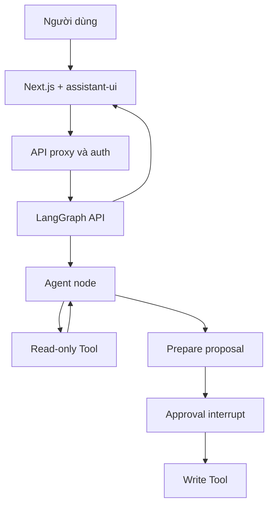

# Project cuối khóa: Agent chat đa trạng thái với UI tương tác

> **Loại:** Project · **Trọng tâm:** Xây dựng sản phẩm hoàn chỉnh từ kiến trúc tới kiểm thử.

## 1. Bài toán

Xây dựng một ứng dụng AI chat bằng Next.js + assistant-ui + LangGraph có thể trả lời tự nhiên, gọi ít nhất một công cụ tra cứu, trình bày kết quả thành card trực quan, và yêu cầu phê duyệt trước một hành động có side effect. Bạn có thể áp dụng cho stockbroker demo, trợ lý quản lý công việc hoặc trợ lý đề xuất thực đơn; ở môi trường học tập, thao tác ghi nên dùng database giả lập.

## 2. Mục tiêu sản phẩm

Người dùng có thể trò chuyện liên tục trong thread, thấy token streaming, mở thông tin tool call, xem UI card, và xác nhận/từ chối thao tác. UI luôn thể hiện đúng trạng thái thực thi, kể cả khi lỗi hoặc refresh.

## 3. Yêu cầu kỹ thuật

### 3.1. Chức năng bắt buộc

1. Giao diện chat có composer, message list và streaming.
2. Ít nhất một backend tool có schema input/output.
3. Component trình bày tool result hoặc UI message.
4. Nhánh phê duyệt cho thao tác ghi ở graph.
5. Giao diện thể hiện lỗi, cancel, pending, success.
6. Có test xử lý approve, reject và retry.

### 3.2. Phi chức năng

Frontend giữ secret ngoài client; backend kiểm tra quyền trước hành động. Kết quả có nguồn dữ liệu và thời điểm khi phù hợp. Tác vụ có side effect phải ghi audit và tránh trùng request.

## 4. Kiến trúc tham khảo

Điều kiện đi vào node `Execute` chỉ mở khi backend đã xác nhận approval và quyền thực thi. Hãy giữ tool đọc/ghi tách biệt để test và audit.

## 5. Milestone triển khai

| Mốc | Công việc | Kết quả cần có |
| --- | --- | --- |
| M1 | Tạo LangGraph API và React chat | Stream text được |
| M2 | Thêm tool read-only và log | Gọi tool có kết quả hợp lệ |
| M3 | Viết card render kết quả | UI trạng thái loading/success/error |
| M4 | Thêm proposal + interrupt + approve/reject | Không có side effect trước approval |
| M5 | Thêm persistence/khôi phục thread | Reload không làm sai state |
| M6 | Security + E2E test + tài liệu | Demo có thể đánh giá độc lập |

## 6. Kịch bản demo sản phẩm

- “Chào bạn” → text thông thường.
- “Tra cứu dữ liệu X” → tool call rồi card kết quả.
- “Giải thích dữ liệu vừa xem” → agent trả lời theo ngữ cảnh thread.
- “Cập nhật bản ghi Y” → xuất đề xuất, yêu cầu phê duyệt.
- Chọn “Từ chối” → không ghi dữ liệu.
- Chọn “Xác nhận” → backend kiểm tra, thực thi và trả kết quả.
- Refresh trong lúc pending → đề xuất vẫn được khôi phục khi thread checkpoint đã lưu.

Nếu làm stockbroker, chỉ dùng mô phỏng và nói rõ rằng đây không phải môi giới hay giao dịch thực.

## 7. Kiểm thử và tiêu chí hoàn thành

**Definition of Done:** người đánh giá khởi chạy được dự án từ README, xem được ít nhất một tool call, một card, hai nhánh approve/reject, và thấy test không có hành động ghi khi từ chối. Tài liệu phải mô tả cấu hình môi trường không chứa secret, sơ đồ kiến trúc, danh sách endpoint và tối thiểu tám test case.

## 8. Rubric tự đánh giá

| Hạng mục | Trọng số |
| --- | ---: |
| Đúng kiến trúc và luồng chat | 20% |
| Streaming và minh bạch tool call | 20% |
| Chất lượng Generative UI | 20% |
| HITL và tính an toàn | 25% |
| Test, bảo mật và tài liệu | 15% |

## 9. Tổng kết

Sản phẩm tốt không cố ép mỗi câu trả lời thành một workflow cố định. Agent hiểu yêu cầu và chọn tool linh hoạt trong phạm vi quyền, trong khi UI chọn cách hiển thị thích hợp và bảo vệ người dùng trước hành động quan trọng.

## 10. Câu hỏi ôn tập

### Câu 1

Thành phần nào là yêu cầu bắt buộc trong capstone?

A. Chỉ một ô text tĩnh  
B. Streaming, tool call, card và approval  
C. Không cần backend  
D. Giao dịch thật bắt buộc

**Đáp án:** B

**Giải thích:** Capstone kết hợp các năng lực chính được học.

### Câu 2

Tool gây side effect được phép chạy khi nào?

A. Ngay khi model suy đoán  
B. Khi frontend đổi màu  
C. Khi backend đã kiểm tra approval và quyền  
D. Sau khi user vừa nhập một chữ

**Đáp án:** C

**Giải thích:** Backend phải kiểm tra quyết định và quyền trước khi ghi dữ liệu.

### Câu 3

Kịch bản nào kiểm tra nhánh reject?

A. Từ chối và xác minh không có ghi dữ liệu  
B. Chỉ mở trang  
C. Đổi tên công ty  
D. Ẩn lỗi khỏi người dùng

**Đáp án:** A

**Giải thích:** Điểm cốt lõi của HITL là từ chối phải chặn tác động.

### Câu 4

Rubric dành trọng số cao nhất cho phần nào?

A. Bố cục CSS  
B. Số lượng thư viện  
C. Tên folder  
D. HITL và tính an toàn

**Đáp án:** D

**Giải thích:** Phần này được phân bổ 25% trong rubric.

### Câu 5

Kiến trúc đúng của công cụ đọc và ghi là gì?

A. Trộn trong CSS  
B. Phân tách để kiểm thử và kiểm soát quyền  
C. Gắn API key vào prompt  
D. Chỉ chạy trên client

**Đáp án:** B

**Giải thích:** Tách quyền đọc/ghi hỗ trợ testing, audit và hạn chế rủi ro.
