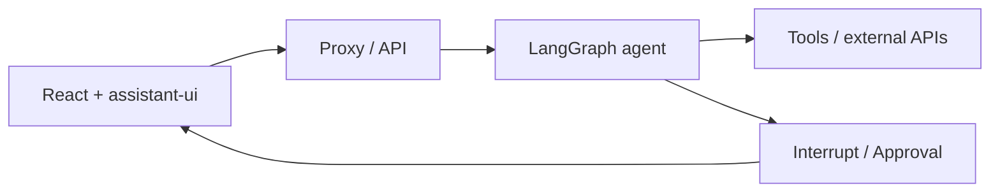

# Xây dựng giao diện AI Agent với assistant-ui và LangGraph

> Khóa học tiếng Việt • Next.js / React / assistant-ui / LangGraph.js • Biên soạn 06/11/2026

## 1. Giới thiệu

Khóa học hướng dẫn thiết kế và triển khai giao diện AI chat có streaming, biểu diễn tool calls, Generative UI và Human-in-the-loop. Lộ trình dùng ứng dụng stockbroker minh họa để dạy cách kết nối agent LangGraph với frontend React, đồng thời phân biệt rõ thao tác demo với hành động nghiệp vụ thật.

Không cần sử dụng API giao dịch tài chính thật để hoàn thành khóa học. Khi demo, mọi thao tác ghi nên được mock hoặc chạy ở sandbox.

## 2. Đối tượng và kiến thức chuẩn bị

Phù hợp người đã biết cơ bản JavaScript/TypeScript, React, cách gọi API HTTP và có kiến thức nền về AI agent. Nên có Node.js, Git, pnpm/npm và một terminal để làm theo các lab. Nếu chưa có API key provider, có thể tập trung vào phần kiến trúc, render và mô phỏng công cụ.

## 3. Mục tiêu đầu ra

- Vẽ được kiến trúc frontend → proxy → LangGraph API → tool.
- Khởi chạy được project minh họa Next.js + LangGraph.js.
- Tích hợp LangGraph Runtime, streaming và tool-call UI.
- Hiển thị dữ liệu có cấu trúc bằng React component.
- Thiết kế approval flow với trạng thái pending/approved/rejected/executed.
- Kiểm thử, debug và đưa ra checklist bảo mật khi triển khai.

## 4. Cấu trúc khóa học

- [Module 01 — Nền tảng assistant-ui và Agentic UX](01-Nen-tang-agentic-UX/README.md) — 2 bài
- [Module 02 — Backend LangGraph.js và công cụ](02-Backend-LangGraph/README.md) — 3 bài
- [Module 03 — Frontend Next.js, Runtime và Streaming](03-Frontend-va-Streaming/README.md) — 3 bài
- [Module 04 — Generative UI và React components](04-Generative-UI/README.md) — 2 bài
- [Module 05 — Human-in-the-loop và phê duyệt](05-Human-in-the-loop/README.md) — 2 bài
- [Module 06 — Kiểm thử, production và capstone](06-Kiem-thu-va-trien-khai/README.md) — 3 bài

## 5. Phương pháp học

Học tuần tự các module. Mỗi bài được viết độc lập để có thể mở riêng, có mục tiêu đo lường được, phần giải thích, ví dụ hoặc lab, lưu ý sai thường gặp và 5 câu trắc nghiệm có đáp án. Với các lab, chạy xong checkpoint rồi mới chuyển bài. Với capstone, dùng rubric để tự đánh giá.

## 6. Sơ đồ kết nối

Frontend cung cấp UX và trình bày trạng thái. Backend chịu trách nhiệm thực thi, kiểm soát quyền và xác nhận kết quả. Các thành phần có side effect phải được kiểm tra riêng.

## 7. Tài liệu và repository thực hành

- Tài liệu LangGraph Runtime: https://www.assistant-ui.com/docs/runtimes/langgraph/overview
- Quickstart: https://www.assistant-ui.com/docs/runtimes/langgraph/quickstart
- Tutorial ứng dụng stockbroker: https://www.assistant-ui.com/docs/runtimes/langgraph/tutorial/part-1
- LangGraph Generative UI: https://www.assistant-ui.com/docs/runtimes/langgraph/generative-ui
- Interrupts: https://www.assistant-ui.com/docs/runtimes/langgraph/interrupts
- Quản lý thread: https://www.assistant-ui.com/docs/runtimes/langgraph/threads
- Tool UI: https://www.assistant-ui.com/docs/tools/tool-ui
- Repository stockbroker: https://github.com/assistant-ui/assistant-ui-stockbroker
- Demo tham khảo: https://assistant-ui-stockbroker.vercel.app/
- Blog hợp tác: https://blog.langchain.dev/assistant-ui/

## 8. Ghi chú phiên bản và sử dụng

Các framework phát triển nhanh. Câu lệnh, module và code mẫu được đối chiếu với tài liệu có thể truy cập vào ngày 06/11/2026; hãy kiểm tra lại README và SDK nếu package thay đổi. Những đoạn được ghi là “minh họa” tập trung giải thích hợp đồng dữ liệu hoặc kiến trúc, không phải module hoàn chỉnh có thể chạy độc lập. Giá trong ví dụ chỉ phục vụ học tập, không phải báo giá thực tế.
